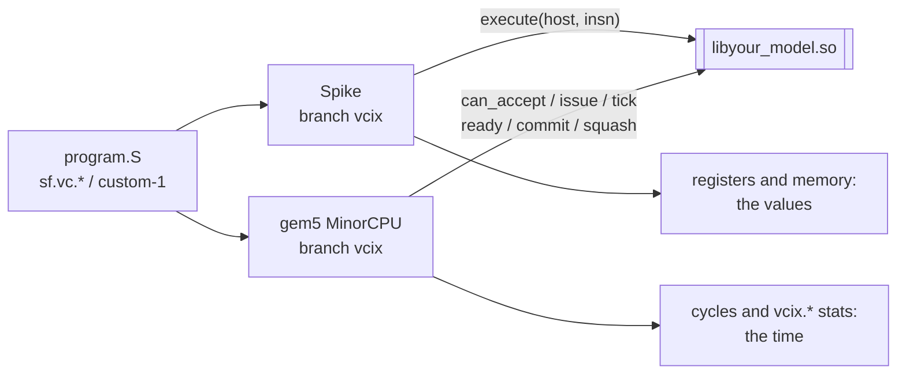
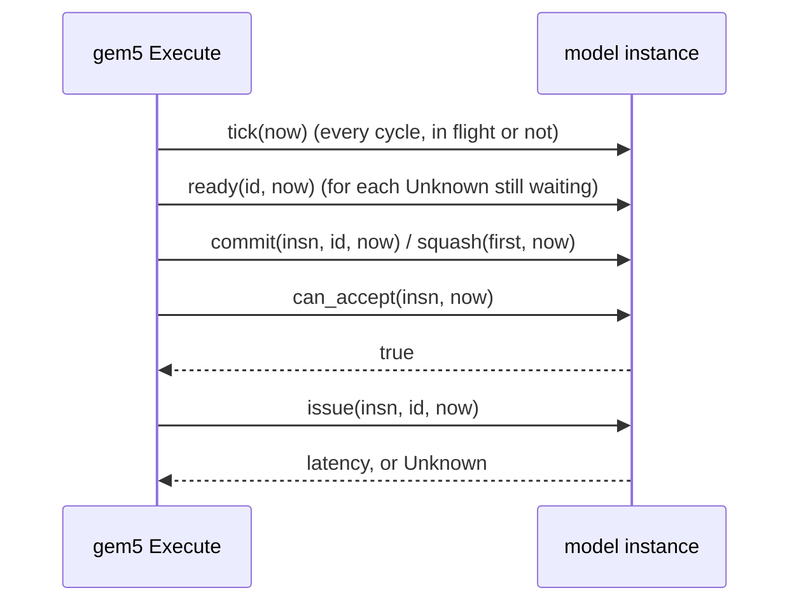

# vcix-accelerator

You describe an accelerator once, as one shared library (a *model*). Spike runs
it to get the values. gem5 runs the same library to get the time. Neither
simulator is patched again for a new accelerator.

The accelerator talks to the core through custom instructions only. Two
opcodes go to the model:

- **custom-2** (`0x5B`), read by the operand rules of VCIX, SiFive's Vector
  Coprocessor Interface. This gives the project its name.
- **custom-1** (`0x2B`), read as R-type on integer registers.



The two runs are separate processes. They never run together. Each one calls
only its own half of the model.

Without this, a new unit means editing two simulators by hand, in two styles:

- **Spike** (functional): a `DECLARE_INSN` in `encoding.h`, a body in
  `insns/*.h`, and unit state as members of `processor_t`.
- **gem5** (timing): a custom `OpClass`, a decoder entry per encoding, a
  functional unit class, and a branch in `Execute::issue` of the MinorCPU.

Nothing keeps the two descriptions in step.

**Contents**

1. [One instruction, bit by bit](#one-instruction-bit-by-bit)
2. [A first run: print_args](#a-first-run-print_args)
3. [The C ABI and its two faces](#the-c-abi-and-its-two-faces)
4. [The timing rules](#the-timing-rules)
5. [The machine description](#the-machine-description)
6. [Build with hidden visibility](#build-with-hidden-visibility)
7. [The cp engine: a unit as a component](#the-cp-engine-a-unit-as-a-component)
8. [A unit that is RTL](#a-unit-that-is-rtl)
9. [What you do not implement, and what you configure](#what-you-do-not-implement-and-what-you-configure)
10. [Constraints and non-goals](#constraints-and-non-goals)
11. [Layout](#layout), [Environment](#environment), [Build and run](#build-and-run), [Status](#status)

## One instruction, bit by bit

Take `sf.vc.x 0x1, 0x2, 0x3, a0`. It assembles to `0x062541db`:

```
 31     26 25 24   20 19   15 14 12 11    7 6       0
+--------+--+-------+-------+-----+-------+---------+
| 000001 | 1| 00010 | 01010 | 100 | 00011 | 1011011 |
+--------+--+-------+-------+-----+-------+---------+
  funct6  vm  vs2 /   rs1    funct3  rd /   opcode
  = 0x01  =1  = 2     = x10    = 4   = 3    = 0x5B (custom-2)
                       (a0)    (.x)
```

print_args prints the same split on Spike:

```
[execute] insn=062541db funct6=01 vm=1 f24_20=2  f19_15=10 funct3=4 f11_7=3  | vl=8 sew=32 lmul=2^0 lanes=4 x[10]=0x1234
```

A model says which instructions are its own with `{match, mask}` pairs. It
owns an instruction when `(bits & mask) == match`
([`include/vcix_accel.h:117-123`](include/vcix_accel.h)).

- print_args owns `{0x5B, 0x7F}` and `{0x2B, 0x7F}`: the whole custom-2 and
  custom-1 opcodes
  ([`examples/print_args/print_args.cc:61`](examples/print_args/print_args.cc)).
- The test model `reports` owns `{0x0600405B, 0xFE00707F}` and
  `{0x0E00405B, 0xFE00707F}`: funct6 `0x01` or `0x03`, vm 1, funct3 4
  ([`tests/contract/reports.cc:21-23`](tests/contract/reports.cc)).
  `0x062541db` is its own. `0x0a2541db` (`sf.vc.x 0x2, ...`, funct6 `0x02`) is not.

An instruction no model owns never reaches a model. It is an illegal
instruction on both simulators. Here is `tests/contract/unowned.S` on
`reports`, one owned instruction and then `0x0a2541db`:

```
Spike:  [model] execute 062541db, 0 in flight, 0 commits seen
        ...
        pc 00000000000101a6 va/inst 000000000a2541db sr 8000000200006620
        An illegal instruction was executed!

gem5:   src/arch/riscv/faults.cc:299: panic: Illegal instruction 0x500010d00a2541db at pc (0x101a6=>0x101aa).(0=>1): no VCIX accelerator model owns it
```

The test is [`tests/contract/run.sh:48-63`](tests/contract/run.sh).

## A first run: print_args

`print_args` is a unit that only watches. It owns all of custom-2 and
custom-1, computes nothing, and prints what each face is given. It is not a
template for a real model. It shows what crosses the interface.

```
scripts/build.sh
examples/print_args/run.sh
```

`examples/print_args/vcix.S` runs seven `sf.vc.*` forms, `sf.vc.v.vv` again
under LMUL=2, and one custom-1 instruction. It does not cover the widening
forms, the three-operand forms without `vd`, or fractional LMUL.

**Spike** calls `execute` once per instruction. It prints the fields and the
registers the encoding names:

```
[config ] print_args_latency_cycles=7 vpu_num_lanes=4
[execute] insn=062541db funct6=01 vm=1 f24_20=2  f19_15=10 funct3=4 f11_7=3  | vl=8 sew=32 lmul=2^0 lanes=4 x[10]=0x1234
[execute] insn=2620825b funct6=09 vm=1 f24_20=2  f19_15=1  funct3=0 f11_7=4  | vl=8 sew=32 lmul=2^0 lanes=4 v2[0..1]=0x3f800000,0x40000000 v1[0..1]=0x41200000,0x41300000
...
[execute] insn=00b5002b funct7=00 rs2=11 rs1=10 funct3=0 rd=0  | vl=8 sew=32 lmul=2^1 lanes=4 x[10]=0x1234 x[11]=0x2a
```

**gem5** never calls `execute`. It calls `issue` and `commit` and prints cycles:

```
[config ] print_args_latency_cycles=7 vpu_num_lanes=4
[issue  ] insn=062541db ... | vl=8 sew=32 lmul=2^0 | cycle=6379 ready=6386
[commit ] insn=062541db ... | vl=8 sew=32 lmul=2^0 | cycle=6461
[issue  ] insn=0e22b1db ... | vl=8 sew=32 lmul=2^0 | cycle=6464 ready=6471
[commit ] insn=0e22b1db ... | vl=8 sew=32 lmul=2^0 | cycle=6471
...
[issue  ] insn=2c2081db ... | vl=8 sew=32 lmul=2^0 | cycle=6484 ready=6491
...
[issue  ] insn=2c23025b ... | vl=8 sew=32 lmul=2^1 | cycle=6578 ready=6592
[commit ] insn=2c23025b ... | vl=8 sew=32 lmul=2^1 | cycle=6592
[issue  ] insn=00b5002b ... | vl=8 sew=32 lmul=2^1 | cycle=6619 ready=6626
```

How to read it:

- Both simulators read the same `machine.yml`, so both print the same
  `[config ]` line.
- The latency is `print_args_latency_cycles` (7), once per register of a
  vector operand's group
  ([`print_args.cc:89-91`](examples/print_args/print_args.cc)):
  - `2c2081db` (`sf.vc.v.vv`) at LMUL 1: ready 7 cycles after issue.
  - `2c23025b`, the same form at LMUL 2: 14 cycles.
  - `00b5002b` (custom-1) under LMUL 2: 7 cycles. It has no vector operand.
- print_args takes one instruction at a time, and stays busy 3 cycles
  (`RECOVERY`) after each commit
  ([`print_args.cc:17,88,100`](examples/print_args/print_args.cc)). So `0e22b1db`
  issues at 6464, 3 cycles after the commit at 6461.
- The first commit (6461) is later than its ready cycle (6386). An
  instruction leaves the processor at its ready cycle or when the instructions
  before it have left, whichever is later.

[`tests/print_args/run.sh`](tests/print_args/run.sh) asserts the config line
on both simulators, nine `execute` lines, and the latencies 7, 14 and 7. The
absolute cycles above come from one run of `examples/print_args/run.sh`.

## The C ABI and its two faces

The boundary is a C struct of function pointers, `vcix_model`, in
[`include/vcix_accel.h`](include/vcix_accel.h). A library exports one symbol,
`vcix_accel_model()`, which returns it. A model needs neither simulator's
source tree.

```
vcix_model                                         who calls it
  abi_version, name, encodings[], num_encodings    both, once, at load
  create(config, error) / destroy                  both, one instance each
  execute(self, host, insn)                        Spike only: the values
  can_accept(self, insn, now)                      gem5 only ┐
  issue(self, insn, id, now)                       gem5 only │
  squash(self, first, now)                         gem5 only │ the timing
  commit(self, insn, id, now)                      gem5 only │
  tick(self, now)                  may be NULL     gem5 only │
  ready(self, id, now)             may be NULL     gem5 only ┘
  reset(self)                      may be NULL
  num_stats / stat / read_stats    num_stats may be NULL: no statistics
```

`encodings` may be NULL when `num_encodings` is 0. A table written by hand may
leave `tick`, `ready` and `reset` NULL. `tests/contract/by_hand.cc` is such a
table, and both simulators run it ([`tests/contract/run.sh:105-118`](tests/contract/run.sh)).

Most models use the C++ layer, [`include/vcix_cp_base.hpp`](include/vcix_cp_base.hpp)
(namespace `cp`). You derive from `cp::Model` and add one line:

```cpp
VCIX_CP_REGISTER(YourModel)
```

Most units do not write these methods themselves: a `cp::Coprocessor`
([the cp engine](#the-cp-engine-a-unit-as-a-component)) is a `cp::Model` that
derives all of them from its components' `cycle()`. The list is what a model
written by hand implements, and what the engine does for you.

The methods ([`vcix_cp_base.hpp:171-206`](include/vcix_cp_base.hpp)); "optional"
ones have a default:

- Both simulators
  - `name()`: the model's name. A simulator prints it when the model cannot be
    configured.
  - `owns()`: the `{match, mask, name}` encodings that belong to this model.
  - `configure(config)`: read the machine's numbers by key. Optional.
- Spike
  - `execute(host, insn)`: what the instruction does to registers and memory,
    through `host`.
- gem5
  - `can_accept(insn, now)`: whether the unit takes this instruction in this
    cycle. Must not change state.
  - `issue(insn, id, now)`: the instruction enters the unit. Return the cycles
    until its result is ready, or `Unknown`.
  - `commit(insn, id, now)`: the instruction can no longer be squashed.
    Optional.
  - `tick(now)`: one cycle of the unit's own time. Optional.
  - `ready(id, now)`: whether a result issued as `Unknown` is ready now. Must
    not change state. Optional.
  - `ports()`: the `cp::Stats` counters that time the unit, one `PRIMARY`
    per unit. gem5 reports each primary one as `vcix.<unit>.admitted`,
    `capacity`, `cycles`, `occupancy` and `utilized_cycles`, and each
    encoding's commits as `vcix.committed.<encoding>`. Optional.
- `reset()`: back to the state `configure` left; statistics stay. Optional.
- `check_layout(bytes)`: throws if the model keeps state outside its own
  object; asked before and after `configure`. Optional; the cp engine
  implements it.

`insn` is the instruction bits with the vector configuration it was decoded
under: `vl`, SEW and LMUL. Both faces get the same `insn`, so a latency can
depend on how much data the instruction moves. `execute` reaches the hart
through `host`: `lanes()`, `vlen_bits()`, `vreg(lane, reg)`,
`vreg_mut(lane, reg)`, `xreg`, `set_xreg`, `freg_bits`, `csr`, `mem_read` and
`mem_write` ([`vcix_cp_base.hpp:80-102`](include/vcix_cp_base.hpp)).

**Instances.** A simulator makes one object per instance of the accelerator:
Spike one per hart, gem5 one per `MinorVcixAccelFU`. Instances share nothing.
A model's state belongs in the object's members: a static or a global is
shared by every instance in the process. `tests/contract` runs gem5 with two
units naming one library, and each instance sees only its own commit
([`run.sh:134-139`](tests/contract/run.sh)).

**Lifetimes.**

- `name()` and `owns()` are asked once, when the library is loaded, of an
  object that is then destroyed. So they cannot depend on the machine
  description.
- The name, and the name in each encoding, must live as long as the library.
  String literals do.
- `configure` is called once on each object, before any instruction reaches it.
- What `config.get` returns is valid only until `configure` returns. Copy what
  you want to keep.
- An exception from `configure` stops the run, with its `what()` as the
  reason. An exception from the constructor is caught too: the library writes
  the reason to stderr and hands over no table.

**A first smoke test, with no simulator.** `tools/timing_probe` loads a
library and drives its timing face: N copies of one instruction, one at a
time, ticked until each is ready.

```
$ build/timing_probe build/libprint_args.so 062541db 3 | grep '^insn'
insn 0: issued at 0, committed at 5
insn 1: issued at 8, committed at 13
insn 2: issued at 16, committed at 21
```

Here print_args has no machine description, so its latency is its default 5,
and each issue waits the 3 cycles of `RECOVERY` after a commit. The probe
refuses a table of another ABI version:

```
$ build/timing_probe build/libother_abi.so 062541db 2
.../libother_abi.so has ABI 12, the probe has 11
```

## The timing rules

gem5 keeps these rules. The model can rely on them.

**One cycle, in this order** ([`include/vcix_accel.h:99`](include/vcix_accel.h)):



- `issue` follows a `can_accept` that returned true in the same cycle. It
  returns when the result is ready. An instruction that reads the result waits
  that long. The instruction itself leaves the processor then, or when the
  instructions before it have left, whichever is later.
- `commit` comes once for every instruction that really ran, in issue order.
  `id` names the instruction in both calls, and later instructions have larger
  ids.
- `tick(now)` comes once in every cycle the processor runs, whether or not an
  instruction is in flight.
- **A squashed instruction was never issued.** Write `issue` as if every issued
  instruction runs.

The state may change in three places:

- in `issue`: it lands in the cycle the instruction enters the unit;
- in `commit`: it lands when the instruction can no longer be squashed, which
  the instructions before it can delay;
- in `tick`: it lands every cycle.

### How many overlap is the model's choice

An accepted instruction does not hold gem5's functional unit. The model
decides in `can_accept`, from its own state, how many it takes:

- one at a time: `return !in_flight_ && now >= busy_until_;`
  ([`print_args.cc:88`](examples/print_args/print_args.cc));
- a pipeline of depth 4: `return issued_.size() < DEPTH;`
  ([`tests/pipeline/pipelined.cc:25`](tests/pipeline/pipelined.cc));
- a queue with room: see the next example.

Six back-to-back instructions on the depth-4 model, `tests/pipeline/burst.S`
on gem5:

```
[model] issue, 0 in flight
[model] issue, 1 in flight
[model] issue, 2 in flight
[model] issue, 3 in flight
[model] commit, 10 cycles after its issue
[model] issue, 3 in flight
[model] commit, 10 cycles after its issue
[model] commit, 10 cycles after its issue
[model] issue, 2 in flight
[model] commit, 10 cycles after its issue
...
```

The fifth waits for the first commit, and every one commits 10 cycles after
its issue. [`tests/pipeline/run.sh`](tests/pipeline/run.sh) asserts "3 in
flight" at least once, "4 in flight" never, and six commits at 10.

gem5 also bounds the model: a unit that already has `vcixMaxInFlight`
instructions in the processor (8192 unless the CPU config sets it) is issued
no more, and its model is not asked. With `vcixMaxInFlight` 4, gem5 asks the
model with three in flight and never with four
([`tests/contract/run.sh:141-147`](tests/contract/run.sh); where gem5 checks it:
[gem5 adapter, Issue](adapters/gem5/README.md#3-issue)).

### Example: a queue of two

The test model [`tests/contract/timing.cc`](tests/contract/timing.cc) has a
queue of two commands. Each command takes 10 ticks. A wait is accepted only
when the queue is empty.

```cpp
// tests/contract/timing.cc:33-36
bool can_accept(const Insn &insn, Cycle) const override {
  const Form f = form(insn);
  return f == WAIT ? queue_.empty() : f != COMMAND || queue_.size() < DEPTH;   // DEPTH 2
}
// :46-47, in issue
if (f == COMMAND) queue_.push_back(TICKS);                                      // TICKS 10
if (f != POP) return LATENCY;                                                   // LATENCY 3
// :61-62, in tick
if (!queue_.empty() && --queue_.front() == 0) {
  queue_.pop_front();
```

`tests/contract/queue.S` sends four commands back to back, then a wait. The
model prints its state at each issue (the first five of the program's eight
issues; the last three are two more commands and a wait):

```
[model] issue command: 0 issued, 0 committed, 0 pops waiting, 0 ticks missing, 0 finished
[model] issue command: 1 issued, 0 committed, 0 pops waiting, 0 ticks missing, 0 finished
[model] issue command: 2 issued, 2 committed, 0 pops waiting, 0 ticks missing, 1 finished, the last 0 cycles ago
[model] issue command: 3 issued, 3 committed, 0 pops waiting, 0 ticks missing, 2 finished, the last 0 cycles ago
[model] issue wait: 4 issued, 4 committed, 0 pops waiting, 0 ticks missing, 4 finished, the last 0 cycles ago
...
```

```
cycle ->          a tick finishes      a tick finishes      a tick finishes
                  cmd 0                cmd 1                cmd 3, the last
queue  [0 1]  ... [1 2]  ...           [2 3]  ...           []
                   ^ cmd 2 issues       ^ cmd 3 issues       ^ the wait issues
                     in this cycle        in this cycle        in this cycle
```

- Commands 0 and 1 fill the queue. Command 2 is refused until a slot frees.
- "the last 0 cycles ago": command 2 issues in the very cycle whose `tick`
  finished command 0. `tick` comes first in the cycle, so `can_accept` already
  sees the free slot.
- The wait issues in the cycle whose `tick` emptied the queue.
- "0 ticks missing" on every line: no cycle passed without its `tick`.

[`tests/contract/run.sh:156-168`](tests/contract/run.sh) asserts these lines.

### Squash: a copy, and the cycles since run again

gem5 issues instructions before it knows they will run. After a mispredicted
branch it takes them back. The model does not see this. The C++ layer keeps
the rule for you ([`vcix_cp_base.hpp:208-263`](include/vcix_cp_base.hpp)):

```
issue #1 ──► save a copy of the model ──► model.issue(#1)
issue #2 ──► save a copy               ──► model.issue(#2)
   ...            ticks, commits ...
squash from #2:  model = the copy saved before #2
                 run tick() and commit() again for every cycle since,
                 with replaying() == true
```

So a model must be copyable, keep all its state in its members, and reach the
same state from the same calls. `issue` and `can_accept` are never called
again. In `tick` and `commit`, skip what must happen only once (a line of
output) while `replaying()` is true. A `cp::Coprocessor` is copyable by
construction; the rules its components keep are in
[Squash and copy safety](#squash-and-copy-safety).

`tests/contract/speculated.S` puts one wait that commits, two waits behind a
`jr` the core has not seen before, and one wait at the jump target:

```
[model] issue wait: 0 issued, 0 committed, 0 pops waiting, 0 ticks missing, 0 finished
[model] issue wait: 1 issued, 0 committed, 0 pops waiting, 0 ticks missing, 0 finished
[model] issue wait: 2 issued, 0 committed, 0 pops waiting, 0 ticks missing, 0 finished
[model] issue wait: 1 issued, 1 committed, 0 pops waiting, 0 ticks missing, 0 finished
```

The second and third lines are the wrong path. After the squash the model is
back to "1 issued": the two never happened
([`tests/contract/run.sh:170-178`](tests/contract/run.sh)).

### A result whose time is not known at issue

When `issue` cannot tell the ready cycle, it returns `Unknown`. The model says
it later:

- From the next cycle on, after each `tick`, gem5 asks `ready(id, now)` for
  that instruction until it answers true. Then it is not asked again.
- In the cycle it answers true, a reader of the result can issue, and the
  instruction itself can leave if the ones before it have left.
- Until then it is in flight and can be squashed like any other. What comes
  after it still issues, unless it reads the result.
- Two such instructions writing one register are waited for together: a reader
  of the later one is held until both are ready.

`tests/contract/waited.S` starts with a pop (its result waits for an item), the
command that makes the item, and a use of the pop's register:

```
[model] issue pop: 0 issued, 0 committed, 0 pops waiting, 0 ticks missing, 0 finished
[model] issue command: 1 issued, 0 committed, 1 pops waiting, 0 ticks missing, 0 finished
[model] commit pop, ready 0 cycles ago
[model] issue use: 2 issued, 2 committed, 0 pops waiting, 0 ticks missing, 1 finished, the last 0 cycles ago, the last pop ready 0 cycles ago
...
```

(The rest of the program is a pop behind a mispredicted jump, squashed while
it waits, and a use at the jump target.)

The command issues while the pop waits. The pop commits, and its reader
issues, in the cycle `ready` first says true. A model whose `ready` never says
true stalls the program with no error. gem5 warns once after
`vcixReadyWarnCycles` cycles (1000000 by default, 0 for never). With 100, on
`tests/contract/asleep.S`:

```
src/cpu/minor/execute.cc:636: warn: 0/26.18/107/661.661 pc: 0x102c4 (vcix): its accelerator model has not said its result is ready 100 cycles after its issue
```

All of these are asserted in [`tests/contract/run.sh:180-205`](tests/contract/run.sh).

**Spike calls none of this.** When the program exits, the simulation ends,
whatever the unit is still doing. `tick` moves the model's own time only; it
asks nothing of the memory system. A cp model keeps a clock of its own on
Spike: [Spike runs one instruction at a time](#spike-runs-one-instruction-at-a-time).

<details><summary>Reproduce the traces of this section</summary>

From the repository, after `scripts/build.sh`, in bash:

```
source scripts/sim.sh          # BUILD, SPIKE, PK, GEM5; rv_program, spike_run, gem5_run
for p in queue speculated waited asleep; do rv_program tests/contract/$p.S build/$p; done
gem5_run build/m5-queue  build/libtiming.so "" build/queue      --max-ticks 100000000 | grep '^\[model'
gem5_run build/m5-spec   build/libtiming.so "" build/speculated --max-ticks 100000000 | grep '^\[model'
gem5_run build/m5-waited build/libtiming.so "" build/waited     --max-ticks 100000000 | grep '^\[model'
gem5_run build/m5-stuck  build/libtiming.so "" build/asleep --ready-warn-cycles 100 --max-ticks 30000000 2>&1 | grep 'ready 100'
rv_program tests/pipeline/burst.S build/burst
gem5_run build/m5-burst build/libpipelined.so "" build/burst | grep '^\[model'
build/timing_probe build/libprint_args.so 062541db 3 | grep '^insn'
```

</details>

## The machine description

A model reads the machine's numbers from the machine description, a YAML file
the setup already has. This repository defines no format of its own. The model
never sees the file:

- Spike reads it itself (`--machine-config`) and also takes its lanes,
  scratchpad and VLEN from it.
- On gem5 the config script reads it
  ([`examples/machine_description.py`](examples/machine_description.py)) and
  passes keys and values as parameters, so gem5 parses no file.

`config.get("key")` returns a top-level scalar **as written**, with no typing,
or nothing (`nullptr`) when it is absent. This is what both simulators hand
the test model for each line of
[`tests/contract/values.yml`](tests/contract/values.yml)
([`values.expected`](tests/contract/values.expected), checked on both at
[`tests/contract/run.sh:65-70`](tests/contract/run.sh)):

```
plain: 8              ->  <8>
quoted: "8"           ->  <8>
empty:                ->  absent      (YAML null)
tilde: ~              ->  absent      (YAML null)
null_word: null       ->  absent      (YAML null)
quoted_empty: ""      ->  <>          present, empty
quoted_null: "null"   ->  <null>
quoted_tilde: '~'     ->  <~>
leading_zero: 010     ->  <010>       the text, not a number
spaced: 8 cycles      ->  <8 cycles>
nested: {a: 1}        ->  absent      not a scalar
listed: [1, 2]        ->  absent      not a scalar
---
not_in_the_file: 9    ->  absent      only the first document counts
```

Most models want numbers. `config.uint("key", fallback)` reads an unsigned
decimal; `config.hex("key", fallback)` reads `0x` and hex digits, for
addresses. The fallback is for an absent key only. A present value that is
not such a number is a configuration error, never 0 and never the fallback.
These are the cases [`tests/contract/direct.cc:99-116`](tests/contract/direct.cc)
checks, with the reason the model gives:

- `uint`: `8` reads 8, `0` reads 0, absent reads the fallback.
  - `abc`, `-1`, `8 cycles`: "is not an unsigned decimal number"
  - `010`: "has a leading zero, which reads as octal or as decimal depending on
    the reader"
  - `18446744073709551616`: "does not fit in 64 bits"
- `hex`: `0x80001000` and `0xffffffffffffffff` read; absent reads the fallback.
  - `80001000`, `0x`, `0x80zz`, `0X80`: "is not a hexadecimal number written 0x..."
  - `0x10000000000000000`: "does not fit in 64 bits"

On an error no instance is made. The simulator stops with exit status 1 and a
message that names the model, the key and the value. With
`latency: 8 cycles` in the description of the `reports` model:

```
Spike:  vcixaccel: reports: machine description: latency: '8 cycles' is not an unsigned decimal number
gem5:   src/cpu/minor/vcix_accel_model.cc:257: fatal: <build>/libreports.so: reports: machine description: latency: '8 cycles' is not an unsigned decimal number
```

([`tests/contract/run.sh:72-76`](tests/contract/run.sh).) A model that reads a
value itself reports a bad one the same way: it throws
`cp::ConfigError(key, value, why)` from `configure`
([`vcix_cp_base.hpp:37-41`](include/vcix_cp_base.hpp)).

A description whose top level is not a mapping is refused by both simulators
([`run.sh:78-83`](tests/contract/run.sh)).

## Build with hidden visibility

Build the model with `-fvisibility=hidden -fvisibility-inlines-hidden` (in
CMake, `CXX_VISIBILITY_PRESET hidden`, as
[`CMakeLists.txt:11-15`](CMakeLists.txt) does). `VCIX_CP_REGISTER` exports
the one symbol a simulator looks up, `vcix_accel_model`, by itself, so nothing
else has to be marked.

A symbol the library leaves visible is not its own any more. Both simulators
export their own symbols, and theirs win. The test model `reports` defines

```cpp
extern "C" __attribute__((noinline)) uint32_t f16_to_f32(uint16_t) { return 0x0badc0de; }   // tests/contract/reports.cc:7
```

and prints `f16_to_f32(0x3c00)` in `configure`. The same source, two builds:

```
hidden (CMakeLists.txt):        [config] f16_to_f32(0x3c00) = 0x0badc0de     Spike and gem5: its own function
default visibility (g++ alone): [config] f16_to_f32(0x3c00) = 0x3f800000     Spike and gem5: the simulator's softfloat
```

One process can load more than one model. `tests/contract/same_name.cc`
is built twice, both with a class named `Accel`. `direct` loads both and checks that each
library keeps its own table and model, built hidden and built with the default
visibility ([`direct.cc:61-69`](tests/contract/direct.cc)). The table is hidden
whatever the flags ([`vcix_cp_base.hpp:389`](include/vcix_cp_base.hpp)).

The flag covers the code compiled with it. A static library linked into the
model that was not built hidden also needs `-Wl,-Bsymbolic` on the model's
link line. Move `reports`' `f16_to_f32` into such a library and link it into
the hidden rest: both simulators print `0x3f800000`; add `-Wl,-Bsymbolic` and
both print `0x0badc0de` (the last block below).

<details><summary>Reproduce the two builds and the configuration error</summary>

```
source scripts/sim.sh
rv_program tests/contract/pair.S build/pair
spike_run build/libreports.so tests/contract/values.yml build/pair | grep f16
gem5_run build/m5-values build/libreports.so tests/contract/values.yml build/pair | grep f16
g++ -std=c++17 -O2 -shared -fPIC -Iinclude tests/contract/reports.cc -o build/libreports_default.so
spike_run build/libreports_default.so "" build/pair | grep f16
gem5_run build/m5-vis build/libreports_default.so "" build/pair | grep f16
printf 'vpu_num_lanes: 4\nvpu_spad_size_kb_per_lane: 128\nvpu_vector_length_bits: 256\nlatency: 8 cycles\n' > build/malformed.yml
spike_run build/libreports.so build/malformed.yml build/pair; echo "exit $?"
gem5_run build/m5-mal build/libreports.so build/malformed.yml build/pair 2>&1 | grep fatal
```

The static library and `-Bsymbolic`:

```
printf '#include <cstdint>\nextern "C" __attribute__((noinline)) uint32_t f16_to_f32(uint16_t) { return 0x0badc0de; }\n' > build/f16.cc
sed 's/^extern "C" __attribute__((noinline)) uint32_t f16_to_f32(uint16_t) { return 0x0badc0de; }$/extern "C" uint32_t f16_to_f32(uint16_t);/' \
  tests/contract/reports.cc > build/reports_nof16.cc
g++ -std=c++17 -O2 -fPIC -c build/f16.cc -o build/f16.o && ar rcs build/libf16.a build/f16.o
g++ -std=c++17 -O2 -fPIC -fvisibility=hidden -fvisibility-inlines-hidden -Iinclude -c build/reports_nof16.cc -o build/r.o
g++ -shared build/r.o build/libf16.a -o build/libplain.so
g++ -shared -Wl,-Bsymbolic build/r.o build/libf16.a -o build/libsym.so
for m in plain sym; do
  spike_run build/lib$m.so "" build/pair | grep f16
  gem5_run build/m5-$m build/lib$m.so "" build/pair 2>/dev/null | grep f16
done
```

</details>

## The cp engine: a unit as a component

With a `Model` written by hand, `execute` and the timing methods are two
descriptions. Both are yours to keep in step.
[`include/vcix_cp.hpp`](include/vcix_cp.hpp) derives both faces from one. A
model is a `cp::Coprocessor`. Its members are `cp::Component`s, one per
hardware block. A component writes one function, `cycle(now)`, over the blocks
it holds (`cp::Port`, `cp::Queue<T>`, `cp::Pipeline<T>`). The engine routes
each instruction to its owner's input queue, ticks every component and every
block once a cycle, and answers gem5's `ready` from the component's
`complete`. On Spike it ticks the same cycles until the instruction completes,
and runs the functions given to `values()`, the only place registers and
memory are touched:

```
              gem5 MinorCPU                                  Spike
   can_accept / issue / ready / commit / squash          execute(host, insn)
                     |                                         |
                     v                                         v
 +-------------------------------------------------------------------------------+
 | cp::Coprocessor  (a cp::Model; copied whole by cp::Instance before each issue) |
 |   route by encoding -> owner.insns().push()      Spike: tick until complete() |
 |                                                                               |
 |   +------------- cp::Component "SFU" --------------+   +-- "MISC" --+  ...    |
 |   | insns(): Queue<Insn>, 2 deep, 1 a cycle         |   | insns()    |        |
 |   | cycle(now): pop / issue / take / push / complete|   | cycle(now) |        |
 |   | blocks: Port  Queue<T>  Pipeline<T>             |   | Port       |        |
 |   |         each one a unit in gem5's statistics    |   +------------+        |
 |   | plain members: copyable values only             |                         |
 |   +-------------------------------------------------+                         |
 |                                                                               |
 |   tick(t):  every component's cycle(t)  ->  every block's cycle(t)            |
 +-------------------------------------------------------------------------------+
```

Every tpu unit and [`examples/copier`](examples/copier/copier.cc) are written
this way. The tpu units are described in
[`examples/tpu/README.md`](examples/tpu/README.md).

### A component's life

([`vcix_cp.hpp:162-225`](include/vcix_cp.hpp); `complete` and `fault` at
[`:459-466`](include/vcix_cp.hpp))

- **The constructor** `Component(cp, name)`. `name` is the component as the
  statistics report it. Call `register_insn({match, mask, name})` here for
  each instruction it owns; together they are the model's `owns()`. An
  instruction two components register goes to the one constructed first.
- **`configure(config)`**: read the machine's numbers, size `insns()` and
  the blocks. Called once, before any instruction. Optional.
- **`reset()`**: plain members back to what `configure` left. The engine
  empties the blocks itself. Optional.
- **`valid(insn)`**: flow control only, as an RTL `ready`: `false` while the
  component cannot take the instruction *this cycle*. Never a check of the
  program: a wrong instruction is accepted, and ends in `fault`. Default
  `true`. `can_accept` is `valid(insn) && !insns().full(now)`
  ([`vcix_cp.hpp:321-324`](include/vcix_cp.hpp)).
- **`cycle(now)`**: everything that moves. The one function you must write.
- **`insns()`**: the component's input queue, a `Queue<Insn>`. The engine
  pushes an issued instruction here, and nothing else happens at issue. Its
  default, 2 deep and one push a cycle, sustains one accept a cycle with no
  burst; `insns().configure(2 * W, W)` in `configure` sustains W.
- **`complete(insn)`**: the instruction is done. gem5's `ready(id)` is true
  from this cycle on; Spike's `execute` returns after it. One instruction,
  one `complete`.
- **`fault(insn, why, exit_code = 1)`**: the instruction can never end (a
  wrong field, an order the program got wrong). It completes as failed: gem5
  prints `why` and exits with `exit_code` when the instruction commits (a
  squashed one never does); Spike does the same as its `execute` returns.
- **`values(f)`**: `f(host())` on Spike, nothing on gem5. Values only, never
  timing. `functional_model()` says which simulator this is; `host()` is
  Spike's registers and memory, and aborts the run on gem5.

`cp::Insn` is the simulator's `vcix_insn` (bits, `vl`, SEW, LMUL) with the
`id` gem5 named it by ([`vcix_cp.hpp:32-34`](include/vcix_cp.hpp)).

### The three blocks

A block is a member of its component, constructed with the component
(`*this`) and a name. Every block is a unit in gem5's statistics.

```
Port              N per cycle pass; what passes is counted
   ──►|N|──►        cp::Port entry_{*this, "entry", "instructions", 1, cp::Port::PRIMARY};

Queue<T>          a FIFO; a row pushed in t is visible from t+1
  ─►[r0][r1][r2]─►  cp::Queue<Row> input_{*this, "input", "rows"};   input_.configure(capacity, per_cycle);

Pipeline<T>       latency L, a new row every `interval` cycles, as gem5's MinorFU
  ─►[s0]..[sL-1]─►  cp::Pipeline<Row> array_{*this, "array", "rows"};   array_.configure(L, 1);
```

- **`Port`** ([`vcix_cp.hpp:67-89`](include/vcix_cp.hpp)): `available(now)`
  is the width again in every new cycle, less what `utilize(n, now)` took in
  this one. More than `available(now)` is a broken model: the run stops.
  `occupy(n)` adds to its OCCUPANCY statistic; `set_width` is for `configure`
  only. One port of a component is `PRIMARY`: its counts are the component's
  own statistics. A component with any `Port` has exactly one `PRIMARY`.
- **`Queue<T>`** ([`vcix_cp.hpp:94-156`](include/vcix_cp.hpp)):
  `configure(capacity, per_cycle = UNLIMITED)`, both at least 1. `push(row,
  now)` when `!full(now)`; `length(now)`, `front(now)` and `pop(now)` see
  the row from the next cycle. A slot `pop` frees in t is free from t+1, so a
  queue of depth 2W with W pushes a cycle sustains W a cycle. `size()` counts
  every row, visible or not. A push when full, or a read with no visible row,
  stops the run.
- **`Pipeline<T>`** ([`vcix_cp.hpp:230-305`](include/vcix_cp.hpp)):
  `configure(latency, interval)`, each 1 to `UINT32_MAX`. `issue(row, now)`
  when `can_issue(now)`: no finished head waiting, and `interval` cycles
  since the last issue. A row issued in t is `done` from t+1+latency, once it
  is the head. `front(now)` reads it; `take(now)` removes it, and the next row
  may issue in the same cycle. **While a finished head is not taken, nothing
  in the pipeline moves** (MinorFU's stall). `idle()`: no row at all. On
  Spike, `on_stage(&D::fn)` in the constructor runs `fn(row, k)` on each row
  in each stage it passes.

### One cycle, in this order

In each cycle t gem5 calls `tick(t)`, then `ready`, `commit` and `squash`,
then `can_accept` and `issue` ([the timing rules](#the-timing-rules)). The
engine's `tick` is every component's `cycle(t)`, in construction order, then
every block's own `cycle(t)` ([`vcix_cp.hpp:336-339`](include/vcix_cp.hpp)):
a `Pipeline` ages its rows one stage or holds, a `Queue` adds its occupancy,
a `Port` does nothing. What `cycle(t)` does is first seen here:

| in `cycle(t)` | first seen |
|---|---|
| an instruction issued at t lands in `insns()` | `cycle(t+1)` |
| `q.push(row, t)` | `length`, `front`, `pop` at t+1 |
| `q.pop(t)` | the slot: `full(t+1)`, `available(t+1)`; for `insns()`, `can_accept(t+1)` |
| `p.issue(row, t)` | stage 0 at the block's `cycle(t)`; `done(t+1+L)` |
| `p.take(t)` | `can_issue(t)`, at once |
| `port.utilize(n, t)` | `available(t)` lower for the rest of t; the width again at t+1 |
| `complete(insn)` | `ready(id, t)`; Spike's `execute` returns after `tick(t)` |
| a plain member written | at once, in this component only |
| `values(f)` | Spike's registers and memory, at once |

So an instruction issued at t is ready at t+1 when `cycle` pops and completes
it at once; at t+1+L when it goes through a `Pipeline` of latency L and
completes on `take`; at t+2+L when a `Queue` follows the pipeline.

Write `cycle` as the tpu units do: drain first (`take`, `pop` at the exits),
then fill (`issue`, `push` at the entries), then the head of `insns()`. A full
pipeline then passes one row a cycle.

### The smallest model: an SFU that computes vexp

A whole model in one file: one component, the coprocessor that holds it, the
registration. `vcix_cp_add_model(exp_sfu examples/exp_sfu/exp_sfu.cc)` in
`CMakeLists.txt` builds it as `libexp_sfu.so`.

```
 insns()  Queue (2, 1)       in order, one accepted per cycle
            | head, when eup.can_issue(now)
 entry    Port (1)           PRIMARY -> the unit "SFU" in the statistics
            v
 eup      Pipeline (L, 1)    stage 0 -> stage 1 -> ... -> stage L-1
            | done(now) -> take(now)
 values(): vd = exp(vs2)     complete(insn)
```

```cpp
// libexp_sfu.so: an SFU that computes only vexp (sf.vc.v.iv 0x3, vd, vs2, 0) on a pipelined EUP.
#include <cmath>

#include "vcix_cp.hpp"

namespace {

class ExpSfu : public cp::Component {
 public:
  static constexpr cp::Encoding VEXP{0x2C00305B, 0xFE00707F, "vexp"};

  ExpSfu(cp::Coprocessor &cp, const char *name) : Component(cp, name) { register_insn(VEXP); }

  void configure(const cp::Config &config) override {
    const uint64_t latency = config.uint("exp_sfu_latency_cycles", 10);
    if (latency == 0) throw cp::ConfigError("exp_sfu_latency_cycles", "0", "is not a pipeline depth: at least 1");
    eup_.configure(latency, 1);  // latency L, a new row every cycle
  }
  void cycle(cp::Cycle now) override {
    // 1. Drain first: a finished vexp writes vd and completes.
    if (eup_.done(now)) {
      const cp::Insn in = eup_.take(now);
      values([&](const cp::Host &host) { exp_of(host, in); });
      complete(in);
    }
    // 2. Then fill: the head instruction enters the EUP when it can take a row; a wrong one is a fault.
    if (insns().length(now) && eup_.can_issue(now)) {
      const cp::Insn in = insns().pop(now);
      entry_.utilize(1, now);
      if (supported(in)) eup_.issue(in, now);
      else fault(in, "exp_sfu: vexp: only 32-bit elements in one register (LMUL <= 1) are supported");
    }
  }

 private:
  static bool supported(const vcix_insn &in) { return in.sew_bits == 32 && in.lmul_log2 <= 0; }
  static void exp_of(const cp::Host &host, const cp::Insn &in) {
    for (uint32_t lane = 0; lane < host.lanes(); lane++) {
      const float *vs2 = host.vreg<float>(lane, cp::rs2(in));
      float *vd = host.vreg_mut<float>(lane, cp::rd(in));
      for (uint32_t i = 0; i < in.vl; i++) vd[i] = std::exp(vs2[i]);
    }
  }

  cp::Port entry_{*this, "entry", "instructions", 1, cp::Port::PRIMARY};
  cp::Pipeline<cp::Insn> eup_{*this, "eup", "instructions"};
};

class ExpSfuCP final : public cp::Coprocessor {
 public:
  const char *name() const override { return "exp_sfu"; }

 private:
  ExpSfu sfu_{*this, "SFU"};
};

}  // namespace

VCIX_CP_REGISTER(ExpSfuCP)
```

Two things to notice. The order inside `cycle`: a finished `vexp` leaves the
EUP before the next enters, so the pipeline never holds. And the wrong
instruction: `supported` is asked at the head of `insns()`, not in `valid`.
The instruction is accepted, spends the entry port, and ends in `fault`; both
simulators then print its `why` and exit 1, gem5 as it commits, Spike as its
`execute` returns.

With no machine description L is its default, 10. `timing_probe` (one
instruction at a time, each ticked until it is ready):

```
$ build/timing_probe build/libexp_sfu.so 2c00305b 3
insn 0: issued at 0, committed at 11
insn 1: issued at 11, committed at 22
insn 2: issued at 22, committed at 33
```

Issue to ready is 1 + L: the pop happens in `cycle(t+1)`, then the EUP takes
L. Two `vexp` back to back under `exp_sfu_latency_cycles: 3`, A offered at
cycle 0 and B at 1, by the rules above (checked with a driver that calls the
table as gem5 does: A ready at 4, B at 5):

| t | in `cycle(t)` | the EUP after `cycle(t)` | gem5 at t |
|---|---|---|---|
| 0 | nothing to do | empty | A accepted and issued; B refused, one a cycle |
| 1 | A popped, `eup.issue(A)`, `entry.utilize(1)` | A at age 1 | `insns().available(1)` = 2 − 0 − 1 = 1: B accepted and issued |
| 2 | B popped, `eup.issue(B)` | A 2, B 1 | |
| 3 | nothing to do | A 3 = L, finished; B 2 | |
| 4 | `eup.take` A, `values`, `complete(A)` | B 3, finished | `ready(A, 4)` true |
| 5 | `eup.take` B, `complete(B)` | empty | `ready(B, 5)` true |

### The copier: memory, `values()` and `host()`

[`examples/copier/copier.cc`](examples/copier/copier.cc) is the timing of the
RTL copier in [`examples/rtl/copier`](examples/rtl/copier) as one component,
87 lines. Copy it to start a unit that moves memory.

```cpp
// examples/copier/copier.cc:19-32: three encodings; two ports and a queue of four; valid as the RTL wrapper's can_accept
explicit Copier(cp::Coprocessor &cp) : Component(cp, "COPIER") {
  register_insn(COPY_SOURCE); register_insn(COPY); register_insn(COPY_WAIT);
}
void configure(const cp::Config &) override { commands_.configure(DEPTH); }                      // DEPTH 4
void reset() override { source_ = left_ = 0; waits_.clear(); }
bool valid(const cp::Insn &) const override { return !insns().size() && commands_.size() < DEPTH; }

// :35-46: one clock edge: a request of the running copy, or the head taken; the pending command in; then the waits
void cycle(cp::Cycle now) override {
  if (left_) { memory_.utilize(1, now); left_--; }
  else if (commands_.length(now) && is(COPY, commands_.pop(now))) left_ = 2 * BYTES / 8;           // 64 requests
  if (insns().length(now) && !commands_.full(now)) enter(insns().pop(now), now);
  if (left_ || commands_.size()) return;
  for (const cp::Insn &wait : waits_) complete(wait);
  waits_.clear();
}

// :52-68: a source or a copy is ready as it enters the queue; on Spike its values happen then
void enter(const cp::Insn &insn, cp::Cycle now) {
  values([&](const cp::Host &host) {
    if (is(COPY_SOURCE, insn)) source_ = host.xreg(cp::rs1(insn));
    if (!is(COPY, insn)) return;
    const uint64_t to = host.xreg(cp::rs1(insn));
    for (uint64_t i = 0; i < BYTES; i += 8) { /* host.mem_read(source_ + i, ...), host.mem_write(to + i, ...) */ }
    source_ += BYTES;
  });
  issue_.utilize(1, now);
  commands_.push(insn, now);
  if (is(COPY_WAIT, insn)) waits_.push_back(insn); else complete(insn);
}

// :70-74: the blocks, then plain members
cp::Port issue_{*this, "issue", "instructions", 1, cp::Port::PRIMARY};
cp::Port memory_{*this, "memory", "requests", 1};
cp::Queue<cp::Insn> commands_{*this, "commands", "commands"};
uint64_t source_ = 0, left_ = 0;
std::vector<cp::Insn> waits_;
```

`source_` is written inside `values()`, so it holds a value on Spike only;
nothing in `cycle` decides on it. `left_` and `waits_` are timing state, and
plain copyable members are fine for it: the waiting itself happens at the
`memory_` port, one request a cycle, which the engine can see move.

What the component gives, with no simulator (`timing_probe` ticks the model
until each instruction is ready, then issues the next):

```
$ build/timing_probe build/libcopier.so 0a00405b 6        six copies
insn 0: issued at 0, committed at 1
insn 1: issued at 1, committed at 2
insn 2: issued at 2, committed at 3
insn 3: issued at 3, committed at 4
insn 4: issued at 4, committed at 5
insn 5: issued at 67, committed at 68

$ build/timing_probe build/libcopier.so 0e00405b 2        two waits
insn 0: issued at 0, committed at 2
insn 1: issued at 2, committed at 4
```

- A copy is ready in the cycle after its issue: `enter` runs in `cycle(t+1)`
  and completes it as it joins the queue.
- The queue has four slots, but five copies get in: the first was taken as the
  head in cycle 2, before the second arrived, and started its 64 requests.
- The sixth waits for a slot. The requests end at cycle 66, the next head is
  taken at 67, and `valid` lets it in then.
- A wait is complete once the queue is empty and nothing copies: the cycle
  after it entered.

On Spike, `copy.c -DWAIT` (a source, a copy, a wait, then ordinary loads of
the destination) prints `256 of 256 bytes copied` and exits 0. On gem5,
`copy.c -DWAIT -DTIMING` prints `0 of 256` (gem5 moves no data; `-DTIMING`
makes that exit 0) and gives these statistics (gem5's descriptions cut; the
`cycles` and `utilized_cycles` lines of the other two units left out):

```
system.cpu.executeFuncUnits.funcUnits8.vcix.COPIER.admitted                3
system.cpu.executeFuncUnits.funcUnits8.vcix.COPIER.capacity                1
system.cpu.executeFuncUnits.funcUnits8.vcix.COPIER.cycles             111444
system.cpu.executeFuncUnits.funcUnits8.vcix.COPIER.occupancy               0
system.cpu.executeFuncUnits.funcUnits8.vcix.COPIER.utilized_cycles         3
system.cpu.executeFuncUnits.funcUnits8.vcix.COPIER_commands.admitted       3
system.cpu.executeFuncUnits.funcUnits8.vcix.COPIER_commands.capacity       4
system.cpu.executeFuncUnits.funcUnits8.vcix.COPIER_commands.occupancy     67
system.cpu.executeFuncUnits.funcUnits8.vcix.COPIER_insns.admitted          3
system.cpu.executeFuncUnits.funcUnits8.vcix.COPIER_insns.capacity          1
system.cpu.executeFuncUnits.funcUnits8.vcix.COPIER_insns.occupancy         3
system.cpu.executeFuncUnits.funcUnits8.vcix.committed.copy_source          1
system.cpu.executeFuncUnits.funcUnits8.vcix.committed.copy                 1
system.cpu.executeFuncUnits.funcUnits8.vcix.committed.copy_wait            1
```

Three units from one component: `COPIER` is its `PRIMARY` port `issue`,
`COPIER_insns` its input queue, `COPIER_commands` its queue of commands.
`memory_` is a `REPORTING` port, which only times. `COPIER_commands.occupancy`
67: the source and the copy each sat in the queue for a cycle, the wait for 65,
behind the copy's 64 requests. How the units are counted is in
[Statistics](#statistics) below.

### A pipeline, cycle by cycle

The EUP of the tpu model's special-function unit is one `Pipeline` of
`tpu_sfu_latency_cycles` (10) stages, with a `Queue` before it and one after
([`examples/tpu/sfu.hpp:55-57,169-172`](examples/tpu/sfu.hpp)). At the head
of `insns()`, `sfu_push` pushes its register into `eup_input`; the component
issues queued registers into the EUP one a cycle and moves finished ones into
`eup_output`; `sfu_pop` pops one back ([`sfu.hpp:62-81,93-123`](examples/tpu/sfu.hpp)).
A push, then the pop that takes it, on gem5 with `tpu_trace: 1`:

```
[tpu] issue sfu_push: the first, input queue 0, output queue 0
[tpu] commit sfu_push: 1 cycles after its issue
[tpu] issue sfu_pop: 1 cycles after the last issue, 0 in flight, input queue 1, output queue 0
[tpu] commit sfu_pop: 12 cycles after its issue
```

```
t      sfu_push issues: it lands in insns().
t+1    cycle: the head push puts its register into eup_input, and completes.
       sfu_pop issues. The trace prints the state after tick(t+1): "input queue 1".
t+2    cycle: the register enters the EUP, stage 0. The pop is the head; eup_output is empty, it waits.
 |     The register ages one stage a cycle; at the block's cycle(t+11) it reaches age 10 = L.
 v
t+12   cycle: eup.done, take, eup_output.push; the row is visible from t+13.
t+13   cycle: the pop pops it, writes vd on Spike, completes. gem5: ready, and the pop commits:
       "12 cycles after its issue".
```

What the EUP computes is in [tpuv6e: the EUP](examples/tpuv6e/README.md); its
keys are in [tpu: keys](examples/tpu/README.md).

### Spike runs one instruction at a time

Spike has no clock of its own for the unit. `Coprocessor::execute` keeps one
per instance and moves it only inside `execute`
([`vcix_cp.hpp:342-353`](include/vcix_cp.hpp)):

1. Tick until `can_accept`: `valid`, and a slot in `insns()`.
2. Push the instruction into `insns()`.
3. Tick until the component has called `complete` (or `fault`) for it,
   running the `values()` functions on the way.
4. Commit it. A faulted one prints its `why` and exits with its code.

Between instructions the unit stands still. So on Spike an instruction that
waits for something no instruction before it will ever make can never end.
The engine sees this: a tick after which the instruction is still not complete
and **nothing in its component moved** (no push or pop, no pipeline row
issued, aged or taken, no interval still running, no port utilized, no
`complete`) looks the same as every tick after it. The run ends with exit 1
and ([`vcix_cp.hpp:405-415`](include/vcix_cp.hpp)):

```
vcix_cp: <instruction> waits, and nothing in its unit moves any more: on Spike, which runs each instruction to its end before the next, it never ends
```

(asserted for `vmatprep` in
[`tests/tpuv6e/functional/run.sh:58-59`](tests/tpuv6e/functional/run.sh)).
This is why time spent waiting lives in a block: a countdown on a plain member
moves nothing the engine can see, and Spike would end the run at its first
tick. gem5 runs such a program into its limit.

A program that is wrong, rather than early, should not reach that message:
`fault` it at the head of `insns()`. The tpu SFU does, for an `sfu_pop` with
nothing pushed (`sf.vc.v.x 0x3, 0x0, v3, a0`, `0x0c0541db`) and for an
`sfu_push` of 16-bit elements (`sf.vc.vv 0x3, 0x0, v2, v1` under `e16`,
`0x2e20805b`), with `tpu::message` building the `why`
([`examples/tpu/machine.hpp:17-25`](examples/tpu/machine.hpp)):

```
Spike (exit 1):  tpu: sfu_pop: lane 0 has no pushed result left
gem5  (exit 1):  [tpu] issue sfu_pop: the first, input queue 0, output queue 0
                 [tpu] issue sfu_pop: the first, input queue 0, output queue 0
                 [tpu] commit sfu_pop: 1 cycles after its issue
                 tpu: sfu_pop: lane 0 has no pushed result left

Spike (exit 1):  tpu: sfu_push: an element of 16 bits is not supported
gem5  (exit 1):  [tpu] issue sfu_push: the first, input queue 0, output queue 0
                 [tpu] issue sfu_push: the first, input queue 0, output queue 0
                 [tpu] commit sfu_push: 1 cycles after its issue
                 tpu: sfu_push: an element of 16 bits is not supported
```

On gem5 the instruction is issued, faulted at the head in the next cycle, and
the run ends as it commits, one cycle after its issue. The repeated issue line
is a squash: the first issue was on a wrong path and taken back, the model
with it, so the trace says "the first" twice. `tpu::fail`
([`examples/tpu/values.hpp:18-26`](examples/tpu/values.hpp)) is for what only
Spike can know, inside `values()`: it prints `tpu: ` and the reason and exits
1 at once.

### Squash and copy safety

gem5 copies the whole model before each issue and puts the copy back on a
squash ([above](#squash-a-copy-and-the-cycles-since-run-again)). A
`Coprocessor` is copyable by construction: components and blocks find each
other by byte offset inside the model object, never by pointer
([`vcix_cp.hpp:440-458`](include/vcix_cp.hpp)), so a copy's `cycle()` ticks
the copy's own blocks ([`tests/contract/route_once.cc`](tests/contract/route_once.cc):
a copy, an assigned copy and the original each reach the same cycle). The
rules that keep it so:

- Blocks are members of the model object, directly or inside a
  `std::optional`; never in a `std::vector`, never behind a pointer.
  `check_layout` ([`vcix_cp.hpp:380-389`](include/vcix_cp.hpp)) refuses a
  block or component outside the model object at create, before and after
  `configure`: `vcix_cp: a block of <component> lies outside the model object`.
- No pointer or reference to model state in a member: in a copy it points at
  the original. A reference member does not compile
  ([`vcix_cp_base.hpp:211-212`](include/vcix_cp_base.hpp)); a raw pointer
  compiles and is wrong.
- Components never read each other. `cycle()` is a function of the
  component's own state and `now`.
- A line of output belongs in `commit`, behind `replaying()`
  ([`examples/tpu/machine.hpp:81-87`](examples/tpu/machine.hpp)).
- Every gem5 issue and every Spike instruction copies the model. Keep a row's
  payload empty on gem5: fill it inside `values()`.

### Statistics

Every block is a unit in gem5's statistics, under the component's name. The
four kinds are the C ABI's ([`vcix_accel.h:57-73`](include/vcix_accel.h));
gem5 adds `utilized_cycles` (`admitted / capacity`) to each unit and
`vcix.committed.<encoding>` for each encoding, with every character outside
`[A-Za-z0-9_]` turned into `_` ("copy source" is `copy_source`, `COPIER.insns`
is `COPIER_insns`). The full name is
`system.cpu.executeFuncUnits.funcUnits<N>.vcix.<unit>.<stat>`, `N` the
accelerator unit's place in the pool (8 in the fixture).

| unit | ADMITTED | CAPACITY | CYCLES | OCCUPANCY |
|---|---|---|---|---|
| `<COMPONENT>`, its `PRIMARY` `Port` | `utilize`d | width | ticks | `occupy`d |
| `<COMPONENT>_insns` | instructions issued | pushes a cycle (1) | ticks | instructions held as each `cycle()` began |
| `<COMPONENT>_<queue>` | rows pushed | `min(capacity, per_cycle)` | ticks | rows held as each `cycle()` began |
| `<COMPONENT>_<pipeline>` | rows issued | 1 | ticks | rows in its stages after each cycle |

A `REPORTING` port is not a statistic. `cycles` is the ticks: the whole run,
which for the copier exited at cycle 111444. A component named `X_insns` next
to one named `X` is refused at create, as are two `PRIMARY` ports in one
component ([`vcix_cp_base.hpp:326-363`](include/vcix_cp_base.hpp)).

### Four rules keep the two faces together

1. **Decide on state only.** Whether an instruction is accepted, waits or
   faults may depend on the instruction, the ports' room, the queues, the
   pipelines and plain members written in `cycle()`. Never on register or
   memory values: gem5 has none, and a member written inside `values()` is
   empty there.
2. **Touch values only inside `values()`.** gem5 never runs it. `host()`
   outside it aborts the run on gem5.
3. **A wrong program is accepted and faulted** at the head of `insns()`.
   `valid()` is flow control only: it says "not this cycle", never "never".
4. **Waiting lives in a block.** A `Pipeline` of the latency, a `Queue` the
   next stage drains, a `Port` the beats pass. Spike's progress test counts
   only what blocks and `complete` move.

<details><summary>Reproduce the runs of this section</summary>

```
source scripts/sim.sh
build/timing_probe build/libcopier.so 0a00405b 6
build/timing_probe build/libcopier.so 0e00405b 2
riscv64-unknown-elf-gcc -O1 -static -march=rv64gcv -mabi=lp64d -DWAIT examples/rtl/copier/copy.c -o build/copy-wait
riscv64-unknown-elf-gcc -O1 -static -march=rv64gcv -mabi=lp64d -DWAIT -DTIMING examples/rtl/copier/copy.c -o build/copy-timing
spike_run build/libcopier.so "" build/copy-wait
gem5_run build/m5-copier build/libcopier.so "" build/copy-timing && grep vcix build/m5-copier/stats.txt
```

The ExpSfu model, once `vcix_cp_add_model(exp_sfu ...)` is in `CMakeLists.txt`
and the file above is at `examples/exp_sfu/exp_sfu.cc`:

```
build/timing_probe build/libexp_sfu.so 2c00305b 3
```

The EUP programs, each `main:` then `li t0, 8` and a `vsetvli` (`e32`, or `e16`
for the third), then:

```
push_pop.S:   sf.vc.vv  0x3, 0x0, v2, v1      # sfu_push
              sf.vc.v.x 0x3, 0x0, v3, a0      # sfu_pop
pop_alone.S:  sf.vc.v.x 0x3, 0x0, v3, a0      # sfu_pop
push_e16.S:   sf.vc.vv  0x3, 0x0, v2, v1      # sfu_push, under e16
```

each followed by `li a0, 0` and `ret`.

```
M=tests/tpu/functional/machine.yml
{ cat $M; echo 'tpu_trace: 1'; } > build/tpu-trace.yml
for p in push_pop pop_alone push_e16; do rv_program $p.S build/$p; done
spike_run build/libtpu.so $M build/push_pop
gem5_run build/m5-pp build/libtpu.so build/tpu-trace.yml build/push_pop --max-ticks 30000000 | grep '^\[tpu'
# pop_alone and push_e16: Spike prints the reason on stderr and exits 1; gem5 prints its trace, then the same reason, and exits 1
```

</details>

## A unit that is RTL

A unit that exists as RTL needs no component. `examples/rtl/rtl_model.hpp` wraps one
Verilated module with standard ports (command, in and out beats, memory,
`busy`), and the model is a table of the encodings it owns. gem5 clocks the
module once a cycle for the timing. Spike clocks it only while an instruction
needs it, for the values. So on Spike a copy with no wait after it copies
nothing on the RTL copier, and everything on `libcopier.so`, which copies as
the copy enters its queue ([`tests/rtl/run.sh:79-80,88-91`](tests/rtl/run.sh)). See
[`examples/rtl/README.md`](examples/rtl/README.md).

## What you do not implement, and what you configure

You do not write:

- **Decoding, registration, dispatch.** The adapters register your encodings
  and route matching instructions to your model.
- **Rejecting what you do not support.** `owns()` is the whole definition. An
  instruction it does not list ends as an illegal instruction on both
  simulators.
- **Anything inside Spike or gem5.** No `encoding.h` entry, no instruction
  header, no `OpClass`, no decoder entry, no functional unit class.
- **The adapters.** They do not change when the accelerator changes. How each
  simulator loads and drives a model is in
  [`adapters/spike/README.md`](adapters/spike/README.md) and
  [`adapters/gem5/README.md`](adapters/gem5/README.md).

You configure, per run, only where the model is. These are the two command
lines [`scripts/sim.sh:32-42`](scripts/sim.sh) uses:

```
spike --extlib=build/libprint_args.so --isa=rv64gcv_zfh_xvcixaccel \
      --machine-config=examples/print_args/machine.yml  <pk> build/vcix

gem5.opt -d build/m5out examples/gem5_se.py --model build/libprint_args.so \
      --config examples/print_args/machine.yml  build/vcix
```

- **Spike**: the ISA suffix `_xvcixaccel` turns the adapter on, `--extlib`
  names the model, `--machine-config` gives the description.
- **gem5**: the CPU's functional unit pool gets one `MinorVcixAccelFU`. Its
  `vcixModel` names the model; `vcixConfigKeys` and `vcixConfigValues` carry
  the description. From [`examples/gem5_se.py:29-38`](examples/gem5_se.py):

  ```python
  class ExampleFUPool(MinorFUPool):
      funcUnits = MinorDefaultFUPool.funcUnits + [
          MinorVcixAccelFU(
              vcixModel=args.model,
              vcixConfigKeys=list(settings.keys()),
              vcixConfigValues=list(settings.values()),
              **bound,
          )
          for _ in range(args.units)
      ]
  ```

`MinorVcixAccelFU` is defined in the gem5 branch, beside gem5's own units. A
machine's CPU config stays where it lives and gains that one unit.
`examples/gem5_se.py` is only a fixture, for the example and the tests: gem5's
default pool plus the one unit. `examples/tpu/gem5/`, `examples/tpuv6e/gem5/`
and `examples/tpuv3/gem5/` are whole machines, the CPU and memory
configurations PyTorchSim measures on, each with the one unit naming its model.

**On gem5 only MinorCPU is supported.** The other CPU models do not ask the
model, and what they do instead is wrong rather than an error: see
[`adapters/gem5/README.md`](adapters/gem5/README.md).

## Constraints and non-goals

- **The timing face cannot see data.** gem5 does not compute vector values for
  these instructions. The timing may depend only on the instruction (its bits,
  `vl`, SEW, LMUL) and on state the model keeps itself in `issue`, `commit`
  and `tick`. Data-dependent latency is out of scope.
- **The two faces run in different processes.** A Spike run and a gem5 run
  share nothing at run time. In a `Model` written by hand, functional state
  and timing state live in one class but must not depend on each other. In a
  cp component, the values live only inside `values()`.
- **The boundary is a C ABI.** Spike installs the headers of fesvr and of its
  MMIO plug-in interface, not the ones an extension needs, and a model that
  subclasses simulator types would have to be built against both simulator
  source trees. A plain C boundary keeps the model independent of both, and
  leaves room for models in other languages. `include/vcix_accel.h` is the
  contract for such a model and for an adapter.

Not goals:

- Co-simulation. Spike and gem5 are not run together.
- Modelling memory transfers (DMA) in gem5. Their timing belongs to the
  system-level simulator downstream.
- Any channel between core and accelerator other than the two custom opcodes.

## Layout

```
include/vcix_accel.h      the C ABI: vcix_model, vcix_insn, vcix_config, vcix_host,
                          vcix_encoding, vcix_stat
include/vcix_cp_base.hpp  the C++ layer, namespace cp: Model, Config, Host, Stats, Instance,
                          VCIX_CP_REGISTER
include/vcix_cp.hpp       the cp engine: Coprocessor, Component, and the blocks Port,
                          Queue<T>, Pipeline<T>; a component's cycle() derives both faces
adapters/spike/           what the Spike branch does; its code is in the Spike repository
adapters/gem5/            what the gem5 branch does; its code is in the gem5 repository
examples/print_args/      the first example: a model, a program, a machine description,
                          and a script that runs both simulators
examples/copier/          the RTL copier's timing as one cp component (libcopier.so)
examples/tpu/             libtpu.so: five cp components (special functions, one-cycle
                          and DMA instructions, systolic array, cross-lane unit,
                          multi-precision array); also the matrix unit the next two use
examples/tpu/gem5/        the gem5 machine the tpu example is measured on: PyTorchSim's
                          CPU and memory configuration
examples/tpuv6e/          libtpuv6e.so: the tpu example's special-function, one-cycle and
                          cross-lane units, and a matrix unit in the v6e's shape
examples/tpuv6e/gem5/     its machine: the tpu machine with the v6e's VALUs and
                          scratchpad slots
examples/tpuv3/           libtpuv3.so: the same units, with the matrix unit in the v3's shape
examples/tpuv3/gem5/      its machine: the tpu machine with the v3's VALUs, scratchpad
                          slots and 940 MHz
examples/rtl/             models whose unit is Verilated RTL behind one wrapper: a systolic
                          array checked against the tpu example's, and an asynchronous
                          memory copier; built when Verilator is found
examples/gem5_se.py       the gem5 fixture the example and the tests run on
examples/machine_description.py
                          how a gem5 config script reads the machine description
tools/timing_probe.cc     drives a model's timing face without gem5
tests/run.sh              every test below
tests/contract/           the rules of the interface: ownership, the machine description,
                          the model table, instances, tick, squash, a late result,
                          processor state
tests/pipeline/           a pipelined model overlaps instructions on gem5
tests/print_args/         the example reaches the model once per instruction
tests/tpu/                the tpu example's timing on gem5; functional/: its values on
                          Spike, against the Spike its units came from
tests/tpuv6e/             the tpuv6e example's timing on gem5; functional/: its matrix
                          unit's values on Spike, against a formula
tests/tpuv3/              the same, of the tpuv3 example
tests/stats/              the tpu model's unit statistics in gem5's dumps
tests/rtl/                the examples/rtl models on both simulators; skipped when not built
setup/                    the pinned environment: versions.env, the scripts that build it,
                          and the image
scripts/                  build this repository (build.sh); how each simulator is started
                          (sim.sh)
.github/                  CI: publish the image, build and test in it, propose the PTB
                          submodule bump (ptb_bump.sh); toolchain.yml builds the aarch64
                          host's RISC-V toolchain release
```

## Environment

Building and running needs a RISC-V toolchain, the proxy kernel, Spike, the
gem5 branch and, for the RTL models of `examples/rtl`, Verilator.
`setup/versions.env` pins all of them (repository and commit for Spike, pk and
Verilator; the gem5 release and the Python it embeds) and is the only place a
version is written. gem5 is not built here: a `vcix-v*` tag in
`PSAL-POSTECH/gem5` publishes `gem5.opt`, built for the packages
`setup/system.sh` installs, and the setup downloads it. There are two ways to
get the environment.

**The image.** CI publishes the environment, already built, to GHCR. Its tag
is derived from the contents of `setup/`, so a checkout names the image it
needs:

```
docker run --rm -it -v "$PWD":/work -w /work "$(setup/image.sh ref)" bash
```

`setup/image.sh build` builds the same image locally. It holds the toolchain,
pk, Spike (the binary, and its source for the copy of the header the tests
compare), the gem5 binary and Verilator, but nothing of this repository: a
checkout is built inside it.

**The scripts**, on Ubuntu 22.04:

```
sudo setup/system.sh       # system packages
setup/setup.sh -j 16       # toolchain, pk, spike, gem5, verilator, then this repository
```

Everything lands under `/opt/vcix-env`. Set `VCIX_ENV_ROOT` to put it
elsewhere, and keep it set when running. `setup/setup.sh spike repo` runs only
those steps.

## Build and run

```
scripts/build.sh                 # cmake + ninja into build/
tests/run.sh                     # every test; non-zero if any fails
examples/print_args/run.sh       # the first example, printing what each face is given
```

The run scripts use the simulators the setup produced. To use others, pass
them (`tests/run.sh <build-dir> <spike> <pk> <gem5.opt>`) or set `SPIKE`,
`PK`, `GEM5`. `SPIKE_ROOT` is the source tree of that Spike, whose copy of the
header `tests/contract` compares with this one.

By hand, the build is

```
cmake -G Ninja -S . -B build
ninja -C build
```

It needs no simulator tree: it builds the models, `timing_probe` and the test
programs that run with no simulator. With Verilator on `PATH` (or
`VERILATOR_ROOT` set) it also builds the RTL models of `examples/rtl`; without
it they are skipped, and so is `tests/rtl`. `scripts/build.sh` puts the
Verilator of `setup/versions.env` on `PATH` when it is installed there.

`source scripts/sim.sh` in bash gives the functions the run scripts use:
`rv_program <source.S> <elf>` assembles and links a test program,
`spike_run <model.so> <machine.yml or ""> <elf>` and
`gem5_run <out-dir> <model.so> <machine.yml or ""> <elf> [fixture options]`
run it. The "Reproduce" sections above use them.

## Status

- Interface: ABI version 11 (`VCIX_ACCEL_ABI_VERSION`). A simulator refuses a
  model of another version. Each simulator carries a copy of
  `include/vcix_accel.h` (Spike `riscv/vcix_accel.h`, gem5
  `src/cpu/minor/vcix_accel.h`) that must stay identical to this one;
  `tests/contract` compares Spike's.
- Spike adapter: working; branch `vcix` of `PSAL-POSTECH/riscv-isa-sim`
  (see [`adapters/spike/`](adapters/spike/README.md)).
- gem5 adapter: working, on MinorCPU only; branch `vcix` of
  `PSAL-POSTECH/gem5`, on upstream gem5 25.1.0.1 (see
  [`adapters/gem5/`](adapters/gem5/README.md)).
