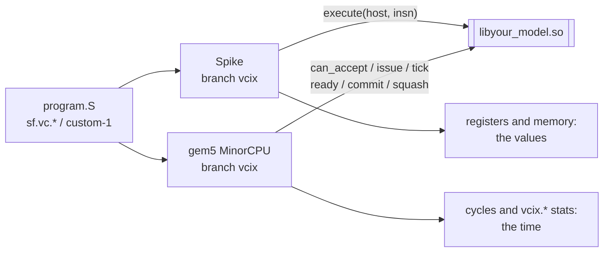
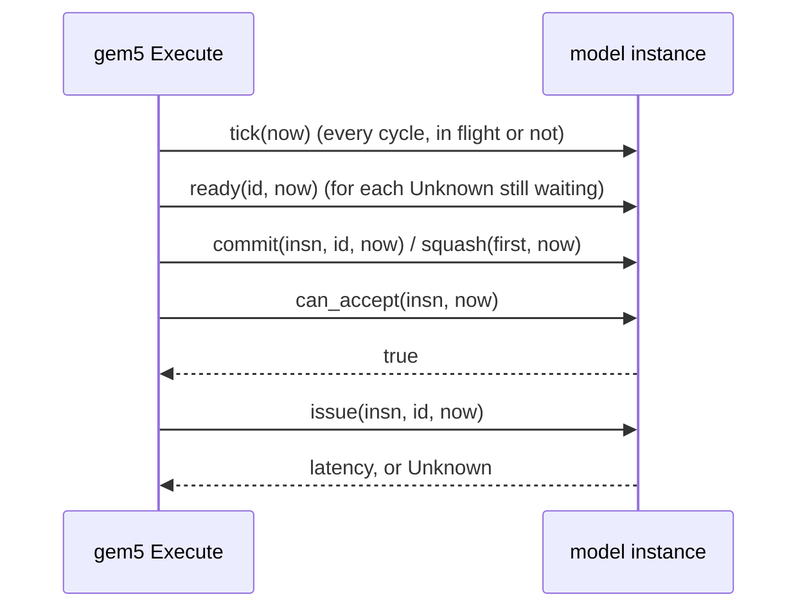

# vcix-accelerator

You describe an accelerator once, as one shared library (a *model*). Spike runs
it to get the values. gem5 runs the same library to get the time. Neither
simulator is patched again for a new accelerator.

The accelerator talks to the core through custom instructions only. Two
opcodes go to the model:

- **custom-2** (`0x5B`), read by the operand rules of VCIX, SiFive's Vector
  Coprocessor Interface. This gives the project its name.
- **custom-1** (`0x2B`), read as R-type on integer registers.



The two runs are separate processes. They never run together. Each one calls
only its own half of the model.

Without this, a new unit means editing two simulators by hand, in two styles:

- **Spike** (functional): a `DECLARE_INSN` in `encoding.h`, a body in
  `insns/*.h`, and unit state as members of `processor_t`.
- **gem5** (timing): a custom `OpClass`, a decoder entry per encoding, a
  functional unit class, and a branch in `Execute::issue` of the MinorCPU.

Nothing keeps the two descriptions in step.

**Contents**

1. [One instruction, bit by bit](#one-instruction-bit-by-bit)
2. [A first run: print_args](#a-first-run-print_args)
3. [The C ABI and its two faces](#the-c-abi-and-its-two-faces)
4. [The timing rules](#the-timing-rules)
5. [The machine description](#the-machine-description)
6. [Build with hidden visibility](#build-with-hidden-visibility)
7. [vcix_uarch: a unit as hardware blocks](#vcix_uarch-a-unit-as-hardware-blocks)
8. [A unit that is RTL](#a-unit-that-is-rtl)
9. [What you do not implement, and what you configure](#what-you-do-not-implement-and-what-you-configure)
10. [Constraints and non-goals](#constraints-and-non-goals)
11. [Layout](#layout), [Environment](#environment), [Build and run](#build-and-run), [Status](#status)

## One instruction, bit by bit

Take `sf.vc.x 0x1, 0x2, 0x3, a0`. It assembles to `0x062541db`:

```
 31     26 25 24   20 19   15 14 12 11    7 6       0
+--------+--+-------+-------+-----+-------+---------+
| 000001 | 1| 00010 | 01010 | 100 | 00011 | 1011011 |
+--------+--+-------+-------+-----+-------+---------+
  funct6  vm  vs2 /   rs1    funct3  rd /   opcode
  = 0x01  =1  = 2     = x10    = 4   = 3    = 0x5B (custom-2)
                       (a0)    (.x)
```

print_args prints the same split on Spike:

```
[execute] insn=062541db funct6=01 vm=1 f24_20=2  f19_15=10 funct3=4 f11_7=3  | vl=8 sew=32 lmul=2^0 lanes=4 x[10]=0x1234
```

A model says which instructions are its own with `{match, mask}` pairs. It
owns an instruction when `(bits & mask) == match`
([`include/vcix_accel.h:117-123`](include/vcix_accel.h)).

- print_args owns `{0x5B, 0x7F}` and `{0x2B, 0x7F}`: the whole custom-2 and
  custom-1 opcodes
  ([`examples/print_args/print_args.cc:60`](examples/print_args/print_args.cc)).
- The test model `reports` owns `{0x0600405B, 0xFE00707F}` and
  `{0x0E00405B, 0xFE00707F}`: funct6 `0x01` or `0x03`, vm 1, funct3 4
  ([`tests/contract/reports.cc:20-22`](tests/contract/reports.cc)).
  `0x062541db` is its own. `0x0a2541db` (`sf.vc.x 0x2, ...`, funct6 `0x02`) is not.

An instruction no model owns never reaches a model. It is an illegal
instruction on both simulators. Here is `tests/contract/unowned.S` on
`reports`, one owned instruction and then `0x0a2541db`:

```
Spike:  [model] execute 062541db, 0 in flight, 0 commits seen
        ...
        pc 00000000000101a6 va/inst 000000000a2541db sr 8000000200006620
        An illegal instruction was executed!

gem5:   src/arch/riscv/faults.cc:299: panic: Illegal instruction 0x500010d00a2541db at pc (0x101a6=>0x101aa).(0=>1): no VCIX accelerator model owns it
```

The test is [`tests/contract/run.sh:48-63`](tests/contract/run.sh).

## A first run: print_args

`print_args` is a unit that only watches. It owns all of custom-2 and
custom-1, computes nothing, and prints what each face is given. It is not a
template for a real model. It shows what crosses the interface.

```
scripts/build.sh
examples/print_args/run.sh
```

`examples/print_args/vcix.S` runs seven `sf.vc.*` forms, `sf.vc.v.vv` again
under LMUL=2, and one custom-1 instruction. It does not cover the widening
forms, the three-operand forms without `vd`, or fractional LMUL.

**Spike** calls `execute` once per instruction. It prints the fields and the
registers the encoding names:

```
[config ] print_args_latency_cycles=7 vpu_num_lanes=4
[execute] insn=062541db funct6=01 vm=1 f24_20=2  f19_15=10 funct3=4 f11_7=3  | vl=8 sew=32 lmul=2^0 lanes=4 x[10]=0x1234
[execute] insn=2620825b funct6=09 vm=1 f24_20=2  f19_15=1  funct3=0 f11_7=4  | vl=8 sew=32 lmul=2^0 lanes=4 v2[0..1]=0x3f800000,0x40000000 v1[0..1]=0x41200000,0x41300000
...
[execute] insn=00b5002b funct7=00 rs2=11 rs1=10 funct3=0 rd=0  | vl=8 sew=32 lmul=2^1 lanes=4 x[10]=0x1234 x[11]=0x2a
```

**gem5** never calls `execute`. It calls `issue` and `commit` and prints cycles:

```
[config ] print_args_latency_cycles=7 vpu_num_lanes=4
[issue  ] insn=062541db ... | vl=8 sew=32 lmul=2^0 | cycle=10012 ready=10019
[commit ] insn=062541db ... | vl=8 sew=32 lmul=2^0 | cycle=10094
[issue  ] insn=0e22b1db ... | vl=8 sew=32 lmul=2^0 | cycle=10097 ready=10104
[commit ] insn=0e22b1db ... | vl=8 sew=32 lmul=2^0 | cycle=10104
...
[issue  ] insn=2c2081db ... | vl=8 sew=32 lmul=2^0 | cycle=10117 ready=10124
...
[issue  ] insn=2c23025b ... | vl=8 sew=32 lmul=2^1 | cycle=10199 ready=10213
[commit ] insn=2c23025b ... | vl=8 sew=32 lmul=2^1 | cycle=10213
[issue  ] insn=00b5002b ... | vl=8 sew=32 lmul=2^1 | cycle=10216 ready=10223
```

How to read it:

- Both simulators read the same `machine.yml`, so both print the same
  `[config ]` line.
- The latency is `print_args_latency_cycles` (7), once per register of a
  vector operand's group
  ([`print_args.cc:88-90`](examples/print_args/print_args.cc)):
  - `2c2081db` (`sf.vc.v.vv`) at LMUL 1: ready 7 cycles after issue.
  - `2c23025b`, the same form at LMUL 2: 14 cycles.
  - `00b5002b` (custom-1) under LMUL 2: 7 cycles. It has no vector operand.
- print_args takes one instruction at a time, and stays busy 3 cycles
  (`RECOVERY`) after each commit
  ([`print_args.cc:16,87,99`](examples/print_args/print_args.cc)). So `0e22b1db`
  issues at 10097, 3 cycles after the commit at 10094.
- The first commit (10094) is later than its ready cycle (10019). An
  instruction leaves the processor at its ready cycle or when the instructions
  before it have left, whichever is later.

[`tests/print_args/run.sh`](tests/print_args/run.sh) asserts the config line
on both simulators, nine `execute` lines, and the latencies 7, 14 and 7. The
absolute cycles above come from one run of `examples/print_args/run.sh`.

## The C ABI and its two faces

The boundary is a C struct of function pointers, `vcix_model`, in
[`include/vcix_accel.h`](include/vcix_accel.h). A library exports one symbol,
`vcix_accel_model()`, which returns it. A model needs neither simulator's
source tree.

```
vcix_model                                         who calls it
  abi_version, name, encodings[], num_encodings    both, once, at load
  create(config, error) / destroy                  both, one instance each
  execute(self, host, insn)                        Spike only: the values
  can_accept(self, insn, now)                      gem5 only ┐
  issue(self, insn, id, now)                       gem5 only │
  squash(self, first, now)                         gem5 only │ the timing
  commit(self, insn, id, now)                      gem5 only │
  tick(self, now)                  may be NULL     gem5 only │
  ready(self, id, now)             may be NULL     gem5 only ┘
  reset(self)                      may be NULL
  num_stats / stat / read_stats    num_stats may be NULL: no statistics
```

`encodings` may be NULL when `num_encodings` is 0. A table written by hand may
leave `tick`, `ready` and `reset` NULL. `tests/contract/by_hand.cc` is such a
table, and both simulators run it ([`tests/contract/run.sh:105-118`](tests/contract/run.sh)).

Most models use the C++ wrapper, [`include/vcix_accel.hpp`](include/vcix_accel.hpp).
You derive from `vcix_accel::Model` and add one line:

```cpp
VCIX_ACCEL_REGISTER(YourModel)
```

The methods ([`vcix_accel.hpp:172-206`](include/vcix_accel.hpp)); "optional"
ones have a default:

- Both simulators
  - `name()`: the model's name. A simulator prints it when the model cannot be
    configured.
  - `owns()`: the `{match, mask, name}` encodings that belong to this model.
  - `configure(config)`: read the machine's numbers by key. Optional.
- Spike
  - `execute(host, insn)`: what the instruction does to registers and memory,
    through `host`.
- gem5
  - `can_accept(insn, now)`: whether the unit takes this instruction in this
    cycle. Must not change state.
  - `issue(insn, id, now)`: the instruction enters the unit. Return the cycles
    until its result is ready, or `Unknown`.
  - `commit(insn, id, now)`: the instruction can no longer be squashed.
    Optional.
  - `tick(now)`: one cycle of the unit's own time. Optional.
  - `ready(id, now)`: whether a result issued as `Unknown` is ready now. Must
    not change state. Optional.
  - `ports()`: the `Port`s that time the unit, one `PRIMARY` per unit. gem5
    reports each primary port as `vcix.<unit>.admitted`, `capacity`,
    `cycles`, `occupancy` and `utilized_cycles`, and each encoding's commits
    as `vcix.committed.<encoding>`. Optional.
- `reset()`: back to the state `configure` left; statistics stay. Optional.

`insn` is the instruction bits with the vector configuration it was decoded
under: `vl`, SEW and LMUL. Both faces get the same `insn`, so a latency can
depend on how much data the instruction moves. `execute` reaches the hart
through `host`: `lanes()`, `vlen_bits()`, `vreg(lane, reg)`,
`vreg_mut(lane, reg)`, `xreg`, `set_xreg`, `freg_bits`, `csr`, `mem_read` and
`mem_write` ([`vcix_accel.hpp:82-104`](include/vcix_accel.hpp)).

**Instances.** A simulator makes one object per instance of the accelerator:
Spike one per hart, gem5 one per `MinorVcixAccelFU`. Instances share nothing.
A model's state belongs in the object's members: a static or a global is
shared by every instance in the process. `tests/contract` runs gem5 with two
units naming one library, and each instance sees only its own commit
([`run.sh:134-139`](tests/contract/run.sh)).

**Lifetimes.**

- `name()` and `owns()` are asked once, when the library is loaded, of an
  object that is then destroyed. So they cannot depend on the machine
  description.
- The name, and the name in each encoding, must live as long as the library.
  String literals do.
- `configure` is called once on each object, before any instruction reaches it.
- What `config.get` returns is valid only until `configure` returns. Copy what
  you want to keep.
- An exception from `configure` stops the run, with its `what()` as the
  reason. An exception from the constructor is caught too: the library writes
  the reason to stderr and hands over no table.

**A first smoke test, with no simulator.** `tools/timing_probe` loads a
library and drives its timing face: N copies of one instruction, one at a
time, ticked until each is ready.

```
$ build/timing_probe build/libprint_args.so 062541db 3 | grep '^insn'
insn 0: issued at 0, committed at 5
insn 1: issued at 8, committed at 13
insn 2: issued at 16, committed at 21
```

Here print_args has no machine description, so its latency is its default 5,
and each issue waits the 3 cycles of `RECOVERY` after a commit. The probe
refuses a table of another ABI version:

```
$ build/timing_probe build/libother_abi.so 062541db 2
.../libother_abi.so has ABI 12, the probe has 11
```

## The timing rules

gem5 keeps these rules. The model can rely on them.

**One cycle, in this order** ([`include/vcix_accel.h:99`](include/vcix_accel.h)):



- `issue` follows a `can_accept` that returned true in the same cycle. It
  returns when the result is ready. An instruction that reads the result waits
  that long. The instruction itself leaves the processor then, or when the
  instructions before it have left, whichever is later.
- `commit` comes once for every instruction that really ran, in issue order.
  `id` names the instruction in both calls, and later instructions have larger
  ids.
- `tick(now)` comes once in every cycle the processor runs, whether or not an
  instruction is in flight.
- **A squashed instruction was never issued.** Write `issue` as if every issued
  instruction runs.

The state may change in three places:

- in `issue`: it lands in the cycle the instruction enters the unit;
- in `commit`: it lands when the instruction can no longer be squashed, which
  the instructions before it can delay;
- in `tick`: it lands every cycle.

### How many overlap is the model's choice

An accepted instruction does not hold gem5's functional unit. The model
decides in `can_accept`, from its own state, how many it takes:

- one at a time: `return !in_flight_ && now >= busy_until_;`
  ([`print_args.cc:87`](examples/print_args/print_args.cc));
- a pipeline of depth 4: `return issued_.size() < DEPTH;`
  ([`tests/pipeline/pipelined.cc:24`](tests/pipeline/pipelined.cc));
- a queue with room: see the next example.

Six back-to-back instructions on the depth-4 model, `tests/pipeline/burst.S`
on gem5:

```
[model] issue, 0 in flight
[model] issue, 1 in flight
[model] issue, 2 in flight
[model] issue, 3 in flight
[model] commit, 10 cycles after its issue
[model] issue, 3 in flight
[model] commit, 10 cycles after its issue
[model] commit, 10 cycles after its issue
[model] issue, 2 in flight
[model] commit, 10 cycles after its issue
...
```

The fifth waits for the first commit, and every one commits 10 cycles after
its issue. [`tests/pipeline/run.sh`](tests/pipeline/run.sh) asserts "3 in
flight" at least once, "4 in flight" never, and six commits at 10.

gem5 also bounds the model: a unit that already has `vcixMaxInFlight`
instructions in the processor (8192 unless the CPU config sets it) is issued
no more, and its model is not asked. With `vcixMaxInFlight` 4, gem5 asks the
model with three in flight and never with four
([`tests/contract/run.sh:141-147`](tests/contract/run.sh); where gem5 checks it:
[gem5 adapter, Issue](adapters/gem5/README.md#3-issue)).

### Example: a queue of two

The test model [`tests/contract/timing.cc`](tests/contract/timing.cc) has a
queue of two commands. Each command takes 10 ticks. A wait is accepted only
when the queue is empty.

```cpp
// tests/contract/timing.cc:32-35
bool can_accept(const Insn &insn, Cycle) const override {
  const Form f = form(insn);
  return f == WAIT ? queue_.empty() : f != COMMAND || queue_.size() < DEPTH;   // DEPTH 2
}
// :45-46, in issue
if (f == COMMAND) queue_.push_back(TICKS);                                      // TICKS 10
if (f != POP) return LATENCY;                                                   // LATENCY 3
// :60-61, in tick
if (!queue_.empty() && --queue_.front() == 0) {
  queue_.pop_front();
```

`tests/contract/queue.S` sends four commands back to back, then a wait. The
model prints its state at each issue (the first five of the program's eight
issues; the last three are two more commands and a wait):

```
[model] issue command: 0 issued, 0 committed, 0 pops waiting, 0 ticks missing, 0 finished
[model] issue command: 1 issued, 0 committed, 0 pops waiting, 0 ticks missing, 0 finished
[model] issue command: 2 issued, 2 committed, 0 pops waiting, 0 ticks missing, 1 finished, the last 0 cycles ago
[model] issue command: 3 issued, 3 committed, 0 pops waiting, 0 ticks missing, 2 finished, the last 0 cycles ago
[model] issue wait: 4 issued, 4 committed, 0 pops waiting, 0 ticks missing, 4 finished, the last 0 cycles ago
...
```

```
cycle ->          a tick finishes      a tick finishes      a tick finishes
                  cmd 0                cmd 1                cmd 3, the last
queue  [0 1]  ... [1 2]  ...           [2 3]  ...           []
                   ^ cmd 2 issues       ^ cmd 3 issues       ^ the wait issues
                     in this cycle        in this cycle        in this cycle
```

- Commands 0 and 1 fill the queue. Command 2 is refused until a slot frees.
- "the last 0 cycles ago": command 2 issues in the very cycle whose `tick`
  finished command 0. `tick` comes first in the cycle, so `can_accept` already
  sees the free slot.
- The wait issues in the cycle whose `tick` emptied the queue.
- "0 ticks missing" on every line: no cycle passed without its `tick`.

[`tests/contract/run.sh:156-168`](tests/contract/run.sh) asserts these lines.

### Squash: copy and replay

gem5 issues instructions before it knows they will run. After a mispredicted
branch it takes them back. The model does not see this. The wrapper keeps the
rule for you ([`vcix_accel.hpp:208-260`](include/vcix_accel.hpp)):

```
issue #1 ──► save a copy of the model ──► model.issue(#1)
issue #2 ──► save a copy               ──► model.issue(#2)
   ...            ticks, commits ...
squash from #2:  model = the copy saved before #2
                 replay tick() and commit() for every cycle since,
                 with replaying() == true
```

So a model must be copyable, keep all its state in its members, and reach the
same state from the same calls. `issue` and `can_accept` are never called
again. In `tick` and `commit`, skip what must happen only once (a line of
output) while `replaying()` is true.

`tests/contract/speculated.S` puts one wait that commits, two waits behind a
`jr` the core has not seen before, and one wait at the jump target:

```
[model] issue wait: 0 issued, 0 committed, 0 pops waiting, 0 ticks missing, 0 finished
[model] issue wait: 1 issued, 0 committed, 0 pops waiting, 0 ticks missing, 0 finished
[model] issue wait: 2 issued, 0 committed, 0 pops waiting, 0 ticks missing, 0 finished
[model] issue wait: 1 issued, 1 committed, 0 pops waiting, 0 ticks missing, 0 finished
```

The second and third lines are the wrong path. After the squash the model is
back to "1 issued": the two never happened
([`tests/contract/run.sh:170-178`](tests/contract/run.sh)).

### A result whose time is not known at issue

When `issue` cannot tell the ready cycle, it returns `Unknown`. The model says
it later:

- From the next cycle on, after each `tick`, gem5 asks `ready(id, now)` for
  that instruction until it answers true. Then it is not asked again.
- In the cycle it answers true, a reader of the result can issue, and the
  instruction itself can leave if the ones before it have left.
- Until then it is in flight and can be squashed like any other. What comes
  after it still issues, unless it reads the result.
- Two such instructions writing one register are waited for together: a reader
  of the later one is held until both are ready.

`tests/contract/waited.S` starts with a pop (its result waits for an item), the
command that makes the item, and a use of the pop's register:

```
[model] issue pop: 0 issued, 0 committed, 0 pops waiting, 0 ticks missing, 0 finished
[model] issue command: 1 issued, 0 committed, 1 pops waiting, 0 ticks missing, 0 finished
[model] commit pop, ready 0 cycles ago
[model] issue use: 2 issued, 2 committed, 0 pops waiting, 0 ticks missing, 1 finished, the last 0 cycles ago, the last pop ready 0 cycles ago
...
```

(The rest of the program is a pop behind a mispredicted jump, squashed while
it waits, and a use at the jump target.)

The command issues while the pop waits. The pop commits, and its reader
issues, in the cycle `ready` first says true. A model whose `ready` never says
true stalls the program with no error. gem5 warns once after
`vcixReadyWarnCycles` cycles (1000000 by default, 0 for never). With 100, on
`tests/contract/asleep.S`:

```
src/cpu/minor/execute.cc:636: warn: 0/30.107/235/684.684 pc: 0x10244 (vcix): its accelerator model has not said its result is ready 100 cycles after its issue
```

All of these are asserted in [`tests/contract/run.sh:180-205`](tests/contract/run.sh).

**Spike calls none of this.** When the program exits, the simulation ends,
whatever the unit is still doing. `tick` moves the model's own time only; it
asks nothing of the memory system.

<details><summary>Reproduce the traces of this section</summary>

From the repository, after `scripts/build.sh`, in bash:

```
source scripts/sim.sh          # BUILD, SPIKE, PK, GEM5; rv_program, spike_run, gem5_run
for p in queue speculated waited asleep; do rv_program tests/contract/$p.S build/$p; done
gem5_run build/m5-queue  build/libtiming.so "" build/queue      --max-ticks 100000000 | grep '^\[model'
gem5_run build/m5-spec   build/libtiming.so "" build/speculated --max-ticks 100000000 | grep '^\[model'
gem5_run build/m5-waited build/libtiming.so "" build/waited     --max-ticks 100000000 | grep '^\[model'
gem5_run build/m5-stuck  build/libtiming.so "" build/asleep --ready-warn-cycles 100 --max-ticks 30000000 2>&1 | grep 'ready 100'
rv_program tests/pipeline/burst.S build/burst
gem5_run build/m5-burst build/libpipelined.so "" build/burst | grep '^\[model'
build/timing_probe build/libprint_args.so 062541db 3 | grep '^insn'
```

</details>

## The machine description

A model reads the machine's numbers from the machine description, a YAML file
the setup already has. This repository defines no format of its own. The model
never sees the file:

- Spike reads it itself (`--machine-config`) and also takes its lanes,
  scratchpad and VLEN from it.
- On gem5 the config script reads it
  ([`examples/machine_description.py`](examples/machine_description.py)) and
  passes keys and values as parameters, so gem5 parses no file.

`config.get("key")` returns a top-level scalar **as written**, with no typing,
or nothing (`nullptr`) when it is absent. This is what both simulators hand
the test model for each line of
[`tests/contract/values.yml`](tests/contract/values.yml)
([`values.expected`](tests/contract/values.expected), checked on both at
[`tests/contract/run.sh:65-70`](tests/contract/run.sh)):

```
plain: 8              ->  <8>
quoted: "8"           ->  <8>
empty:                ->  absent      (YAML null)
tilde: ~              ->  absent      (YAML null)
null_word: null       ->  absent      (YAML null)
quoted_empty: ""      ->  <>          present, empty
quoted_null: "null"   ->  <null>
quoted_tilde: '~'     ->  <~>
leading_zero: 010     ->  <010>       the text, not a number
spaced: 8 cycles      ->  <8 cycles>
nested: {a: 1}        ->  absent      not a scalar
listed: [1, 2]        ->  absent      not a scalar
---
not_in_the_file: 9    ->  absent      only the first document counts
```

Most models want numbers. `config.uint("key", fallback)` reads an unsigned
decimal; `config.hex("key", fallback)` reads `0x` and hex digits, for
addresses. The fallback is for an absent key only. A present value that is
not such a number is a configuration error, never 0 and never the fallback.
These are the cases [`tests/contract/direct.cc:99-116`](tests/contract/direct.cc)
checks, with the reason the model gives:

- `uint`: `8` reads 8, `0` reads 0, absent reads the fallback.
  - `abc`, `-1`, `8 cycles`: "is not an unsigned decimal number"
  - `010`: "has a leading zero, which reads as octal or as decimal depending on
    the reader"
  - `18446744073709551616`: "does not fit in 64 bits"
- `hex`: `0x80001000` and `0xffffffffffffffff` read; absent reads the fallback.
  - `80001000`, `0x`, `0x80zz`, `0X80`: "is not a hexadecimal number written 0x..."
  - `0x10000000000000000`: "does not fit in 64 bits"

On an error no instance is made. The simulator stops with exit status 1 and a
message that names the model, the key and the value. With
`latency: 8 cycles` in the description of the `reports` model:

```
Spike:  vcixaccel: reports: machine description: latency: '8 cycles' is not an unsigned decimal number
gem5:   src/cpu/minor/vcix_accel_model.cc:257: fatal: <build>/libreports.so: reports: machine description: latency: '8 cycles' is not an unsigned decimal number
```

([`tests/contract/run.sh:72-76`](tests/contract/run.sh).) A model that reads a
value itself reports a bad one the same way: it throws
`vcix_accel::ConfigError(key, value, why)` from `configure`
([`vcix_accel.hpp:39-43`](include/vcix_accel.hpp)).

A description whose top level is not a mapping is refused by both simulators
([`run.sh:78-83`](tests/contract/run.sh)).

## Build with hidden visibility

Build the model with `-fvisibility=hidden -fvisibility-inlines-hidden` (in
CMake, `CXX_VISIBILITY_PRESET hidden`, as
[`CMakeLists.txt:11-15`](CMakeLists.txt) does). `VCIX_ACCEL_REGISTER` exports
the one symbol a simulator looks up, `vcix_accel_model`, by itself, so nothing
else has to be marked.

A symbol the library leaves visible is not its own any more. Both simulators
export their own symbols, and theirs win. The test model `reports` defines

```cpp
extern "C" __attribute__((noinline)) uint32_t f16_to_f32(uint16_t) { return 0x0badc0de; }   // tests/contract/reports.cc:7
```

and prints `f16_to_f32(0x3c00)` in `configure`. The same source, two builds:

```
hidden (CMakeLists.txt):        [config] f16_to_f32(0x3c00) = 0x0badc0de     Spike and gem5: its own function
default visibility (g++ alone): [config] f16_to_f32(0x3c00) = 0x3f800000     Spike and gem5: the simulator's softfloat
```

One process can load more than one model. `tests/contract/same_name.cc`
is built twice, both with a class named `Accel`. `direct` loads both and checks that each
library keeps its own table and model, built hidden and built with the default
visibility ([`direct.cc:61-69`](tests/contract/direct.cc)). The table is hidden
whatever the flags ([`vcix_accel.hpp:385`](include/vcix_accel.hpp)).

The flag covers the code compiled with it. A static library linked into the
model that was not built hidden also needs `-Wl,-Bsymbolic` on the model's
link line. Move `reports`' `f16_to_f32` into such a library and link it into
the hidden rest: both simulators print `0x3f800000`; add `-Wl,-Bsymbolic` and
both print `0x0badc0de` (the last block below).

<details><summary>Reproduce the two builds and the configuration error</summary>

```
source scripts/sim.sh
rv_program tests/contract/pair.S build/pair
spike_run build/libreports.so tests/contract/values.yml build/pair | grep f16
gem5_run build/m5-values build/libreports.so tests/contract/values.yml build/pair | grep f16
g++ -std=c++17 -O2 -shared -fPIC -Iinclude tests/contract/reports.cc -o build/libreports_default.so
spike_run build/libreports_default.so "" build/pair | grep f16
gem5_run build/m5-vis build/libreports_default.so "" build/pair | grep f16
printf 'vpu_num_lanes: 4\nvpu_spad_size_kb_per_lane: 128\nvpu_vector_length_bits: 256\nlatency: 8 cycles\n' > build/malformed.yml
spike_run build/libreports.so build/malformed.yml build/pair; echo "exit $?"
gem5_run build/m5-mal build/libreports.so build/malformed.yml build/pair 2>&1 | grep fatal
```

The static library and `-Bsymbolic`:

```
printf '#include <cstdint>\nextern "C" __attribute__((noinline)) uint32_t f16_to_f32(uint16_t) { return 0x0badc0de; }\n' > build/f16.cc
sed 's/^extern "C" __attribute__((noinline)) uint32_t f16_to_f32(uint16_t) { return 0x0badc0de; }$/extern "C" uint32_t f16_to_f32(uint16_t);/' \
  tests/contract/reports.cc > build/reports_nof16.cc
g++ -std=c++17 -O2 -fPIC -c build/f16.cc -o build/f16.o && ar rcs build/libf16.a build/f16.o
g++ -std=c++17 -O2 -fPIC -fvisibility=hidden -fvisibility-inlines-hidden -Iinclude -c build/reports_nof16.cc -o build/r.o
g++ -shared build/r.o build/libf16.a -o build/libplain.so
g++ -shared -Wl,-Bsymbolic build/r.o build/libf16.a -o build/libsym.so
for m in plain sym; do
  spike_run build/lib$m.so "" build/pair | grep f16
  gem5_run build/m5-$m build/lib$m.so "" build/pair 2>/dev/null | grep f16
done
```

</details>

## vcix_uarch: a unit as hardware blocks

With a `Model` written by hand, `execute` and the timing methods are two
descriptions. Both are yours to keep in step.
[`include/vcix_uarch.hpp`](include/vcix_uarch.hpp) derives both faces from one.
You list the unit's hardware blocks, and for each instruction you write a
*route*: what it needs and what it moves. A route function does not run the
instruction. It declares steps on `r`. `vcix_uarch::Machine` reads the steps:

```
             void pop(Route &r) { r.use(entry_).receive(eup_, n, take); }
                                    │
             ┌──────────────────────┴───────────────────────┐
           gem5                                           Spike
  can_accept: do the steps fit now?               execute: issue the same steps,
  issue: take them; latency or Unknown            tick the same blocks until done,
  tick: move the blocks, count the ports          and run the functions that carry
  only counts: no value is ever made              the values (take, at_issue(host), ...)
```

Every tpu unit and [`examples/copier`](examples/copier/copier.cc) are written
this way. The tpu units are described in
[`examples/tpu/README.md`](examples/tpu/README.md).

### The four blocks

A unit lists its blocks in `hardware(h)`. Names given to blocks become gem5
statistics.

```
Port              N per cycle pass; what passes is counted (admitted, utilized)
   ──►|N|──►        Port issue_{name, "issue", "instructions", 1, PRIMARY};

Pipeline<T>       input queue ──► S stages ──► output queue (1 or 2)
  [in]─►[s0][s1]..[sS-1]─►[out]      each queue `depth` rows deep
                    one entry enters the stages per cycle, through its entry port;
                    on Spike each row carries a value of type T
                    pipe.configure(stages, depth, Stall::WHEN_OUTPUT_FULL);

CommandQueue      issued instructions in program order; only the head works
  head─►[c0][c1][c2][c3]             depth 0: no queue, every step at issue
                    commands_.configure(4, Free::WHEN_STARTED);

Register<S>       unit state, read and written the same way on both simulators
                    source_.get();  source_.write() = x;
```

- **Port** ([`vcix_accel.hpp:107-170`](include/vcix_accel.hpp)): a capacity
  per cycle. A unit has one `PRIMARY` port; its counts are the unit's
  statistics.
- **`Pipeline<T>`** ([`vcix_uarch.hpp:268-350`](include/vcix_uarch.hpp)): rows
  that arrive in a cycle are seen in the next. An entry of `weight` rows
  leaves the stages as that many rows, into every output queue. Two stall
  modes: `Stall::WHEN_OUTPUT_FULL` (stop as soon as an output queue is full)
  and `Stall::WHEN_HEAD_BLOCKED` (stop only when the entry leaving does not
  fit). `h.pipeline(p, entry, &Unit::stage)` adds a function the unit runs on
  each row in each stage, on Spike, where rows carry values.
- **CommandQueue** ([`vcix_uarch.hpp:352-420`](include/vcix_uarch.hpp)): a
  command arrives `arrival_cycles` (1) after its issue and works from the cycle
  after. `Free::WHEN_DONE` gives the slot back when its work is done;
  `Free::WHEN_STARTED` gives it back as the head starts, in a cycle of its own.
- **`Register<S>`** ([`vcix_uarch.hpp:38-60`](include/vcix_uarch.hpp)): `get()`
  reads, `write()` changes, `reset` puts back what `configure` gave. Copies
  share the value until one writes, so the copy gem5 saves at each issue is
  cheap.

### The route verbs

Steps run in the order you write them. **Steps before `enqueue` happen in the
issue cycle, all or nothing. Steps after it happen at the queue head, in
order, as much a cycle as the ports allow**
([`vcix_uarch.hpp:422-423`](include/vcix_uarch.hpp)).

- What must hold
  - `require(holds)` and `require(holds, never)`: never accepted while `holds`
    is false. `never()` is the reason Spike prints.
  - `use(port, n = 1)`: `n` of the port's room this cycle.
- Moving entries
  - `send(pipe, n)`: `n` entries into the pipeline's input queue.
    `send(pipe, n, weight)`: each entry is `weight` rows (at most 65535).
  - `receive(pipe, n)`: **exactly** `n` rows from an output queue. Before
    `enqueue` it waits until `n` are out. `.from_output(1)` picks the second
    output queue.
  - `transfer(n)`: `n` beats that go through no pipeline, into the unit's own
    registers or through a port.
  - `.through(port)`: the last step's `n` pass this port, at most its width a
    cycle. At issue the whole `n` must fit in this cycle.
  - `.through_received(port)`: as `through`, but counts only what is out. A
    receive of more than the port's width that is stuck still gets its
    `when_stuck` reason on Spike.
  - `wait_until_empty(pipe)`: the next step moves nothing until the
    pipeline's input queue and stages are empty.
- Queueing
  - `enqueue(queue)`: the steps after this run at the queue head.
- When it is done
  - `done_after(cycles)`: for a route that has no queue (default 1).
  - `done_when_enqueued()`: as soon as the queue takes it; its work goes on.
  - `done_when_idle()`: once no command that reached the queue is left
    unfinished.
  - A queued route without either is done when its last step is.
- State and values
  - `at_issue([&] { ... })`: changes unit state. Runs on gem5 **and** Spike.
  - `at_issue([&](const Host &h) { ... })`: changes values. **Spike only.**
  - the value functions given to `send(pipe, n, [weight,] value_of)`,
    `receive(pipe, n, take)` and `transfer(n, beat)`: **Spike only**.
  - `when_received(fn(host))`: as the last receive ends. **Spike only.**
  - `when_done(fn(host))`: as the instruction is done. **Spike only.**
  - `when_stuck(fn(got))`: the reason Spike prints when the instruction waits
    and nothing in its unit moves any more. `got` is the rows its waiting
    receive has.

A route has at most 12 steps. The functions given to a route outlive its
declaration: capture the route and the unit by reference, the rest by value.

### Machine

```cpp
class Model final : public vcix_uarch::Machine<Copier> {          // Machine<Unit, Unit, ...>
 public:
  Model() : Machine("COPIER") {}                                  // each unit's name in the statistics
  const char *name() const override { return "copier"; }
};
VCIX_ACCEL_REGISTER(Model)
```

`Machine<Units...>` is the `Model`
([`vcix_uarch.hpp:772-1087`](include/vcix_uarch.hpp)). `owns()` is every
unit's `INSTRUCTIONS`, in unit order. An instruction goes to the first unit
that owns it. `configure`, `tick`, `reset` and `ports` go to every unit in
order. `can_accept`, `issue`, `ready` and Spike's `execute` come from the
routes. Squash and the commit counts come from the wrapper, as for any model.

`can_accept` runs the route function each time gem5 asks, and `issue` runs it
once more. So a route function must change nothing itself: state changes go
in `at_issue`.

### The smallest unit: copier

[`examples/copier/copier.cc`](examples/copier/copier.cc) is a whole unit in 67
lines: the timing of the RTL copier in [`examples/rtl/copier`](examples/rtl/copier).
Copy it to start a new unit.

```cpp
// examples/copier/copier.cc:14-22: two ports, a queue of four, one register
explicit Copier(const char *name)
    : issue_{name, "issue", "instructions", 1, vcix_uarch::PRIMARY}, memory_{name, "memory", "requests", 1} {}
void configure(const vcix_uarch::Config &) { commands_.configure(4, vcix_uarch::Free::WHEN_STARTED); }
template <class H>
void hardware(H &&h) {
  h.port(issue_), h.port(memory_);
  h.queue(commands_);
  h.reg(source_);
}

// :25-28: x[rs1] is the source of the copies after it
void set_source(Route &r) {
  r.use(issue_).enqueue(commands_).done_when_enqueued();
  r.at_issue([&](const Host &host) { source_.write() = host.xreg(vcix_accel::rs1(r.insn())); });
}
// :30-42: 256 bytes; 2 * 256 / 8 = 64 requests at the head, one a cycle through memory_
void copy(Route &r) {
  r.use(issue_).enqueue(commands_).done_when_enqueued().transfer(2 * BYTES / 8).through(memory_);
  r.at_issue([&](const Host &host) { /* read and write BYTES, 8 at a time, through host */ });
}
// :43: done once the queue has finished everything
void wait(Route &r) { r.use(issue_).enqueue(commands_).done_when_idle(); }

// :46-51: three encodings on custom-2, funct3 4
static constexpr vcix_uarch::Instruction<Copier> INSTRUCTIONS[] = {
    {0x0600405B, FORM, "copy source", &Copier::set_source},
    {0x0A00405B, FORM, "copy", &Copier::copy},
    {0x0E00405B, FORM, "copy wait", &Copier::wait},
};
```

What the routes give, with no simulator (`timing_probe` ticks the model until
each instruction is ready, then issues the next):

```
$ build/timing_probe build/libcopier.so 0a00405b 6        six copies
insn 0: issued at 0, committed at 1
insn 1: issued at 1, committed at 2
insn 2: issued at 2, committed at 3
insn 3: issued at 3, committed at 4
insn 4: issued at 4, committed at 5
insn 5: issued at 67, committed at 68

$ build/timing_probe build/libcopier.so 0e00405b 2        two waits
insn 0: issued at 0, committed at 2
insn 1: issued at 2, committed at 4
```

- A copy is done as soon as the queue takes it (`done_when_enqueued`), one a
  cycle.
- The queue has four slots, but five copies get in: the head gave its slot
  back as it started (`Free::WHEN_STARTED`).
- The sixth waits for a free slot. That comes at 67, after the head's 64
  requests, one a cycle, and the next head's start.

On Spike, `copy.c -DWAIT` (a source, a copy, a wait, then ordinary loads of
the destination) prints `256 of 256 bytes copied` and exits 0. On gem5,
`copy.c -DWAIT -DTIMING` gives these statistics:

```
system.cpu.executeFuncUnits.funcUnits8.vcix.COPIER.admitted            3   # instructions admitted at port issue (Count)
system.cpu.executeFuncUnits.funcUnits8.vcix.COPIER.capacity            1   # instructions the unit can admit per cycle ((Count/Cycle))
system.cpu.executeFuncUnits.funcUnits8.vcix.COPIER.cycles         149776   # cycles the model was ticked, replays after a squash included (Cycle)
system.cpu.executeFuncUnits.funcUnits8.vcix.COPIER.occupancy           0   # instructions held behind the port, summed over cycles (Count)
system.cpu.executeFuncUnits.funcUnits8.vcix.COPIER.utilized_cycles     3   # admitted / capacity, the cycles admitting at full capacity takes (Cycle)
system.cpu.executeFuncUnits.funcUnits8.vcix.committed.copy_source      1   # instructions counted (Count)
system.cpu.executeFuncUnits.funcUnits8.vcix.committed.copy             1   # instructions counted (Count)
system.cpu.executeFuncUnits.funcUnits8.vcix.committed.copy_wait        1   # instructions counted (Count)
```

The unit is `COPIER` (the name `Machine` gave it), counted at its `PRIMARY`
port `issue`. An encoding's name becomes a statistic with every character
outside `[A-Za-z0-9_]` turned into `_` ("copy source" is `copy_source`).
`cycles` is the ticks: here the whole run, which exited at cycle 149776.
Utilization is `admitted / (capacity * cycles)`
([`vcix_accel.h:57-73`](include/vcix_accel.h)). `occupancy` adds, in each cycle
a pipeline is not drained, the rows in its stages, for each pipeline the port
is the entry of; the copier has none.

### A pipeline, cycle by cycle

The EUP of the tpu model's special-function unit is one pipeline of
`tpu_sfu_latency_cycles` (10) stages
([`examples/tpu/sfu.hpp:33,42-65`](examples/tpu/sfu.hpp)). `sfu_push` sends
its register in; `sfu_pop` receives one register back:

```cpp
r.use(entry_).send(eup_, registers(r), value_of);   // push: done once sent
r.use(entry_).receive(eup_, registers(r), take);    // pop: exactly that many rows out
```

A push, then the pop that takes it, on gem5 with `tpu_trace: 1`:

```
[tpu] issue sfu_push: the first, input queue 0, output queue 0
[tpu] commit sfu_push: 1 cycles after its issue
[tpu] issue sfu_pop: 11 cycles after the last issue, 0 in flight, input queue 0, output queue 1
[tpu] commit sfu_pop: 1 cycles after its issue
```

```
c0    sfu_push issues. Its register arrives in the input queue.
      Arrivals are seen in the next cycle.
 |    The register enters the stages through the EUP's entry port, one a cycle,
 |    and moves one stage a cycle through the 10 stages.
 v
c11   The register is in the output queue (trace: "output queue 1").
      The pop's receive of exactly one fits, so the pop issues.
```

What the EUP computes is in
[tpuv6e: the EUP](examples/tpuv6e/README.md#the-eup-sfu_push-and-sfu_pop); its keys
are in [tpu: keys](examples/tpu/README.md#keys-read-from-the-machine-description).

### Spike runs one instruction at a time

Spike has no clock of its own for the unit. `Machine::execute` keeps one per
instance and moves it only inside `execute`
([`vcix_uarch.hpp:787-1033`](include/vcix_uarch.hpp)):

1. While the route does not fit, tick the unit one cycle.
2. Issue the route, with the functions that carry its values.
3. Tick until it is done: its latency, or until it is ready and out of the
   queue.
4. Run its `when_done` functions and commit it.

Between instructions the unit stands still. So on Spike an instruction that
waits for something no instruction before it will ever make can never end.
Spike sees this: a cycle in which nothing in the unit moves, no command is
still on its way and the instruction is still waiting looks the same as every
cycle after it. Then the run ends, with the route's `when_stuck` or `require`
reason first, if it gave one. gem5 runs the same program into its limit.

An `sfu_pop` with nothing pushed (`sf.vc.v.x 0x3, 0x0, v3, a0`, `0x0c0541db`):

```
Spike (exit 1):  tpu: sfu_pop: lane 0 has no pushed result left
gem5:            gem5_se.py: the simulation did not end with the program exiting: simulate() limit reached
                 exit: simulate() limit reached at cycle 30000
```

An `sfu_push` of 16-bit elements (`sf.vc.vv 0x3, 0x0, v2, v1` under `e16`,
`0x2e20805b`), which its route refuses with
`r.require(sew == 32, [sew] { fail("sfu_push: an element of %u bits is not supported", sew); })`:

```
Spike (exit 1):  tpu: sfu_push: an element of 16 bits is not supported
gem5:            gem5_se.py: the simulation did not end with the program exiting: simulate() limit reached
                 exit: simulate() limit reached at cycle 30000
```

On gem5 neither instruction is ever issued: there is no `[tpu] issue` line.
`tpu::fail` prints `tpu: ` and the reason and exits 1
([`examples/tpu/values.hpp:17-26`](examples/tpu/values.hpp)). A route with no
reason ends with `vcix_uarch`'s own message,
`vcix_uarch: <name> waits, and nothing in its unit moves any more: on Spike,
which runs each instruction to its end before the next, it never ends`
(asserted for `vmatprep` in
[`tests/tpuv6e/functional/run.sh:58-59`](tests/tpuv6e/functional/run.sh)).

### Three rules keep the two faces together

1. **Decide on state only.** Whether an instruction is accepted, waits or is
   stuck may depend on the instruction, the ports' room, the queues and
   pipelines, and `Register`s. Never on register or memory values: gem5 has
   none. When a decision needs a fact, keep the fact in a `Register` and set
   it in `at_issue([&] { ... })`.
2. **Touch values only in functions that take a `Host`.** `at_issue(host)`,
   the `send`/`receive`/`transfer` value functions, `when_received` and
   `when_done`. gem5 never calls them.
3. **Refuse a bad program with `require(holds, never)`.** gem5 then never
   accepts the instruction, and Spike ends the run at the same instruction with
   the reason, as the `sfu_push` above shows.

<details><summary>Reproduce the copier and EUP runs</summary>

```
source scripts/sim.sh
build/timing_probe build/libcopier.so 0a00405b 6
build/timing_probe build/libcopier.so 0e00405b 2
riscv64-unknown-elf-gcc -O1 -static -march=rv64gcv -mabi=lp64d -DWAIT examples/rtl/copier/copy.c -o build/copy-wait
riscv64-unknown-elf-gcc -O1 -static -march=rv64gcv -mabi=lp64d -DWAIT -DTIMING examples/rtl/copier/copy.c -o build/copy-timing
spike_run build/libcopier.so "" build/copy-wait
gem5_run build/m5-copier build/libcopier.so "" build/copy-timing && grep vcix build/m5-copier/stats.txt
```

The EUP programs, each `main:` then `li t0, 8` and a `vsetvli` (`e32`, or `e16`
for the second), then:

```
push_pop.S:   sf.vc.vv  0x3, 0x0, v2, v1      # sfu_push
              sf.vc.v.x 0x3, 0x0, v3, a0      # sfu_pop
pop_alone.S:  sf.vc.v.x 0x3, 0x0, v3, a0      # sfu_pop
push_e16.S:   sf.vc.vv  0x3, 0x0, v2, v1      # sfu_push, under e16
```

each followed by `li a0, 0` and `ret`.

```
M=tests/tpu/functional/machine.yml
{ cat $M; echo 'tpu_trace: 1'; } > build/tpu-trace.yml
rv_program push_pop.S build/push_pop
spike_run build/libtpu.so $M build/push_pop
gem5_run build/m5-pp build/libtpu.so build/tpu-trace.yml build/push_pop --max-ticks 30000000 | grep '^\[tpu'
# the same for pop_alone and push_e16: Spike prints the reason on stderr, gem5 ends at the limit
```

</details>

## A unit that is RTL

A unit that exists as RTL needs no route. `examples/rtl/rtl_model.hpp` wraps one
Verilated module with standard ports (command, in and out beats, memory,
`busy`), and the model is a table of the encodings it owns. gem5 clocks the
module once a cycle for the timing. Spike clocks it only while an instruction
needs it, for the values. So on Spike a copy with no wait after it copies
nothing on the RTL copier, and everything on `libcopier.so`, which copies at
issue ([`tests/rtl/run.sh:79-91`](tests/rtl/run.sh)). See
[`examples/rtl/README.md`](examples/rtl/README.md).

## What you do not implement, and what you configure

You do not write:

- **Decoding, registration, dispatch.** The adapters register your encodings
  and route matching instructions to your model.
- **Rejecting what you do not support.** `owns()` is the whole definition. An
  instruction it does not list ends as an illegal instruction on both
  simulators.
- **Anything inside Spike or gem5.** No `encoding.h` entry, no instruction
  header, no `OpClass`, no decoder entry, no functional unit class.
- **The adapters.** They do not change when the accelerator changes. How each
  simulator loads and drives a model is in
  [`adapters/spike/README.md`](adapters/spike/README.md) and
  [`adapters/gem5/README.md`](adapters/gem5/README.md).

You configure, per run, only where the model is. These are the two command
lines [`scripts/sim.sh:32-43`](scripts/sim.sh) uses:

```
spike --extlib=build/libprint_args.so --isa=rv64gcv_zfh_xvcixaccel \
      --machine-config=examples/print_args/machine.yml  <pk> build/vcix

gem5.opt -d build/m5out examples/gem5_se.py --model build/libprint_args.so \
      --config examples/print_args/machine.yml  build/vcix
```

- **Spike**: the ISA suffix `_xvcixaccel` turns the adapter on, `--extlib`
  names the model, `--machine-config` gives the description.
- **gem5**: the CPU's functional unit pool gets one `MinorVcixAccelFU`. Its
  `vcixModel` names the model; `vcixConfigKeys` and `vcixConfigValues` carry
  the description. From [`examples/gem5_se.py:29-38`](examples/gem5_se.py):

  ```python
  class ExampleFUPool(MinorFUPool):
      funcUnits = MinorDefaultFUPool.funcUnits + [
          MinorVcixAccelFU(
              vcixModel=args.model,
              vcixConfigKeys=list(settings.keys()),
              vcixConfigValues=list(settings.values()),
              **bound,
          )
          for _ in range(args.units)
      ]
  ```

`MinorVcixAccelFU` is defined in the gem5 branch, beside gem5's own units. A
machine's CPU config stays where it lives and gains that one unit.
`examples/gem5_se.py` is only a fixture, for the example and the tests: gem5's
default pool plus the one unit. `examples/tpu/gem5/`, `examples/tpuv6e/gem5/`
and `examples/tpuv3/gem5/` are whole machines, the CPU and memory
configurations PyTorchSim measures on, each with the one unit naming its model.

**On gem5 only MinorCPU is supported.** The other CPU models do not ask the
model, and what they do instead is wrong rather than an error: see
[`adapters/gem5/README.md`](adapters/gem5/README.md).

## Constraints and non-goals

- **The timing face cannot see data.** gem5 does not compute vector values for
  these instructions. The timing may depend only on the instruction (its bits,
  `vl`, SEW, LMUL) and on state the model keeps itself in `issue`, `commit`
  and `tick`. Data-dependent latency is out of scope.
- **The two faces run in different processes.** A Spike run and a gem5 run
  share nothing at run time. In a `Model` written by hand, functional state
  and timing state live in one class but must not depend on each other.
- **The boundary is a C ABI.** Spike installs the headers of fesvr and of its
  MMIO plug-in interface, not the ones an extension needs, and a model that
  subclasses simulator types would have to be built against both simulator
  source trees. A plain C boundary keeps the model independent of both, and
  leaves room for models in other languages. `include/vcix_accel.h` is the
  contract for such a model and for an adapter.

Not goals:

- Co-simulation. Spike and gem5 are not run together.
- Modelling memory transfers (DMA) in gem5. Their timing belongs to the
  system-level simulator downstream.
- Any channel between core and accelerator other than the two custom opcodes.

## Watching a run cycle by cycle: the timeline

`vcix_timeline: <path>` in the machine description makes the run write a
timeline of the model; open it in
[`tools/timeline/viewer.html`](tools/timeline/viewer.html) (one file, no
network: open it in a browser and drop the timeline on it). It works for any
model; nothing in the model changes, and without the key the run is the same
([`tests/timeline/run.sh`](tests/timeline/run.sh) compares stats.txt and both
simulators' output with and without it).

The file is JSON Lines
([`vcix_accel.hpp:172-226`](include/vcix_accel.hpp)):

- the first line names the model, its encodings and its blocks: for a
  vcix_uarch model each unit's ports, its pipelines (by their entry port) and
  its queues ([`vcix_uarch.hpp`](include/vcix_uarch.hpp) `timeline_blocks`);
  for any other model its ports;
- one line per issue, commit and squash, with its cycle and id;
- one line per cycle whose state changed: the state at the end of that cycle.
  What each port admitted and held so far; each pipeline's input rows, its
  rows per stage and output rows, and its moves; each queue's commands with
  the step the head is at; the ids done and not yet committed. A cycle with
  no line is as the last line before it.

A tpuv6e run on gem5 (`tests/tpuv6e/mxu_rate.S`), the first issue:

```
{"e":"issue","c":13492,"id":1,"insn":"vmatprep","latency":1}
{"c":13492,"units":[{"admitted":[0,0],"held":[0,0],"pipelines":[{"in":0,"line":[],"out":[0,0],"moves":0}], ...
{"e":"commit","c":13493,"id":1}
```

The viewer draws, from the first line alone, a bar per instruction from issue
to done with its commit, and a row per block over cycles: a port's use in the
cycle against its capacity, a pipeline's rows (per stage on a click) and
whether it moved, a queue's commands. Clicking a cycle shows every block's
state then; it plays, zooms, jumps, and can fold runs of cycles in which
nothing happens.

What a timeline is, by simulator:

- **gem5**: the cycles of the run. After a squash the replayed cycles are
  written again, as replayed, so the file ends up with what happened without
  the squashed instructions. gem5 ends without destroying the model, so the
  state of the last cycle after the last line is not written.
- **Spike** runs each instruction to its end before the next
  ([Spike runs one instruction at a time](#spike-runs-one-instruction-at-a-time)):
  its cycles are that serialized time, and the file says it comes from Spike.
  Only vcix_uarch models clock on Spike; another model's file is its first
  line alone.
- Each instance writes its own file: gem5's units and Spike's harts after the
  first write `<path>.1`, `<path>.2`, ...

<details><summary>Reproduce</summary>

```
tests/timeline/run.sh build    # tpuv6e, tpu, copier and print_args, on both simulators
```

</details>

## Layout

```
include/vcix_accel.h      the C ABI: vcix_model, vcix_insn, vcix_config, vcix_host,
                          vcix_encoding, vcix_stat
include/vcix_accel.hpp    the C++ wrapper: Model, Config, Host, Port, VCIX_ACCEL_REGISTER
include/vcix_uarch.hpp    units as hardware blocks (Port, Pipeline, CommandQueue, Register)
                          and a route per instruction; Machine derives the Model
adapters/spike/           what the Spike branch does; its code is in the Spike repository
adapters/gem5/            what the gem5 branch does; its code is in the gem5 repository
examples/print_args/      the first example: a model, a program, a machine description,
                          and a script that runs both simulators
examples/copier/          the RTL copier's timing as one vcix_uarch unit (libcopier.so)
examples/tpu/             libtpu.so: five vcix_uarch units (special functions, one-cycle
                          and DMA instructions, systolic array, cross-lane unit,
                          multi-precision array); also the matrix unit the next two use
examples/tpu/gem5/        the gem5 machine the tpu example is measured on: PyTorchSim's
                          CPU and memory configuration
examples/tpuv6e/          libtpuv6e.so: the tpu example's special-function, one-cycle and
                          cross-lane units, and a matrix unit in the v6e's shape
examples/tpuv6e/gem5/     its machine: the tpu machine with the v6e's VALUs and
                          scratchpad slots
examples/tpuv3/           libtpuv3.so: the same units, with the matrix unit in the v3's shape
examples/tpuv3/gem5/      its machine: the tpu machine with the v3's VALUs, scratchpad
                          slots and 940 MHz
examples/rtl/             models whose unit is Verilated RTL behind one wrapper: a systolic
                          array checked against the tpu example's, and an asynchronous
                          memory copier; built when Verilator is found
examples/gem5_se.py       the gem5 fixture the example and the tests run on
examples/machine_description.py
                          how a gem5 config script reads the machine description
tools/timing_probe.cc     drives a model's timing face without gem5
tools/timeline/viewer.html
                          draws a run's vcix_timeline cycle by cycle, for any model
tests/run.sh              every test below
tests/contract/           the rules of the interface: ownership, the machine description,
                          the model table, instances, tick, squash, a late result,
                          processor state
tests/pipeline/           a pipelined model overlaps instructions on gem5
tests/print_args/         the example reaches the model once per instruction
tests/tpu/                the tpu example's timing on gem5; functional/: its values on
                          Spike, against the Spike its units came from
tests/tpuv6e/             the tpuv6e example's timing on gem5; functional/: its matrix
                          unit's values on Spike, against a formula
tests/tpuv3/              the same, of the tpuv3 example
tests/stats/              the tpu model's unit statistics in gem5's dumps
tests/rtl/                the examples/rtl models on both simulators; skipped when not built
tests/timeline/           the vcix_timeline file on both simulators, against stats.txt and the
                          models' own traces
setup/                    the pinned environment: versions.env, the scripts that build it,
                          and the image
scripts/                  build this repository (build.sh); how each simulator is started
                          (sim.sh)
.github/                  CI: publish the image, build and test in it, propose the PTB
                          submodule bump (ptb_bump.sh); toolchain.yml builds the aarch64
                          host's RISC-V toolchain release
```

## Environment

Building and running needs a RISC-V toolchain, the proxy kernel, Spike, the
gem5 branch and, for the RTL models of `examples/rtl`, Verilator.
`setup/versions.env` pins all of them (repository and commit for Spike, pk and
Verilator; the gem5 release and the Python it embeds) and is the only place a
version is written. gem5 is not built here: a `vcix-v*` tag in
`PSAL-POSTECH/gem5` publishes `gem5.opt`, built for the packages
`setup/system.sh` installs, and the setup downloads it. There are two ways to
get the environment.

**The image.** CI publishes the environment, already built, to GHCR. Its tag
is derived from the contents of `setup/`, so a checkout names the image it
needs:

```
docker run --rm -it -v "$PWD":/work -w /work "$(setup/image.sh ref)" bash
```

`setup/image.sh build` builds the same image locally. It holds the toolchain,
pk, Spike (the binary, and its source for the copy of the header the tests
compare), the gem5 binary and Verilator, but nothing of this repository: a
checkout is built inside it.

**The scripts**, on Ubuntu 22.04:

```
sudo setup/system.sh       # system packages
setup/setup.sh -j 16       # toolchain, pk, spike, gem5, verilator, then this repository
```

Everything lands under `/opt/vcix-env`. Set `VCIX_ENV_ROOT` to put it
elsewhere, and keep it set when running. `setup/setup.sh spike repo` runs only
those steps.

## Build and run

```
scripts/build.sh                 # cmake + ninja into build/
tests/run.sh                     # every test; non-zero if any fails
examples/print_args/run.sh       # the first example, printing what each face is given
```

The run scripts use the simulators the setup produced. To use others, pass
them (`tests/run.sh <build-dir> <spike> <pk> <gem5.opt>`) or set `SPIKE`,
`PK`, `GEM5`. `SPIKE_ROOT` is the source tree of that Spike, whose copy of the
header `tests/contract` compares with this one.

By hand, the build is

```
cmake -G Ninja -S . -B build
ninja -C build
```

It needs no simulator tree: it builds the models, `timing_probe` and the test
programs that run with no simulator. With Verilator on `PATH` (or
`VERILATOR_ROOT` set) it also builds the RTL models of `examples/rtl`; without
it they are skipped, and so is `tests/rtl`. `scripts/build.sh` puts the
Verilator of `setup/versions.env` on `PATH` when it is installed there.

`source scripts/sim.sh` in bash gives the functions the run scripts use:
`rv_program <source.S> <elf>` assembles and links a test program,
`spike_run <model.so> <machine.yml or ""> <elf>` and
`gem5_run <out-dir> <model.so> <machine.yml or ""> <elf> [fixture options]`
run it. The "Reproduce" sections above use them.

## Status

- Interface: ABI version 11 (`VCIX_ACCEL_ABI_VERSION`). A simulator refuses a
  model of another version. Each simulator carries a copy of
  `include/vcix_accel.h` (Spike `riscv/vcix_accel.h`, gem5
  `src/cpu/minor/vcix_accel.h`) that must stay identical to this one;
  `tests/contract` compares Spike's.
- Spike adapter: working; branch `vcix` of `PSAL-POSTECH/riscv-isa-sim`
  (see [`adapters/spike/`](adapters/spike/README.md)).
- gem5 adapter: working, on MinorCPU only; branch `vcix` of
  `PSAL-POSTECH/gem5`, on upstream gem5 25.1.0.1 (see
  [`adapters/gem5/`](adapters/gem5/README.md)).
