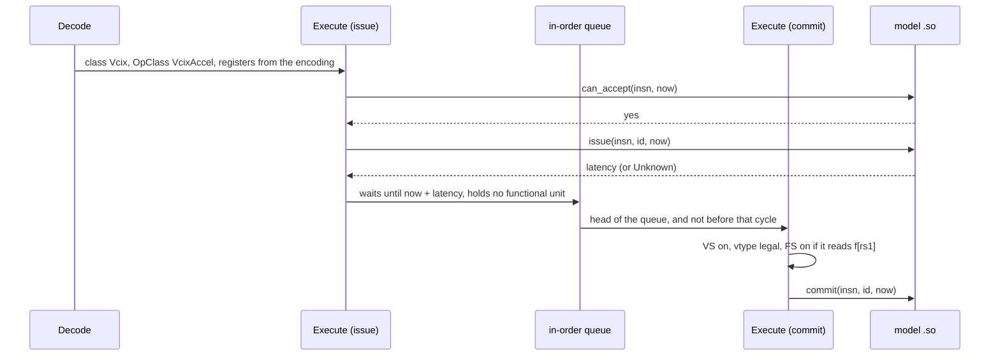
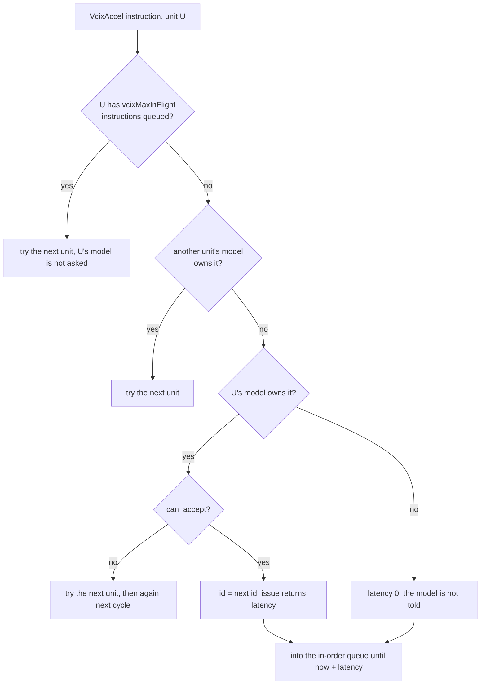

# gem5 adapter

This page shows how gem5 loads a model `.so` and drives its timing face. The
code is not in this repository. It is on branch `vcix` of `PSAL-POSTECH/gem5`,
on top of upstream gem5 `stable` (25.1.0.1, `f5c5a6e390`). The pinned release
is `GEM5_RELEASE` in `setup/versions.env` (`vcix-v0.3.5`). File paths below
under `src/` are in that gem5 tree.

The branch carries no accelerator. It hands every custom-1 and custom-2
instruction to a loaded model. **Only MinorCPU is supported** (see
[Other CPU models](#other-cpu-models)).

What the model must do (call order, `Unknown` + `ready`, squash and replay,
overlap) is in the [root README](../../README.md). This page shows where gem5
does each step. The Spike side is in [../spike/README.md](../spike/README.md).

## The picture

gem5 runs one cycle of the MinorCPU's `Execute` stage like this
(`Execute::evaluate`, `src/cpu/minor/execute.cc:1735-1909`):

```
every cycle, in this order
  1. tick(now)        every unit's model that has tick           execute.cc:1735
  2. ready(id, now)   every instruction issued as Unknown        execute.cc:1736
  3. commit           the head of the in-order queue             execute.cc:1767-1787
  4. can_accept/issue the next instruction                       execute.cc:1807
  5. stay awake       if a model has tick or a result is pending execute.cc:1908
```

One instruction goes through these stages:



## A worked run: print_args

`examples/print_args/vcix.S` runs nine instructions. The `print_args` model
prints each call it gets (`examples/print_args/print_args.cc:86-102`). Its
latency and its one-at-a-time rule are read in
[A first run](../../README.md#a-first-run-print_args) of the root README. Here
is its gem5 output:

```
[config ] print_args_latency_cycles=7 vpu_num_lanes=4
[issue  ] insn=062541db funct6=01 vm=1 f24_20=2  f19_15=10 funct3=4 f11_7=3  | vl=8 sew=32 lmul=2^0 | cycle=10012 ready=10019
[commit ] insn=062541db funct6=01 vm=1 f24_20=2  f19_15=10 funct3=4 f11_7=3  | vl=8 sew=32 lmul=2^0 | cycle=10094
[issue  ] insn=0e22b1db funct6=03 vm=1 f24_20=2  f19_15=5  funct3=3 f11_7=3  | vl=8 sew=32 lmul=2^0 | cycle=10097 ready=10104
[commit ] insn=0e22b1db funct6=03 vm=1 f24_20=2  f19_15=5  funct3=3 f11_7=3  | vl=8 sew=32 lmul=2^0 | cycle=10104
...
[issue  ] insn=2c23025b funct6=0b vm=0 f24_20=2  f19_15=6  funct3=0 f11_7=4  | vl=8 sew=32 lmul=2^1 | cycle=10199 ready=10213
[commit ] insn=2c23025b funct6=0b vm=0 f24_20=2  f19_15=6  funct3=0 f11_7=4  | vl=8 sew=32 lmul=2^1 | cycle=10213
[issue  ] insn=00b5002b funct7=00 rs2=11 rs1=10 funct3=0 rd=0  | vl=8 sew=32 lmul=2^1 | cycle=10216 ready=10223
[commit ] insn=00b5002b funct7=00 rs2=11 rs1=10 funct3=0 rd=0  | vl=8 sew=32 lmul=2^1 | cycle=10223
exit: exiting with last active thread context at cycle 12135
```

`062541db` (`sf.vc.x`) is issued at 10012 and is ready at 10019, but commits
at 10094. Commit is in order, and the `flw` before it commits at 10094 too.
gem5's `Exec` trace of the same run shows both:

```
10094000: system.cpu: T0 : 0x101c4 @main+40    : flw fa0, 0(t1)             : FloatMemRead :  D=0xffffffff40200000 A=0x12060
10094000: system.cpu: T0 : 0x101c8 @main+44    : vcix 0x062541db <- a0      : VcixAccel :
```

`tests/print_args/run.sh` asserts the latencies 7, 14 and 7, nine commits and
one `exit:` line.

<details><summary>Reproduce</summary>

From the repository root, after `scripts/build.sh`. `scripts/sim.sh` defines
`rv_program`, `gem5_run` and `$GEM5`.

```
source scripts/sim.sh
rv_program examples/print_args/vcix.S build/vcix
gem5_run build/m5out build/libprint_args.so examples/print_args/machine.yml build/vcix
$GEM5 --debug-flags=Exec -d build/m5out-exec examples/gem5_se.py \
  --model build/libprint_args.so --config examples/print_args/machine.yml build/vcix
```

</details>

## 1. Decode and operands

The whole custom-2 opcode decodes to one class, `Vcix`
(`src/arch/riscv/insts/vcix.hh`, decoded at `src/arch/riscv/isa/decoder.isa:6076`).
It computes no values. Its job is to tell gem5 which registers the
instruction reads and writes, so the scoreboard tracks dependences through it.
It reads them from the VCIX fields (`vcix.hh:69-97`):

```
 31     28 27 26 25  24   20 19   15 14  12 11    7 6       0
+---------+-----+--+-------+-------+------+-------+---------+
|  shape  |     |vm|  vs2  |  rs1  |funct3|  vd   | 1011011 |   custom-2 = 0x5B
+---------+-----+--+-------+-------+------+-------+---------+
 funct6[5:2]      vm=0: vd is written
```

- **shape** (`funct6[5:2]`): `0x0` no `vs2`; `0x2` reads `vs2`; `0xa` reads
  `vd` and `vs2`; `0xf` reads `vd` and `vs2`, with a wide `vd`.
- **funct3** says what the `rs1` field is: `0` a vector register, `3` an
  immediate, `4` an x register, `5` an f register.
- A vector operand is a group of LMUL registers. A fractional LMUL counts as
  one. The wide shape doubles the `vd` group when LMUL is 1, 2 or 4
  (`vcix.hh:77-80`).

The `Exec` trace of the print_args run prints each instruction with the
registers gem5 found (`-> written <- read`):

```
vcix 0x062541db <- a0                        sf.vc.x     0x1, 0x2, 0x3, a0     shape 0x0, funct3 4
vcix 0x0e22b1db                              sf.vc.i     0x3, 0x2, 0x3, 5      shape 0x0, funct3 3
vcix 0x2620825b <- v2,v1                     sf.vc.vv    0x1, 0x4, v2, v1      shape 0x2, funct3 0
vcix 0x2c2081db -> v3 <- v2,v1               sf.vc.v.vv  0x3, v3, v2, v1       vm=0
vcix 0x2825c1db -> v3 <- v2,a1               sf.vc.v.xv  0x2, v3, v2, a1
vcix 0x2c2552db -> v5 <- v2,fa0              sf.vc.v.fv  0x1, v5, v2, fa0
vcix 0xac23b25b -> v4 <- v4,v2               sf.vc.v.ivv 0x3, v4, v2, 7        shape 0xa
vcix 0x2c23025b -> v4,v5 <- v2,v3,v6,v7      sf.vc.v.vv  0x3, v4, v2, v6       under LMUL=2
custom1 0x00b5002b <- a0,a1                  .insn r 0x2b, 0, 0, x0, a0, a1
```

(Left column: the trace. Right: the source line in `examples/print_args/vcix.S`.)

**custom-1** decodes to a second class, `AccelCustom1`
(`decoder.isa:2067`, `vcix.hh:128-166`). That opcode has no operand rule of its
own, so gem5 takes it as R-type on x registers: it reads `x[rs1]` and `x[rs2]`
and writes nothing. Both classes have the OpClass `VcixAccel`.

The model receives the instruction bits with `vl`, SEW and LMUL of the vector
configuration the instruction was decoded under (`vcixInsn`,
`execute.cc:576-586`).

## 2. Loading the model

A config adds a `MinorVcixAccelFU` to the MinorCPU's functional unit pool
(`src/cpu/minor/BaseMinorCPU.py:308-312`). Nothing else about the machine
changes. Its parameters (`BaseMinorCPU.py:138-161`):

- `vcixModel`: the model `.so`.
- `vcixConfigKeys`, `vcixConfigValues`: the machine description, as two lists.
- `vcixMaxInFlight` (8192): see [Issue](#3-issue).
- `vcixReadyWarnCycles` (1000000, 0 for never): see
  [Result not known at issue](#6-result-not-known-at-issue).

gem5 itself parses no file. The config script reads the YAML. This is the test
fixture's pool (`examples/gem5_se.py:29-38`):

```python
class ExampleFUPool(MinorFUPool):
    funcUnits = MinorDefaultFUPool.funcUnits + [
        MinorVcixAccelFU(
            vcixModel=args.model,
            vcixConfigKeys=list(settings.keys()),
            vcixConfigValues=list(settings.values()),
            **bound,
        )
        for _ in range(args.units)
    ]
```

`settings` comes from `examples/machine_description.py`. It keeps the top-level
scalars of the first YAML document. The rules for which values reach the model
are in the [root README](../../README.md).

**One instance per unit.** Each unit makes its own instance of its model when
the CPU is built (`execute.cc:146-160`) and destroys it with the CPU. Two units
naming one library share no state. With `--units 2`, the `reports` model prints
its configuration twice, and each unit sees one of the two commits:

```
[config] plain is absent            <- unit 1 is configured
...
[config] plain is absent            <- unit 2 is configured
...
[model] commit 062541db, 0 in flight, 1 commits seen
[model] commit 062541db, 0 in flight, 1 commits seen
```

`tests/contract/run.sh` ("gem5 with two units naming one library") asserts
both counts.

**What is refused, and how it reads.** gem5 loads each library path once
(`VcixAccelModel::load`, `src/cpu/minor/vcix_accel_model.cc:202-231`) and stops
with `fatal` when:

- a unit takes `VcixAccel` instructions but names no `vcixModel`
  (`execute.cc:147`);
- the library hands over no table, or a table of another ABI version;
- the table leaves `create`, `destroy`, `can_accept`, `issue`, `squash` or
  `commit` NULL (`tick`, `ready`, `reset` and `num_stats` may be NULL);
- the table has `num_stats` but leaves `stat` or `read_stats` NULL;
- the model refuses the machine description. The message names the model and
  its reason.

Two of them, from runs of `tests/contract/unowned.S` (a refused description
reads as in [the root README](../../README.md#the-machine-description)):

```
src/cpu/minor/vcix_accel_model.cc:220: fatal: fatal condition !model occurred: .../libnull_table.so: vcix_accel_model() returned no table
src/cpu/minor/vcix_accel_model.cc:221: fatal: fatal condition model->abi_version != VCIX_ACCEL_ABI_VERSION occurred: .../libother_abi.so has ABI 12, gem5 has 11
```

A description whose top level is not a mapping stops in the config script:

```
gem5_se.py: notmap.yml: the top level of a machine description is a mapping
```

For gem5, `tests/contract/run.sh` asserts the no-table, the malformed-number
and the not-a-mapping cases ("machine description", "model table and
instances"). The other-ABI line is from the run below.

**Symbols.** gem5 opens a model with `dlopen(RTLD_NOW | RTLD_LOCAL)`
(`vcix_accel_model.cc:212`), not `RTLD_DEEPBIND`. gem5 exports its own
symbols, so a model's *visible* definition of a name gem5 also defines loses to
gem5's. Build models hidden:
[Build with hidden visibility](../../README.md#build-with-hidden-visibility).

**The header.** gem5 keeps a copy of the interface header at
`src/cpu/minor/vcix_accel.h`. It must stay byte-identical to
`include/vcix_accel.h` here. At `vcix-v0.3.5` it is. No test compares the gem5
copy; the ABI version check at load is what catches a mismatch.

<details><summary>Reproduce</summary>

```
source scripts/sim.sh
rv_program tests/contract/unowned.S build/unowned
rv_program tests/contract/pair.S build/pair
printf 'latency: 10\ndepth: 1\n' > build/one.yml
gem5_run build/m5-units build/libreports.so build/one.yml build/pair --units 2
gem5_run build/m5-null build/libnull_table.so "" build/unowned
gem5_run build/m5-abi  build/libother_abi.so  "" build/unowned
printf -- '- plain: 8\n' > build/notmap.yml
gem5_run build/m5-notmap build/libreports.so build/notmap.yml build/unowned
```

</details>

## 3. Issue

`Execute::issue` asks the model in the same chain of conditions that keeps any
instruction from issuing (`execute.cc:795-861`). For a `VcixAccel`
instruction and one accelerator unit of the pool, the chain ends like this:



- The id rises with every issued instruction, across all units.
- An issued instruction holds no functional unit (`inst->fuIndex =
  noCostFUIndex`). It only waits in the in-order queue until
  `minimumCommitCycle = now + latency`, as gem5's own unit-less instructions
  do. So the model alone decides how many of its instructions overlap.
- An instruction no model owns goes through untold, with latency 0. It becomes
  an illegal instruction at commit ([Commit](#4-commit)).

**`vcixMaxInFlight`.** A unit with that many instructions in the in-order
queue gets no more, and its model is not asked. The queue is sized to hold that
many for each unit (`execute.cc:217`); a model that accepts without limit would
otherwise outgrow it. `tests/contract/forty.S` runs 40 owned instructions on
the `reports` model with latency 100. The model prints how many it has in
flight when it is asked to issue:

```
--max-in-flight 4                              default (8192)
  issue 062541db, 0 in flight    x 1             issue 062541db, 0 in flight
  issue 062541db, 1 in flight    x 1             ...
  issue 062541db, 2 in flight    x 10            issue 062541db, 37 in flight
  issue 062541db, 3 in flight    x 28            issue 062541db, 38 in flight
                                                 issue 062541db, 39 in flight
  commit 062541db, 0 in flight, 40 commits seen  commit 062541db, 0 in flight, 40 commits seen
```

With a bound of 4, the model is never asked with 4 in flight. `tests/contract/run.sh`
("in flight") asserts that, and that the default goes past 4.

<details><summary>Reproduce</summary>

```
source scripts/sim.sh
rv_program tests/contract/forty.S build/forty
printf 'latency: 100\n' > build/slow.yml
gem5_run build/m5-forty-4 build/libreports.so build/slow.yml build/forty --max-in-flight 4 | grep -o 'issue 062541db, [0-9]* in flight' | sort | uniq -c
gem5_run build/m5-forty   build/libreports.so build/slow.yml build/forty | grep -o 'issue 062541db, [0-9]* in flight' | sort | uniq -c
```

</details>

## 4. Commit

Commit is in order, and never before the cycle issue set
(`minimumCommitCycle`). At commit (`execute.cc:1235-1252`):

1. If the unit's model does not own the instruction, it becomes an illegal
   instruction, on the same path as any other fault.
2. Otherwise the instruction's own checks run, through the helpers gem5's own
   vector and floating-point instructions use (`vcix.hh:103-112`): VS must be
   on and `vtype` legal, and FS must be on for a form that reads `f[rs1]`. A
   form that writes `vd` leaves VS dirty.
3. Only if they raise no fault is the model's `commit` called.

In syscall-emulation mode an unowned instruction's fault ends the run with a
`panic`; [One instruction, bit by bit](../../README.md#one-instruction-bit-by-bit)
shows it for `0a2541db`.

The state checks, in `tests/contract/status.S`: a bare-metal program in M mode
on `tests/contract/gem5_bare.py` with the `print_args` model. It sets bits in
`s1` for each failed check and exits with `m5_exit` only if none failed.

```
[issue  ] insn=2c2081db ... | vl=0 sew=8 lmul=2^0 | cycle=211 ready=216      sf.vc.v.vv, VS on
[issue  ] insn=2c2081db ... | vl=8 sew=32 lmul=2^0 | cycle=291 ready=296
[issue  ] insn=2c2081db ... | vl=8 sew=32 lmul=2^0 | cycle=372 ready=377
[commit ] insn=2c2081db ... | vl=8 sew=32 lmul=2^0 | cycle=377            it wrote vd: VS is dirty after
[issue  ] insn=2c2552db ... | vl=8 sew=32 lmul=2^0 | cycle=538 ready=543      sf.vc.v.fv, FS off
[issue  ] insn=2c2552db ... | vl=8 sew=32 lmul=2^0 | cycle=619 ready=624      never committed: it traps
[issue  ] insn=2825c1db ... | vl=8 sew=32 lmul=2^0 | cycle=864 ready=869      sf.vc.v.xv, FS off
[commit ] insn=2825c1db ... | vl=8 sew=32 lmul=2^0 | cycle=869            reads x[rs1]: FS does not matter
exit: m5_exit instruction encountered, code 0
```

An issue line with no commit line after it is an instruction that was
squashed: every issued instruction gets one commit or is squashed
(`include/vcix_accel.h:97`). `tests/contract/run.sh`
("processor state") asserts the one commit of `2825c1db`, none of `2c2552db`,
and exit 0.

<details><summary>Reproduce</summary>

```
source scripts/sim.sh
rv_program tests/contract/status.S build/status -nostdlib -Wl,-N,-Ttext=0x80000000,--no-warn-rwx-segments
gem5_bare_run build/m5-status build/libprint_args.so build/status
```

</details>

## 5. Squash

Each unit keeps the list of instructions its model was told were issued and
has not been told were committed. gem5 tells the model `squash` with the
oldest id of that list, and empties the list (`vcixSquash`,
`execute.cc:657-666`). It does so in three places:

- where Execute moves to a new stream: a mispredicted branch, an interrupt, a
  fault (`execute.cc:333-340`). Every instruction still in flight is on the old
  stream and will be discarded;
- where an instruction of the list faults at commit (`execute.cc:1251`);
- where an instruction still on the list leaves the in-order queue uncommitted,
  as a net under the other two (`execute.cc:1661-1668`).

An instruction leaves the in-order queue at its head. So a squash always takes
the whole list. That holds for one thread only: a CPU of more than one thread
with an accelerator unit is refused (`execute.cc:150`).

What the model must do on a squash, and how `cp::Instance` replays the
ticks and commits since, is in the [root README](../../README.md).

## 6. Result not known at issue

When `issue` returns `VCIX_LATENCY_UNKNOWN`:

- gem5 marks the instruction's destination registers in the scoreboard as it
  marks a load's, so no reader is issued (`execute.cc:834-857`).
- After each cycle's ticks, gem5 asks `ready` for every such instruction still
  in flight (`vcixRelease`, `execute.cc:618-641`). At the first true it frees
  the registers (`Scoreboard::markInstDestsPredictable`).
- Until then the instruction is not committed, even at the head of the
  in-order queue (`execute.cc:1575-1578`).
- One squashed before it was ready has its registers freed when it leaves the
  queue (`execute.cc:1679`).
- A table without `ready` whose `issue` returns that value is fatal.
- While one waits, Execute stays awake, whether or not its model has `tick`.

One that has waited `vcixReadyWarnCycles` cycles is warned about, once
(`execute.cc:636`). The warning, and the cycle-by-cycle cases (a reader issued
in the cycle `ready` turns true, a waiting pop squashed), are in
[A result whose time is not known at issue](../../README.md#a-result-whose-time-is-not-known-at-issue).

## 7. Tick

`Execute::evaluate` begins by calling `tick` with the current cycle on every
unit's model whose table has one (`execute.cc:1735`). That is before the
cycle's commit and issue. It ends by keeping the pipeline awake
(`execute.cc:1908-1909`). So no cycle the CPU runs passes without a tick, even
when the core has nothing else to do. A drain does not wait for a model: it
waits only for the LSQ, Execute's input buffer and the in-order queue (`Execute::isDrained`,
`execute.cc:2160-2174`). A program that exits ends the simulation.

## 8. Statistics

A table with `num_stats` gives its unit gem5 statistics. gem5 reads them with
`read_stats` at each dump. For each unit of the model, at its primary port,
the stats are `admitted`, `capacity`, `cycles`, `occupancy` and
`utilized_cycles` (`admitted / capacity`). Each encoding gets
`vcix.committed.<encoding>`. The group hangs under the functional unit, so the
full name starts with the FU's path.

`tests/stats/markers.S` on the `tpu` model (4x4 array, `tests/tpu/systolic.yml`)
cuts the run into five windows with m5ops. Dump 1, the systolic array's lines:

```
system.cpu.numCycles                                                           123
system.cpu.executeFuncUnits.funcUnits8.vcix.SYSTOLIC.admitted                   12   # rows admitted at port input
system.cpu.executeFuncUnits.funcUnits8.vcix.SYSTOLIC.capacity                    1   # rows the unit can admit per cycle
system.cpu.executeFuncUnits.funcUnits8.vcix.SYSTOLIC.cycles                    123   # cycles the model was ticked, replays after a squash included
system.cpu.executeFuncUnits.funcUnits8.vcix.SYSTOLIC.occupancy                  84   # rows held behind the port, summed over cycles
system.cpu.executeFuncUnits.funcUnits8.vcix.SYSTOLIC.utilized_cycles            12   # admitted / capacity, the cycles admitting at full capacity takes
system.cpu.executeFuncUnits.funcUnits8.vcix.committed.systolic_input_push        3
system.cpu.executeFuncUnits.funcUnits8.vcix.committed.systolic_weight_push       0
system.cpu.executeFuncUnits.funcUnits8.vcix.committed.systolic_pop               3
```

(Columns aligned here. The comments are gem5's descriptions, without their
unit suffix; the last three lines' descriptions are left out.)

**Reset.** The model's counters only grow. At a reset gem5 stores them as a
base, and a dump shows `value - base`, except `capacity`, which is a constant
(`vcix_accel_model.cc:182-199`). Admitted rows, input pushes and pops in the
five windows:

```
dump 1   12  3  3    reset, three pushes of four rows, three pops, dump
dump 2    0  0  0    reset, then dump at once (capacity still 1)
dump 3    4  1  1
dump 4    8  2  2
dump 5    0  0  0    to the end of the run
```

`tests/stats/run.sh` ("m5op windows") asserts these counts, and that for each
of the five units `cycles` equals `system.cpu.numCycles` in every dump.

**FUs that are not models.** Any `MinorFU` takes a `unit` name
(`BaseMinorCPU.py:141-145`). The cycles in which any FU of the unit is occupied
print as `system.cpu.units.<unit>.{admitted,capacity,cycles,utilized_cycles}`,
in the same shape as a model's unit. An FU that names both a `unit` and a
`vcixModel` is fatal: a VCIX unit is counted by its model
(`execute.cc:2246-2248`). `tests/stats/run.sh` ("vector unit busy cycles")
checks `system.cpu.units.Vpu` on the tpu machine of `examples/tpu/gem5/`.

<details><summary>Reproduce</summary>

```
source scripts/sim.sh
rv_program tests/stats/markers.S build/markers
gem5_run build/m5-markers build/libtpu.so tests/tpu/systolic.yml build/markers --max-ticks 100000000
awk '/Begin Simulation Statistics/ { s++ } s == 1' build/m5-markers/stats.txt | grep -E 'SYSTOLIC|committed\.systolic|numCycles '
```

</details>

## Other CPU models

No CPU model but MinorCPU asks the model, and none of them fails cleanly. The
same `tests/contract/unowned.S` (one owned instruction, then one no model
owns), on gem5's own CPU models with no accelerator unit:

- **O3** does not finish. Commit stops, and `iew.iqFullEvents` grows every
  cycle:

  ```
  --max-ticks 20000000    simInsts 464   numCycles 20001    iew.iqFullEvents 17833
  --max-ticks 200000000   simInsts 464   numCycles 200001   iew.iqFullEvents 197833
  ```

- **The simple CPUs** (atomic, timing) run the instruction as one that does
  only its state checks (`vcix.hh:103-112`; custom-1 returns `NoFault`,
  `vcix.hh:153-157`). No model is asked, no latency is charged, and the
  instruction no model owns passes instead of trapping. Both run the program
  to its end:

  ```
  atomic: exit: exiting with last active thread context at cycle 611     simInsts 572
  timing: exit: exiting with last active thread context at cycle 34490   simInsts 572
  ```

`src/cpu/minor/execute.cc` includes RISC-V headers for the fault, so the branch
is not ISA-neutral.

<details><summary>Reproduce</summary>

`other_cpus.py`: the machine of `examples/gem5_se.py` with another CPU model.

```python
import argparse
import m5
from m5.objects import *

parser = argparse.ArgumentParser()
parser.add_argument("binary")
parser.add_argument("--cpu", required=True, choices=["o3", "atomic", "timing"])
parser.add_argument("--max-ticks", type=int)
args = parser.parse_args()

system = System()
system.clk_domain = SrcClockDomain(clock="1GHz", voltage_domain=VoltageDomain())
system.mem_mode = "atomic" if args.cpu == "atomic" else "timing"
system.mem_ranges = [AddrRange("512MB")]
system.cpu = {"o3": RiscvO3CPU, "atomic": RiscvAtomicSimpleCPU, "timing": RiscvTimingSimpleCPU}[args.cpu]()
system.cpu.ArchISA.vlen = 256
system.membus = SystemXBar()
system.cpu.icache_port = system.membus.cpu_side_ports
system.cpu.dcache_port = system.membus.cpu_side_ports
system.cpu.createInterruptController()
system.mem_ctrl = SimpleMemory(range=system.mem_ranges[0], port=system.membus.mem_side_ports)
system.system_port = system.membus.cpu_side_ports
system.workload = SEWorkload.init_compatible(args.binary)
system.cpu.workload = Process(cmd=[args.binary])
system.cpu.createThreads()
root = Root(full_system=False, system=system)
m5.instantiate()
event = m5.simulate(*([args.max_ticks] if args.max_ticks is not None else []))
print(f"exit: {event.getCause()} at cycle {m5.curTick() // 1000}")
```

```
source scripts/sim.sh
for cpu in atomic timing; do $GEM5 -d build/m5-$cpu other_cpus.py --cpu $cpu --max-ticks 400000000 build/unowned; done
$GEM5 -d build/m5-o3 other_cpus.py --cpu o3 --max-ticks 20000000 build/unowned
grep -E '^(simInsts|system.cpu.numCycles|system.cpu.iew.iqFullEvents) ' build/m5-o3/stats.txt
```

</details>

## What else the branch carries

These are on the same branch but are not about the accelerator interface:

- `SpmXBar`, a zero-latency bus for scratchpad memory.
- `MultiPortScratchpad`: a memory with `load_ports`, `store_ports` and
  `access_ports` per cycle and a fixed latency (`src/mem/MultiPortScratchpad.py`).
- MinorCPU: the memory issue limit holds back only memory references.
- MinorCPU: the `unit` statistics of an FU ([Statistics](#8-statistics)).
- m5ops: `resetstats`, `dumpstats` and `dumpresetstats` act at once and take
  no delay or period, and they leave `a1` alone. `tests/stats/run.sh` asserts
  a dump at the marker although `a0` and `a1` ask for 2000 ns and 1000 ns.
  `resetstats` takes a tile id in `a0` and a call index in `a1`; the next dump
  shows them as `system.sample.tileId` and `system.sample.call` (-1 when no
  `resetstats` opened the dump).
- RISC-V: BF16 scalar and vector instructions; OFP8 element types,
  `vtype.altfmt`, and the Zvfofp8min converts.
