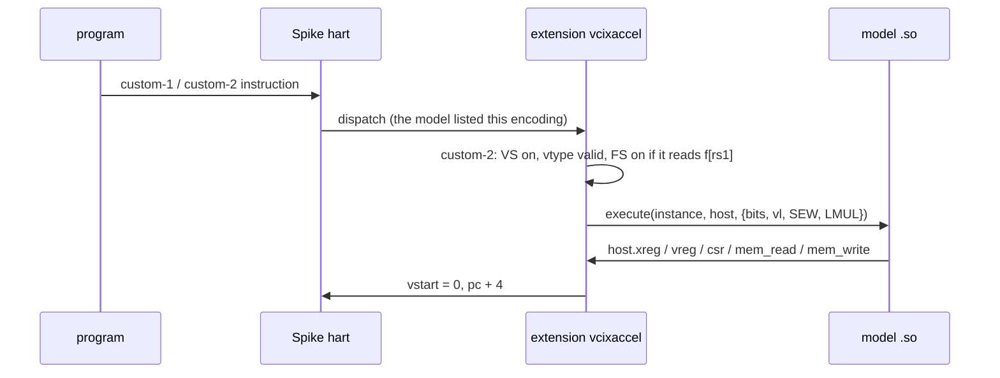

# Spike adapter

This page shows how Spike loads a model `.so` and drives its functional face.
The code is not in this repository. It is on branch `vcix` of
`PSAL-POSTECH/riscv-isa-sim`, on top of the fork whose vector unit has lanes
(`9f555b4`). `SPIKE_SHA` in `setup/versions.env` pins the commit (`751354f`).
File paths below under `riscv/` and `spike_main/` are in that Spike tree.

The branch carries no accelerator. The fork's built-in units (the DMA, the
systolic array, the special functions, `vlane_idx`, the cross-lane unit) are
not in it; what they did is a model's business. Its ISA string takes three
vector float extensions: `zvfp8` (the fork's 8-bit floats; it turns on
`zvfofp8min` too), `zvfofp8min` and `zvfbfmin` (`riscv/processor.cc:266-279`).

What the model must do is in the [root README](../../README.md). The gem5
side is in [../gem5/README.md](../gem5/README.md).

```
spike --extlib=<model.so> --isa=rv64gcv_zfh_xvcixaccel --machine-config=<machine.yml> \
      [--base-path=<dir>] [--kernel-addr=<start>:<end>] pk <program>
```

## The picture

Spike runs one instruction at a time. For an instruction the model owns, it
calls `execute` once, and the instruction is done when `execute` returns:



`dispatch` is `riscv/vcix_accel_extension.cc:201-227`.

## A worked run: print_args

`examples/print_args/vcix.S` runs nine instructions. The `print_args` model
prints what `execute` is given: the fields, `vl`, SEW, LMUL, the lane count,
and the registers the encoding names (lane 0 of a vector register, two
elements).

```
[config ] print_args_latency_cycles=7 vpu_num_lanes=4
[execute] insn=062541db funct6=01 vm=1 f24_20=2  f19_15=10 funct3=4 f11_7=3  | vl=8 sew=32 lmul=2^0 lanes=4 x[10]=0x1234
[execute] insn=0e22b1db funct6=03 vm=1 f24_20=2  f19_15=5  funct3=3 f11_7=3  | vl=8 sew=32 lmul=2^0 lanes=4
[execute] insn=2620825b funct6=09 vm=1 f24_20=2  f19_15=1  funct3=0 f11_7=4  | vl=8 sew=32 lmul=2^0 lanes=4 v2[0..1]=0x3f800000,0x40000000 v1[0..1]=0x41200000,0x41300000
[execute] insn=2c2081db funct6=0b vm=0 f24_20=2  f19_15=1  funct3=0 f11_7=3  | vl=8 sew=32 lmul=2^0 lanes=4 v2[0..1]=0x3f800000,0x40000000 v1[0..1]=0x41200000,0x41300000
[execute] insn=2825c1db funct6=0a vm=0 f24_20=2  f19_15=11 funct3=4 f11_7=3  | vl=8 sew=32 lmul=2^0 lanes=4 x[11]=0x2a v2[0..1]=0x3f800000,0x40000000
[execute] insn=2c2552db funct6=0b vm=0 f24_20=2  f19_15=10 funct3=5 f11_7=5  | vl=8 sew=32 lmul=2^0 lanes=4 f[10]=0xffffffff40200000 v2[0..1]=0x3f800000,0x40000000
[execute] insn=ac23b25b funct6=2b vm=0 f24_20=2  f19_15=7  funct3=3 f11_7=4  | vl=8 sew=32 lmul=2^0 lanes=4 v4[0..1]=0x00000000,0x00000000 v2[0..1]=0x3f800000,0x40000000
[execute] insn=2c23025b funct6=0b vm=0 f24_20=2  f19_15=6  funct3=0 f11_7=4  | vl=8 sew=32 lmul=2^1 lanes=4 v2[0..1]=0x3f800000,0x40000000 v6[0..1]=0x00000000,0x00000000
[execute] insn=00b5002b funct7=00 rs2=11 rs1=10 funct3=0 rd=0  | vl=8 sew=32 lmul=2^1 lanes=4 x[10]=0x1234 x[11]=0x2a
```

Read one line against the program. `2620825b` is `sf.vc.vv 0x1, 0x4, v2, v1`.
Before it, the program loaded `vec_b` (1, 2, 3, ...) into `v2` and `vec_a`
(10, 11, 12, ...) into `v1`. The model reads them through the host as
`0x3f800000, 0x40000000` (1.0, 2.0) and `0x41200000, 0x41300000` (10.0, 11.0).
`2c2552db` reads `f[10]`, which holds 2.5 as `0x40200000`, NaN-boxed in 64
bits.

There is no cycle anywhere: the Spike adapter calls only `execute`. The same
`.so` on gem5 gives cycles and no values. `tests/print_args/run.sh` asserts the
config line, nine `[execute]` lines, and the `v2`/`v1` values of `2620825b`.

<details><summary>Reproduce</summary>

From the repository root, after `scripts/build.sh`. `scripts/sim.sh` defines
`rv_program`, `spike_run`, `$SPIKE` and `$PK`.

```
source scripts/sim.sh
rv_program examples/print_args/vcix.S build/vcix
spike_run build/libprint_args.so examples/print_args/machine.yml build/vcix
```

</details>

## 1. Loading the model

`--extlib` opens the library with `dlopen(RTLD_NOW | RTLD_GLOBAL)`
(`spike_main/spike.cc:451`). The extension `vcixaccel` is built into Spike and
named in the ISA string. It finds `vcix_accel_model` with
`dlsym(RTLD_DEFAULT, ...)` (`riscv/vcix_accel_extension.cc:45-77`). The run
ends, with the library's path and the reason, when:

- no model is loaded;
- the library hands over no table, or a table of another ABI version;
- the table has no name, or leaves `create`, `destroy` or `execute` NULL;
- an encoding has no name, or is not within custom-1 (`0x2B`) or custom-2
  (`0x5B`).

The timing members of the table are not looked at. Four of these, run on
`tests/contract/unowned.S`:

```
$ spike --isa=rv64gcv_zfh_xvcixaccel ... pk unowned                       (no --extlib)
vcixaccel: no accelerator model is loaded; give its library with --extlib=<model.so>
$ spike --extlib=build/libnull_table.so ...
vcixaccel: .../libnull_table.so: vcix_accel_model() returned no table
$ spike --extlib=build/libother_abi.so ...
vcixaccel: .../libother_abi.so has ABI 12, Spike has 11
$ spike --extlib=build/libcannot_be_made.so ...
vcix_cp: the model cannot be made: no such unit can be built
vcixaccel: .../libcannot_be_made.so: vcix_accel_model() returned no table
```

Each exits with 1. In the last one, the model's own C++ wrapper prints why
before it hands over no table. `tests/contract/run.sh` ("model table and
instances") asserts the last three.

**Symbols.** Spike exports its own symbols, so a model's *visible*
definition of a name Spike also defines loses to Spike's. Build models hidden:
[Build with hidden visibility](../../README.md#build-with-hidden-visibility)
shows `reports`' own `f16_to_f32` losing to Spike's.

<details><summary>Reproduce</summary>

```
source scripts/sim.sh
rv_program tests/contract/unowned.S build/unowned
$SPIKE --isa=rv64gcv_zfh_xvcixaccel --varch=vlen:256,elen:64 $PK build/unowned
for m in null_table other_abi cannot_be_made; do spike_run build/lib$m.so "" build/unowned; echo "exit $?"; done
```

</details>

## 2. Ownership

The encodings the model lists are registered as the extension's instructions
(`get_instructions`, `vcix_accel_extension.cc:155-163`). Spike refuses an
extension whose encoding overlaps an instruction it implements itself,
whichever is registered first (`refuse_overlap`, `riscv/processor.cc:1112-1122`).
So a model cannot shadow a base instruction, or be shadowed by one. An
instruction of the two opcodes that the model does not list is an illegal
instruction.

[One instruction, bit by bit](../../README.md#one-instruction-bit-by-bit) in
the root README shows `tests/contract/unowned.S` on both simulators: the owned
`062541db` reaches the model once, and the unlisted `0a2541db` is an illegal
instruction.

## 3. Instances and reset

There is one extension per hart, and one model instance per extension
(`vcix_accel_extension.cc:139-199`). The instance is made from the machine
description the first time the hart needs it. A hart reset resets every
custom extension (`riscv/processor.cc:696-697`); the extension's `reset` makes
the instance if there is none yet, then calls the model's `reset` if the table
has one (`vcix_accel_extension.cc:148-153`).

A description the model refuses ends the run, with exit 1, the model's name
and its reason. [The machine description](../../README.md#the-machine-description)
in the root README shows one, `vcixaccel: reports: machine description: ...`.

## 4. Execute

For custom-2, the vector unit must be on and `vtype` valid, and a form that
reads `f[rs1]` (funct3 5) needs the floating-point unit on. Otherwise the
instruction is illegal and the model is not called
(`vcix_accel_extension.cc:209-213`). Then the model gets the bits, `vl`, SEW
and LMUL, and a host (`vcix_accel_extension.cc:95-135`). The host:

- reads and writes x registers, and reads f registers;
- reads a CSR as the hart holds it, with no check of the privilege mode;
- reads and writes memory through the MMU, the scratchpad included;
- reaches a vector register **of one lane**.

This Spike's vector unit has lanes. Each lane has its own copy of all 32
vector registers. `host.vreg(lane, reg)` is the `VLEN/8` bytes of `reg` in that
lane. With `vpu_num_lanes: 4` and `vpu_vector_length_bits: 256`:

```
             v0        v1        v2      ...   v31
lane 0   [32 bytes][32 bytes][32 bytes]  ... [32 bytes]   <- host.vreg(0, 2) = v2 of lane 0
lane 1   [32 bytes][32 bytes][32 bytes]  ... [32 bytes]
lane 2   [32 bytes][32 bytes][32 bytes]  ... [32 bytes]
lane 3   [32 bytes][32 bytes][32 bytes]  ... [32 bytes]   <- host.vreg(3, 2) = v2 of lane 3
host.lanes() = 4, host.vlen_bits() = 256
```

Outside a kernel range (see [the scratchpad](#6-the-scratchpad-and---kernel-addr))
a vector instruction of the program works on lane 0 only.

Rules the adapter keeps:

- Asking for a vector register to write marks the vector state dirty.
- A lane, a register or a CSR that does not exist ends the run.
- After `execute`, `vstart` is 0: a model never handles it.

Two contract tests show the processor state a model sees and leaves:

- `tests/contract/frm.S` sets `frm` to 2; the `reports` model reads it with
  `host.csr(0x002)` and prints `[host] frm 2`.
- `tests/contract/vstart.S` sets `vstart` to 3 before an owned instruction and
  returns `vstart` read right after it as its exit code. The run exits 0.

`tests/contract/run.sh` ("processor state") asserts both.

## 5. The machine description

Spike reads `--machine-config` itself, with yaml-cpp (`spike_main/spike.cc:129-148`).
It takes its own machine from these keys:

- `vpu_num_lanes` (required);
- `vpu_spad_size_kb_per_lane` (required);
- `vpu_vector_length_bits` (required): a power of two from 64 to 4096. ELEN is 64;
- `vpu_spad_base_vaddr` (optional, default `0xD0000000`).

Every top-level scalar of the first YAML document is what the model's
`config.get` answers from. Which values reach the model, and how, is in the
[root README](../../README.md).

The options that set the same things (`--varch`, `--vectorlane-size`,
`--scratchpad-size`, `--scratchpad-base-vaddr`) are refused beside it. Each
refusal exits with 1:

```
--machine-config=.../print_args/machine.yml: it sets what --varch sets; give one of the two
--machine-config=nospad.yml: no value for vpu_spad_size_kb_per_lane
--machine-config=vlen100.yml: vpu_vector_length_bits is not a power of two from 64 to 4096
--machine-config=notmap.yml: the top level of a machine description is a mapping
--machine-config=rbp.yml: run_base_path is the key --base-path is handed on under; the file may not have it
```

**`--base-path`** is handed to the model as the key `run_base_path`, with or
without `--machine-config` (`spike.cc:533-534`). That is why a description may
not contain that key. The tpu model reads no key of it.

**Without `--machine-config`** the model gets no keys, except `run_base_path`
when `--base-path` is given.
Spike takes its machine from its options, with these defaults: 4 lanes,
128 KB of scratchpad per lane at `0xD0000000` (`spike.cc:347-349`). `spike_run`
in `scripts/sim.sh` passes `--varch=vlen:256,elen:64` then.

<details><summary>Reproduce</summary>

```
source scripts/sim.sh
M='vpu_num_lanes: 4\nvpu_spad_size_kb_per_lane: 128\n'
$SPIKE --extlib=build/libreports.so --isa=rv64gcv_zfh_xvcixaccel \
  --machine-config=examples/print_args/machine.yml --varch=vlen:256,elen:64 $PK build/unowned
printf 'vpu_num_lanes: 4\nvpu_vector_length_bits: 256\n' > build/nospad.yml
printf "${M}vpu_vector_length_bits: 100\n" > build/vlen100.yml
printf -- '- plain: 8\n' > build/notmap.yml
printf "${M}vpu_vector_length_bits: 256\nrun_base_path: /x\n" > build/rbp.yml
for f in nospad vlen100 notmap rbp; do spike_run build/libreports.so build/$f.yml build/unowned; echo "exit $?"; done
```

</details>

## 6. The scratchpad and `--kernel-addr`

The scratchpad is one buffer of `lanes x size per lane` bytes. The MMU serves
it at its virtual address without translation (`riscv/mmu.h:406-412`). It has
no physical address. With 4 lanes of 128 KB (`examples/print_args/machine.yml`):

```
0xD0000000 +---------------------+
           |  lane 0  (128 KB)   |
0xD0020000 +---------------------+
           |  lane 1             |
0xD0040000 +---------------------+
           |  lane 2             |
0xD0060000 +---------------------+
           |  lane 3             |
0xD0080000 +---------------------+  end: 512 KB in all
```

`--kernel-addr=<start>:<end>` (two hex numbers) marks a range of code. While
`pc` is in it, every vector arithmetic, load and store instruction runs once
per lane (`riscv/execute.cc:175`; the `n_vu` loops of `riscv/decode.h`). A vector load or store there
goes to `address + lane x size per lane`, so each lane works on its own slice
of the scratchpad. Outside the range, only lane 0 runs.

A small demo. The host side writes `100 x lane + i` into the first 8 words of
each lane's slice. Then it calls a kernel, linked at `0x2000000`, that loads 8
words from `0xD0000000`, doubles them, and stores them 64 bytes further on:

```
without --kernel-addr                      with --kernel-addr=2000000:2100000
lane 0: 0 2 4 6 8 10 12 14                 lane 0: 0 2 4 6 8 10 12 14
lane 1: 0 0 0 0 0 0 0 0                    lane 1: 200 202 204 206 208 210 212 214
lane 2: 0 0 0 0 0 0 0 0                    lane 2: 400 402 404 406 408 410 412 414
lane 3: 0 0 0 0 0 0 0 0                    lane 3: 600 602 604 606 608 610 612 614
```

The same `vle32.v` / `vadd.vv` / `vse32.v` ran in four lanes, each on its own
slice. A model called from inside such a kernel reads each lane's registers
with `host.vreg(lane, reg)`. `tests/tpu/functional/run.sh` runs the tpu
programs this way.

<details><summary>Reproduce</summary>

`lanes.c`:

```c
#include <stdint.h>
#include <stdio.h>

#define SPAD 0xD0000000UL
#define LANE_WORDS (128 * 1024 / 4) // vpu_spad_size_kb_per_lane: 128

void kernel(void);

int main(void) {
  volatile uint32_t *spad = (volatile uint32_t *)SPAD;
  for (int lane = 0; lane < 4; lane++)
    for (int i = 0; i < 8; i++) spad[lane * LANE_WORDS + i] = 100 * lane + i;
  kernel();
  for (int lane = 0; lane < 4; lane++) {
    printf("lane %d:", lane);
    for (int i = 16; i < 24; i++) printf(" %u", (unsigned)spad[lane * LANE_WORDS + i]);
    printf("\n");
  }
  return 0;
}
```

`kernel.S`:

```
    .section .kernel, "ax"
    .globl kernel
kernel:
    li      t0, 8
    vsetvli t0, t0, e32, m1, ta, ma
    li      t1, 0xD0000000
    vle32.v v1, (t1)
    vadd.vv v1, v1, v1
    addi    t1, t1, 64
    vse32.v v1, (t1)
    ret
```

```
source scripts/sim.sh
clang --target=riscv64 -march=rv64gcv_xsfvcp -c kernel.S -o build/kernel.o
riscv64-unknown-elf-gcc -O1 -static -march=rv64gc -mabi=lp64d -Wl,--section-start=.kernel=0x2000000 \
  lanes.c build/kernel.o -o build/lanes
spike_run build/libprint_args.so examples/print_args/machine.yml build/lanes
spike_run build/libprint_args.so examples/print_args/machine.yml build/lanes --kernel-addr=2000000:2100000
```

</details>

## 7. Timing on Spike

The Spike adapter never calls the timing face. A model built on the cp engine
(`include/vcix_cp.hpp`) still has a clock: its `execute` ticks its components
until the instruction completes. That is the model's code, not the adapter's;
the [root README](../../README.md#spike-runs-one-instruction-at-a-time) shows
it, and what happens when an instruction can never finish.

## The header and the branch's own tests

Spike's `riscv/vcix_accel.h` is a copy of `include/vcix_accel.h`.
`tests/contract/run.sh` ("one header") compares the two on every run, and the
ABI version in the table is checked at load. The branch's own checks are in
its `ci-tests/vcix/run.sh`: `--machine-config`, the scratchpad, the overlap
refusal and the extension `vcixaccel`.
