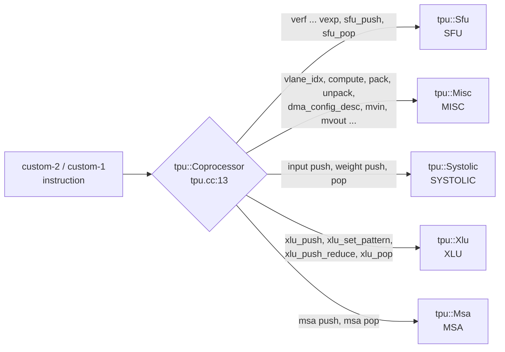

# tpu

`libtpu.so` (model name `tpu`) is a TPU's vector-side units on the two custom
opcodes. It is five `cp::Component`s in one `tpu::Coprocessor`. Each unit
writes one `cycle(now)` over its blocks (ports, queues, pipelines) and says,
per instruction, what it computes. gem5 runs that `cycle` for the timing;
Spike runs the same `cycle` for the values. How the cp engine works
(`cp::Port`, `cp::Queue`, `cp::Pipeline`, a component's `insns()`,
`complete`, `fault`) is in the [root README](../../README.md). This page is
about the tpu units.



- [tpu.cc:18-22](tpu.cc#L18-L22) lists the units and the names their
  statistics use: `SFU`, `MISC`, `SYSTOLIC`, `XLU`, `MSA`. An instruction goes
  to the first unit whose encoding matches it
  ([vcix_cp.hpp:372-378](../../include/vcix_cp.hpp#L372-L378)). Nothing on
  custom-3 is owned.
- [machine.hpp](machine.hpp) is `tpu::Coprocessor`, a `cp::Coprocessor` plus
  one key, `tpu_trace` ([below](#reading-tpu_trace)), and `tpu::Component`, a
  `cp::Component` that adds its queues to the trace.
- [mxu.hpp](mxu.hpp) is in this directory, but `libtpu.so` does not hold it.
  It is the matrix unit of [tpuv6e](../tpuv6e/README.md) and
  [tpuv3](../tpuv3/README.md) (`tpuv6e.cc:30`, `tpuv3.cc:31`), which also use
  `Sfu`, `Misc` and `Xlu` from here.
- [values.hpp](values.hpp) holds the number formats every unit uses.
  [dma.hpp](dma.hpp) is the DMA that `tpu::Misc` carries out.

Contents: [Encodings](#encodings) · [Sfu](#sfu-special-functions-and-the-eup) ·
[Misc](#misc-one-cycle-instructions-and-the-dma) ·
[Systolic](#systolic-the-systolic-array) · [Msa](#msa-the-multi-precision-array) ·
[Xlu](#xlu-the-cross-lane-unit) · [When a run ends](#when-the-model-ends-a-run) ·
[Keys](#keys-read-from-the-machine-description) · [Statistics](#statistics-one-unit-per-block) ·
[tpu_trace](#reading-tpu_trace) · [Where the values come from](#where-the-values-come-from) ·
[The gem5 machine](#the-gem5-machine) · [Running the examples](#running-the-examples-on-this-page)

## Encodings

Each line is an instruction as a test program writes it, the word the
assembler made of it (`objdump` of the built program), and the unit that owns
it. In `sf.vc.*`, the first operand is the 2-bit opcode field (bits 27:26) and
the last immediate is the field at bits 19:15.

```
custom-2 (opcode 0x5B)
  sf.vc.v.iv 0x0, v14, v13, 0     0x20d0375b   verf                   Sfu
  sf.vc.v.iv 0x1, v13, v12, 0     0x24c036db   vtanh                  Sfu
  sf.vc.v.iv 0x2, v15, v14, 0     0x28e037db   vsin   (field 0)       Sfu
  sf.vc.v.iv 0x2, v16, v15, 1     0x28f0b85b   vcos   (field 1)       Sfu
  sf.vc.v.iv 0x2, v17, v16, 2     0x290138db   vlog   (field 2)       Sfu
  sf.vc.v.iv 0x2, v18, v17, 3     0x2911b95b   vatan  (field 3)       Sfu
  sf.vc.v.iv 0x3, v8, v1, 0       0x2c10345b   vexp                   Sfu
  sf.vc.vv   0x3, 0x0, v8, v8     0x2e84005b   sfu_push               Sfu
  sf.vc.v.x  0x3, 0x0, v24, zero  0x0c004c5b   sfu_pop                Sfu
  sf.vc.v.i  0x0, 0, v1, 0        0x000030db   vlane_idx              Misc
  sf.vc.i    0x1, 0, 0, 4         0x0602305b   compute                Misc
  sf.vc.v.vv 0x2, v16, v8, v9     0x2884885b   pack                   Misc
  sf.vc.v.iv 0x2, v16, v8, 8      0x2884385b   unpack_lo (field 8)    Misc
  sf.vc.v.iv 0x2, v17, v8, 9      0x2884b8db   unpack_hi (field 9)    Misc
  sf.vc.iv   0x1, 0x0, v1, 0      0x2610305b   systolic weight push   Systolic
  sf.vc.iv   0x0, 0x0, v1, 0      0x2210305b   systolic input push    Systolic
  sf.vc.v.i  0x2, 0x0, v2, 0      0x0800315b   systolic pop           Systolic
  sf.vc.iv   0x2, 0x0, v1, -16    0x2a18305b   msa push (weights)     Msa
  sf.vc.iv   0x2, 0x0, v1, 0      0x2a10305b   msa push (inputs)      Msa
  sf.vc.v.i  0x3, 0x0, v2, 0      0x0c00315b   msa pop                Msa
  sf.vc.iv   0x3, 0, v4, 4        0x2e42305b   xlu_push               Xlu
  sf.vc.ivv  0x3, v1, v1, 0       0xae1030db   xlu_set_pattern        Xlu
  sf.vc.ivv  0x2, v2, v4, 1       0xaa40b15b   xlu_push_reduce        Xlu
  sf.vc.v.i  0x1, 0, v5, 4        0x040232db   xlu_pop                Xlu
custom-1 (opcode 0x2B): .insn r 0x2b, 3, <funct7>, x0, a0, a1
  funct7 7                        0x0eb5302b   dma_config_desc        Misc
  funct7 8                        0x10b5302b   dma_index_key          Misc
  funct7 2                        0x04b5302b   mvin                   Misc
  funct7 1                        0x02b5302b   mvin2                  Misc
  funct7 14                       0x1cb5302b   mvin3                  Misc
  funct7 3                        0x06b5302b   mvout                  Misc
```

The match words and masks are each unit's `cp::Encoding` constants, registered
in its constructor: [sfu.hpp:35-43](sfu.hpp#L35-L43),
[misc.hpp:28-38](misc.hpp#L28-L38), [systolic.hpp:45-47](systolic.hpp#L45-L47),
[msa.hpp:27-28](msa.hpp#L27-L28), [xlu.hpp:73-76](xlu.hpp#L73-L76). Most masks
are `0xFE00707F`: funct6, vm, funct3 and the opcode. vsin, vcos, vlog, vatan,
unpack_lo and unpack_hi also match the field (`0xFE0FF07F`). sfu_push and
xlu_push differ only in funct3 (`0x2E00005B` and `0x2E00305B`).

<details><summary>Reproduce</summary>

The programs are `tests/tpu/{sfu,one_cycle,systolic_full,msa,xlu,xlu_fold}.S`,
[eup.S](#running-the-examples-on-this-page), and the `k_pack`/`k_unpack` kernels
of `tests/tpu/functional/kernels.S`, built as `scripts/sim.sh`'s `rv_program`
builds them. For example:

```
riscv64-unknown-elf-objdump -d build/tpu-msa | awk '/<main>:/,/ret/' | grep -E 'sf\.vc|\.insn'
```
</details>

## Sfu: special functions and the EUP

`tpu::Sfu` has one pipeline, the EUP: `eup`, a `cp::Pipeline` of
`tpu_sfu_latency_cycles` stages that takes one register a cycle
([sfu.hpp:169-172](sfu.hpp#L169-L172) lists its blocks). The seven special
functions and `sfu_push` share it: a special function sends its group's
registers through it and writes `vd = f(vs2)` when the last one leaves;
`sfu_push` queues registers for it and `sfu_pop` takes them back. A queued push
register enters before a special function's next register.

```
 insns() ──head, one a cycle──► entry port (the SFU statistic)
    │ verf .. vexp: one register a cycle          │ sfu_push                 ▲ sfu_pop
    ▼                                             ▼                          │
 eup, tpu_sfu_latency_cycles stages ◄─1 a cycle── eup_input ──► eup ──► eup_output
    │ a special function's last register out: vd written (Spike), complete()
```

### Seven special functions

An instruction is accepted into `insns()` at its issue (2 deep, one a cycle).
At the next `cycle` the head puts its first register into the EUP and spends
`entry` ([sfu.hpp:76-80](sfu.hpp#L76-L80), [120-122](sfu.hpp#L120-L122)); the
register is done `tpu_sfu_latency_cycles` (default 10) later, when `cycle`
takes it, writes `vd` on Spike and calls `complete()`
([sfu.hpp:63-70](sfu.hpp#L63-L70)). So a special function of one register
issued at t is ready at t + 1 + 10; a group of m registers enters one a cycle
and is ready at t + m + 10. Any number can be in the EUP at once.

```
cycle    0     1     2     3     4     5  ...  11    12    13    14    15
issue   vexp  vexp  vexp  vexp  vexp
in EUP        #1    #2    #3    #4    #5
done                                           #1    #2    #3    #4    #5
```

`tests/tpu/sfu.S` issues five independent `vexp`, then a chain of six, each
reading the one before it. On gem5 with `tests/tpu/trace.yml`:

```
[tpu] issue vexp: the first
[tpu] issue vexp: 1 cycles after the last issue, 1 in flight
[tpu] issue vexp: 1 cycles after the last issue, 2 in flight
[tpu] issue vexp: 1 cycles after the last issue, 3 in flight
[tpu] issue vexp: 1 cycles after the last issue, 4 in flight
[tpu] commit vexp: 11 cycles after its issue          (5 times)
[tpu] issue vtanh: 11 cycles after the last issue, 0 in flight
[tpu] commit vtanh: 11 cycles after its issue
[tpu] issue verf: 11 cycles after the last issue, 0 in flight
...                                                   (vsin, vcos, vlog, vatan the same)
```

With `tpu_sfu_latency_cycles: 4`, every 11 above becomes 5.

<details><summary>Reproduce</summary>

`sfu.S` on `tests/tpu/trace.yml`, and on a description of `tpu_trace: 1` and
`tpu_sfu_latency_cycles: 4`, as [Running the examples](#running-the-examples-on-this-page)
runs a program on gem5.
</details>

The unit's `cycle` is one function ([sfu.hpp:62-81](sfu.hpp#L62-L81)); its
head's work is `head()` ([sfu.hpp:93-123](sfu.hpp#L93-L123)):

```cpp
void cycle(Cycle now) override {
  if (eup_.done(now)) {                                   // the EUP's finished register leaves
    const Row &out = eup_.front(now);
    if (out.special) {                                    // a special function's: the last completes it
      const Row row = eup_.take(now);
      if (row.j + 1 == cp::group_size(row.insn)) {
        values([&](const Host &host) { special_function(host, row.insn); });   // Spike only: vd[i] = f(vs2[i])
        complete(row.insn);
      }
    } else if (!eup_output_.full(now)) {                  // a pushed one: into the output queue
      eup_output_.push(eup_.take(now).pushed, now);
    }
  }
  if (eup_.can_issue(now) && eup_input_.length(now)) eup_.issue({Insn{}, 0, false, eup_input_.pop(now)}, now);
  if (insns().length(now) && head(insns().front(now), now)) {   // the head: a register in, or a push / pop step
    insns().pop(now);
    entry_.utilize(1, now);
    moved_ = 0;
  }
}
```

- gem5 and Spike run the same `cycle`. Only `values(...)` differs: on Spike it
  runs the lambda (`special_function`, `pushed`, `popped`); on gem5 nothing.
- Widths: halves and singles for all seven; doubles only for `vlog` and
  `vatan` ([sfu.hpp:149-153](sfu.hpp#L149-L153)). Another width is a `fault`
  as the instruction reaches the head ([sfu.hpp:95-98](sfu.hpp#L95-L98)): a
  `vexp` on doubles ends the run ([below](#when-the-model-ends-a-run)).

### The EUP: sfu_push and sfu_pop

`sfu_push` and `sfu_pop` also belong to `tpu::Sfu`. They are the v6e's EUP.

- **`sfu_push`**: at the head it pushes its group's registers into `eup_input`,
  as many as fit a cycle, each element as `2^x` (Spike), and completes with
  the last ([sfu.hpp:99-107](sfu.hpp#L99-L107)). The EUP then takes them one
  a cycle, and each leaves into `eup_output` `tpu_sfu_latency_cycles` later.
- **`sfu_pop`**: accepted at once; at the head it takes every visible register
  of `eup_output` it still needs, each cycle, and completes with the last
  ([sfu.hpp:108-119](sfu.hpp#L108-L119)). A pop with nothing left anywhere
  (input queue, EUP and output queue empty) is a `fault`:
  `tpu: sfu_pop: lane 0 has no pushed result left`.

[eup.S](#running-the-examples-on-this-page), two pushes of a group of eight
registers and their two pops, on gem5 with `tests/tpu/trace.yml`:

```
[tpu] issue sfu_push: the first, input queue 0, output queue 0
[tpu] commit sfu_push: 1 cycles after its issue
[tpu] issue sfu_push: 1 cycles after the last issue, 0 in flight, input queue 8, output queue 0
[tpu] commit sfu_push: 1 cycles after its issue
[tpu] issue sfu_pop: 1 cycles after the last issue, 0 in flight, input queue 15, output queue 0
[tpu] issue sfu_pop: 1 cycles after the last issue, 1 in flight, input queue 14, output queue 0
[tpu] commit sfu_pop: 18 cycles after its issue
[tpu] commit sfu_pop: 25 cycles after its issue
```

The first push's eight registers enter the EUP one a cycle from cycle 2; the
eighth is out, visible to the pop, at cycle 20: the first pop, issued at 2 and
waiting at the head, completes 18 cycles after its issue. The second pop's
registers follow one a cycle, so it completes 8 cycles later. What the EUP
computes, and a one-push trace, are in
[tpuv6e: the EUP](../tpuv6e/README.md#the-eup-sfu_push-and-sfu_pop). The EUP's
keys are [below](#keys-read-from-the-machine-description).

## Misc: one-cycle instructions and the DMA

`tpu::Misc` owns every instruction with no timing of its own: `vlane_idx`,
`compute`, `pack`, `unpack_lo`, `unpack_hi`, and the DMA's six. Its `insns()`
takes `tpu_misc_issue_width` (default 2) a cycle, 2 x that deep
([misc.hpp:47-54](misc.hpp#L47-L54)); at the next `cycle` each pops, spends
one slot of the `issue` port, writes its values (Spike) and completes
([misc.hpp:59-74](misc.hpp#L59-L74)). So each is done one cycle after its
issue.

`tests/tpu/one_cycle.S` runs a `vexp`, a weight push that reads it, then the
eight Misc instructions. On gem5 (`examples/gem5_se.py`, `tests/tpu/trace.yml`)
they go two a cycle. "0 cycles after the last issue" is the second of a pair:

```
[tpu] issue vlane_idx: 0 cycles after the last issue, 1 in flight
[tpu] commit vlane_idx: 1 cycles after its issue
[tpu] issue compute: 1 cycles after the last issue, 0 in flight
[tpu] issue dma_config_desc: 0 cycles after the last issue, 1 in flight
[tpu] commit compute: 1 cycles after its issue
[tpu] commit dma_config_desc: 1 cycles after its issue
[tpu] issue dma_index_key: 1 cycles after the last issue, 0 in flight
[tpu] issue mvin: 0 cycles after the last issue, 1 in flight
...
[tpu] issue mvout: 1 cycles after the last issue, 0 in flight
[tpu] commit mvout: 1 cycles after its issue
```

The width is a key. On the [generic gem5 machine](#the-gem5-machine), whose CPU
issues up to 12 instructions a cycle, the same program gives:

- default: at most 2 Misc instructions a cycle; `MISC.capacity` 2, `MISC.admitted` 8.
- `tpu_misc_issue_width: 3`: 3 a cycle (`vlane_idx`, `compute` and
  `dma_config_desc` issue together); `MISC.capacity` 3.
- `tpu_misc_issue_width: 0`: gem5 stops with
  `tpu: machine description: tpu_misc_issue_width: '0' is not an issue width: at least 1`.

<details><summary>Reproduce</summary>

`one_cycle.S` on `tests/tpu/trace.yml`, on `examples/gem5_se.py` and on
`examples/tpu/gem5/script_systolic.py`; for the widths, a description of
`tpu_trace: 1`, `vpu_spad_size_kb_per_lane: 512` and the key. The statistics
are `MISC.capacity` and `MISC.admitted` of `m5out/stats.txt`
([Statistics](#statistics-one-unit-per-block)).
</details>

### What the Misc instructions compute

- `vlane_idx`: every element of `vd` is its lane's number, written as 64 bits
  whatever the element width ([misc.hpp:134-137](misc.hpp#L134-L137)).
- `compute`: nothing.
- `pack` (the v6e's `vpack.c.bf16`): `vd` gets `vl` 32-bit words. Their bf16
  halves are `vs2`'s `vl` singles, then `vs1`'s, rounded to nearest even;
  element `2w` goes in the low half of word `w` ([misc.hpp:95-111](misc.hpp#L95-L111)).
- `unpack_lo` / `unpack_hi` (the v6e's `vunpack.c.l/h.bf16`): the other way.
  `vs2`'s `vl` words hold `2 vl` bf16; `vd` gets elements `0 .. vl-1` (lo) or
  `vl .. 2vl-1` (hi) as singles, widened exactly ([misc.hpp:114-131](misc.hpp#L114-L131)).

A pack of four singles, `vl` = 2:

```
vs2 = 0x3f808000  0x3f818000        vs1 = 0x7f800001  0x3f808001
          │           │                       │           │
        0x3f80      0x3f82                  0x7fc0      0x3f81
     (tie: stays  (tie: up to            (NaN: made   (above half:
      even)        even)                  quiet)       up)

vd  = word 0: 0x3f82 3f80          word 1: 0x3f81 7fc0
              high low                     high low
```

<details><summary>Reproduce</summary>

`show pack` ([show.c](#running-the-examples-on-this-page)) on Spike prints
`pack of 0x3f808000 0x3f818000 (vs2) and 0x7f800001 0x3f808001 (vs1): words 0x3f823f80 0x3f817fc0`.
`tests/tpu/functional/run.sh` checks pack and unpack on every lane against the
formula.
</details>

### The DMA

The DMA moves a tensor of up to four dimensions between memory and the
scratchpad, one slice of its split axis per lane ([dma.hpp](dma.hpp)). It has
no timing of its own (TOGSim counts its time): on gem5 its instructions are the
one-cycle slots above. On Spike its values are carried out as the instruction
leaves `insns()`, one cycle after its issue.

- `dma_config_desc` takes the descriptor's address from `x[rs1]`. `mvin`,
  `mvin2`, `mvin3` and `mvout` read the descriptor when they run: `x[rs1]` is
  the memory address, `x[rs2]` the scratchpad address.
- The descriptor ([dma.hpp:66-88](dma.hpp#L66-L88)): `dim_size[4]` at byte 0,
  `dim_low[4]` at 16, `dim_high[4]` at 32 (int32 each); `mm_stride[4]` at 48,
  `spad_stride[4]` at 80 (uint64 each); `element_size` at 112, `vlane_stride`
  at 114, `split_axis` at 116, `flags` at 118 (indirect, masked, accumulate,
  accumulate as float; skip axes in [7:4]); the indirect source at 120 to 134;
  `fill` at 136; `memory_base` at 144 and `memory_bytes` at 152.
- `dma_index_key` is accepted and does nothing: an indirect transfer writes no
  file of the indices it read. TOGSim takes those offsets from the runtime
  attributes the compiler records.
- A transfer needs `vpu_spad_size_kb_per_lane`. Without it the transfer is a
  `fault` as it leaves `insns()`, on both simulators
  ([misc.hpp:63-66](misc.hpp#L63-L66)): Spike ends with
  `tpu: mvin: the machine description has no vpu_spad_size_kb_per_lane`
  (exit 1); gem5 issues and commits the instruction, prints the same line and
  exits 1.
- A transfer that leaves a lane's scratchpad is a `fault` with exit code 200,
  `MVIN ERROR: Scratchpad address overflow: 0x...` ([misc.hpp:67-72](misc.hpp#L67-L72),
  [dma.hpp:33-40](dma.hpp#L33-L40)). Only Spike reaches it: gem5 runs no values.

<details><summary>Reproduce</summary>

[mvin.S](#running-the-examples-on-this-page), one `mvin`, with no machine
description:
`spike --extlib=build/libtpu.so --isa=rv64gcv_zfh_xvcixaccel --varch=vlen:256,elen:64 pk mvin`
(exit 1), and on gem5 with a description of `tpu_trace: 1` only (exit 1):

```
[tpu] issue mvin: the first
[tpu] commit mvin: 1 cycles after its issue
tpu: mvin: the machine description has no vpu_spad_size_kb_per_lane
```
</details>

## Systolic: the systolic array

### The picture

A `vpu_num_lanes` x `vpu_num_lanes` array of PEs. PE (lane L, row k) holds the
weight `W[L][k]`. An input vector `x` enters from the left, `x[k]` along row
k, and each lane's partial sum flows down its column. PE (L, k) does its
multiply `L + k` steps after the vector entered, so the PEs of one
anti-diagonal work in the same step.

```
             lane 0    lane 1    lane 2    lane 3        the step each PE works in
 x[0] ──►   W[0][0]   W[1][0]   W[2][0]   W[3][0]          0  1  2  3
 x[1] ──►   W[0][1]   W[1][1]   W[2][1]   W[3][1]          1  2  3  4
 x[2] ──►   W[0][2]   W[1][2]   W[2][2]   W[3][2]          2  3  4  5
 x[3] ──►   W[0][3]   W[1][3]   W[2][3]   W[3][3]          3  4  5  6
               │         │         │         │
               ▼         ▼         ▼         ▼
              y0        y1        y2        y3       y[L] = sum over k of x[k] * W[L][k]
```

The model does not keep a register per PE. It keeps:

- **One pipeline of `2 x lanes - 1` stages**, `array`
  ([systolic.hpp:67](systolic.hpp#L67), [71](systolic.hpp#L71)). Stage k is
  anti-diagonal k. With 4 lanes that is 7 stages.
- **A `Row` per input vector**, riding the pipeline
  ([systolic.hpp:38-41](systolic.hpp#L38-L41)): its `input` (x), its `sums`
  (one partial sum per output lane), and the weights it computes with.
- **The weights in a plain member**, `weights_`
  ([systolic.hpp:24-35](systolic.hpp#L24-L35), [271](systolic.hpp#L271)): per
  lane, its last `lanes` weights.
- **A `stage` function** ([systolic.hpp:186-195](systolic.hpp#L186-L195)): at
  stage k, lane L adds `input[k-L] * W[L][k-L]` to its sum. Only Spike calls
  it (`on_stage`, [systolic.hpp:54](systolic.hpp#L54)); gem5's rows carry no
  values.

```
insns() ──head──► input_queue ──► array, 1 row a cycle ──► [ stage 0 | stage 1 | ... | stage 2L-2 ] ──► output_queue ──► pop
          an input push puts   (tpu_systolic_queue_entries)   one anti-diagonal each                   (the same size)    takes exactly vl
          all vl rows in            a row leaves and a row enters only while the output queue had room as the cycle began
```

The blocks are [systolic.hpp:264-270](systolic.hpp#L264-L270); `cycle` is
[systolic.hpp:88-107](systolic.hpp#L88-L107).

### Row 0, worked through

Four lanes. Lane L's weight register holds `W[L][0..3]`; input row i is
element i of every lane.

```
weights                      input rows
lane 0: 1 2 0 0              row 0: 1  2  3  4
lane 1: 0 1 1 0              row 1: 10 20 30 40
lane 2: 0 0 1 1              row 2: 0  0  0  1
lane 3: 1 0 0 1              row 3: 1  1  1  1
```

A weight push, an input push of 4 and a pop of 4. Spike prints, per lane, the
four rows it popped:

```
pop: element i of lane L is row i's sum for output lane L
  lane 0: 5 50 0 3
  lane 1: 5 50 0 2
  lane 2: 7 70 1 2
  lane 3: 5 50 1 2
```

Row 0 is `x = (1, 2, 3, 4)`. What each stage adds to it, one term per lane on
that anti-diagonal (`stage()`):

```
stage   lane 0      lane 1      lane 2      lane 3
  0     +1*1
  1     +2*2        +1*0
  2     +3*0        +2*1        +1*0
  3     +4*0        +3*1        +2*0        +1*1
  4                 +4*0        +3*1        +2*0
  5                             +4*1        +3*0
  6                                         +4*1
sum       5           5           7           5      = the first popped row above
```

Lane L starts at stage L and ends at stage L + 3. Row 1 enters a cycle later
and follows one stage behind. Each row carries its own `sums`, so rows never mix.

<details><summary>Reproduce</summary>

`show matmul` ([show.c](#running-the-examples-on-this-page)) on Spike with
`tests/tpu/functional/machine.yml` (4 lanes). It calls `k_weight_32`,
`k_input_32` and `k_pop_32` of `tests/tpu/functional/kernels.S`.
</details>

### The same three instructions on gem5

`tests/tpu/systolic_full.S` starts with the same three instructions. With
`tests/tpu/systolic.yml` (4 lanes, queues of 8):

```
[tpu] issue systolic weight push: the first, input queue 0, output queue 0
[tpu] commit systolic weight push: 1 cycles after its issue
[tpu] issue systolic input push: 1 cycles after the last issue, 0 in flight, input queue 0, output queue 0
[tpu] commit systolic input push: 1 cycles after its issue
[tpu] issue systolic pop: 1 cycles after the last issue, 0 in flight, input queue 4, output queue 0
[tpu] commit systolic pop: 12 cycles after its issue
```

```
cycle   0     1     2     3     4     5     6     7     8     9     10    11    12    13    14
issue   wgt   in(4) pop
head          wgt   in(4) pop waits at the head of insns() .....................................  takes 4
row 0                     s0    s1    s2    s3    s4    s5    s6    out
row 1                           s0    s1    s2    s3    s4    s5    s6    out
row 2                                 s0    s1    s2    s3    s4    s5    s6    out
row 3                                       s0    s1    s2    s3    s4    s5    s6    out   ──► visible
```

- An instruction is accepted into `insns()` at its issue and worked by the
  head one cycle later ([systolic.hpp:92-93](systolic.hpp#L92-L93)): the weight
  push's beats are taken at 1, the input push's 4 rows go into the input queue
  at 2 (the pop's issue line already shows them: `input queue 4`), and the pop
  waits at the head from 3.
- A row enters the stages the cycle after it reached the input queue, one a
  cycle (`array_.issue`, [systolic.hpp:102-105](systolic.hpp#L102-L105)), is in
  them 7 cycles, leaves into the output queue in the next (`out`) and is
  visible to the pop a cycle after that. The fourth row enters at 6 and is
  visible at 14.
- The pop takes exactly `vl` rows, all in one cycle (the default, `whole_`,
  [systolic.hpp:165-182](systolic.hpp#L165-L182)): at 14, 12 cycles after its
  issue.
- A weight push moves no row through the stages. gem5's `SYSTOLIC.admitted`
  counts rows entering the array: 20 for the whole `systolic_full.S` (its 4 +
  16 input rows), none for its four weight pushes
  ([Statistics](#statistics-one-unit-per-block)).

<details><summary>Reproduce</summary>

`systolic_full.S` on `tests/tpu/systolic.yml`, as
[Running the examples](#running-the-examples-on-this-page) runs a program on
gem5; `SYSTOLIC.admitted` from that run's `stats.txt`.
</details>

### When the queues fill

`tests/tpu/systolic_stream.S`: a weight push, then ten input pushes of 2 back
to back into an input queue of 8. The head puts a push's 2 rows in the cycle
after its issue, or waits until both fit; the queue loses 1 row a cycle from
cycle 3. Pushes go one a cycle while 2 rows of room are left, then one every
two cycles, the waiting push `1 in flight` and the next one accepted behind it
(`insns()` holds 2):

```
[tpu] issue systolic input push: 1 cycles after the last issue, 0 in flight, input queue 0, output queue 0
[tpu] issue systolic input push: 1 cycles after the last issue, 0 in flight, input queue 2, output queue 0
  ... input queue 3, 4, 5, 6, 7, one a cycle ...
[tpu] issue systolic input push: 1 cycles after the last issue, 1 in flight, input queue 6, output queue 0
[tpu] issue systolic input push: 2 cycles after the last issue, 1 in flight, input queue 6, output queue 1
[tpu] issue systolic input push: 2 cycles after the last issue, 1 in flight, input queue 6, output queue 3
```

The end of `systolic_full.S` pushes 16 rows and pops none until the output
queue is full. The array stops with 8 rows out, 7 in the stages and 1 waiting
(`enable`, [systolic.hpp:90](systolic.hpp#L90), [101-102](systolic.hpp#L101-L102)).
A pop of 4 takes its rows at the head the cycle after its issue; the weight
push issued in that cycle sees the queue at 4, and the array moves again in
the cycle after:

```
[tpu] issue systolic weight push: 366 cycles after the last issue, 0 in flight, input queue 1, output queue 8
[tpu] issue systolic weight push: 1 cycles after the last issue, 0 in flight, input queue 1, output queue 8
[tpu] issue systolic pop: 1 cycles after the last issue, 0 in flight, input queue 1, output queue 8
[tpu] commit systolic pop: 1 cycles after its issue
[tpu] issue systolic weight push: 1 cycles after the last issue, 0 in flight, input queue 1, output queue 4
```

<details><summary>Reproduce</summary>

`systolic_stream.S` and `systolic_full.S` on `tests/tpu/systolic.yml`. The 366
is the program's `nop`s.
</details>

### Every pop takes exactly vl

A pop takes exactly `vl` rows ([systolic.hpp:165-177](systolic.hpp#L165-L177)).
Two mistakes a program can make, and what happens:

- **Pop more than was pushed.** The pop is accepted and waits at the head.
  Once nothing can add rows (input queue empty, array idle, fewer rows out than
  it asks) it is a `fault` ([systolic.hpp:166-170](systolic.hpp#L166-L170)):
  `tpu: systolic pop: 1 elements asked, 0 computed`. Spike exits 1 as the
  pop's execute returns; gem5 prints the line and exits 1 when the pop commits.
- **Push more than you pop.** What a pop leaves stays in the output queue, and
  the next pop takes it first. Pushing 4 and popping 2, over and over, fills
  the output queue; the array stops, and a push then waits at the head for
  good. On gem5 the run reaches its tick limit; on Spike, which runs each
  instruction to its end, the engine ends it:
  `vcix_cp: systolic input push waits, and nothing in its unit moves any more: on Spike, which runs each instruction to its end before the next, it never ends`
  ([vcix_cp.hpp:404-415](../../include/vcix_cp.hpp#L404-L415)).

<details><summary>Reproduce</summary>

The Spike message is the `pop` case of `tests/tpu/functional/refused.c`
(`tests/tpu/functional/run.sh`). The stuck push is shown in
[examples/rtl: the limits](../rtl/README.md#the-limits).
</details>

### Which weights a row meets

By default (`tpu_systolic_command_queue: 0`) the head of `insns()` moves the
whole instruction in one cycle, and a row carries the weights that are in the
register when it is pushed ([systolic.hpp:201-206](systolic.hpp#L201-L206),
`whole_ ? weights_ : nullptr`; `stage` reads `row.weights`,
[186-187](systolic.hpp#L186-L187)). A later weight push travels down the array
behind the rows already in it.

With `tpu_systolic_command_queue: N` the unit is `examples/rtl/systolic/systolic.sv`
behind its wrapper: an instruction is accepted only while none is pending and
a command slot is free (`valid`, [systolic.hpp:82-84](systolic.hpp#L82-L84)),
enters an in-order queue of N the cycle after (`enter`,
[137-141](systolic.hpp#L137-L141)), and the head of that queue works one
command a cycle, as many rows a cycle as `tpu_systolic_in_rows_per_cycle`
allows. A row then reads the register as it is at each stage (`held()`), and a
weight push's beats land the cycle after they are taken (`land`,
[215-224](systolic.hpp#L215-L224)), so a weight push lands on rows still in
the array.

The program: weights W, 4 input rows, weights 2W, 4 input rows, two pops of 4.

```
tpu_systolic_command_queue: 0 (default)        tpu_systolic_command_queue: 4
first pop                                      first pop
  lane 0: 5 50 0 3                               lane 0: 5 90 0 6
  lane 1: 5 50 0 2                               lane 1: 10 100 0 4
  lane 2: 7 70 1 2                               lane 2: 14 140 2 4
  lane 3: 5 50 1 2                               lane 3: 10 100 2 4
second pop                                     second pop
  lane 0: 10 100 0 6                             lane 0: 10 100 0 6
  lane 1: 10 100 0 4                             lane 1: 10 100 0 4
  lane 2: 14 140 2 4                             lane 2: 14 140 2 4
  lane 3: 10 100 2 4                             lane 3: 10 100 2 4
```

On the left, the first four rows all use W. On the right, some of their PEs
already hold 2W: row 1 of lane 0 is 90, neither 50 nor 100.

Three more keys need the queue: `tpu_systolic_in_rows_per_cycle`,
`tpu_systolic_pop_rows_per_cycle` and `tpu_systolic_weight_waits` (a weight
push moves only once the array is empty). Given one of them with no queue,
gem5 stops with:

```
tpu: machine description: tpu_systolic_command_queue: '0' is no queue: what moves at issue moves whole, and waits for nothing
```

<details><summary>Reproduce</summary>

`show carry` ([show.c](#running-the-examples-on-this-page)) on Spike, with
`tests/tpu/functional/machine.yml`, and with that file plus
`tpu_systolic_command_queue: 4`. The stop: `examples/gem5_se.py` running
`tests/tpu/sfu.S` with a description of `tpu_trace: 1` and
`tpu_systolic_in_rows_per_cycle: 1` (gem5 exit 1).
</details>

### Element formats

What an element is rides the push or the pop in its rs1 field, one table at
every width ([systolic.hpp:115-122](systolic.hpp#L115-L122)):

- e8: 0 an int8, 1 an E4M3 float, 2 an E5M2 float. 3 is refused.
- e16: 0 a half, 3 a bfloat16. 1 and 2 are refused.
- e32: 0 a single. 1 to 3 are refused.
- e64: 0 pushes zeros, and a pop writes singles. 1 to 3 are refused.
- Any code above 3 is refused.

A refused code is a `fault` as the instruction reaches the head (`wrong`,
[systolic.hpp:126-133](systolic.hpp#L126-L133)). A pop reads the same table
and also refuses 3: a bfloat16 result is not modeled. A pop to halves or 8-bit
floats rounds by `frm`, read through the host
([systolic.hpp:226-240](systolic.hpp#L226-L240)).
`tests/tpu/functional/systolic.c` covers every width, both 8-bit floats and
every value of `frm`.

## Msa: the multi-precision array

The multi-precision array is the systolic array on 32-bit words. A word holds 1
single, 2 halves or 4 floats of 8 bits, so a column keeps `lanes` times that
many weights ([msa.hpp:68-71](msa.hpp#L68-L71), [117-130](msa.hpp#L117-L130)).
It has its own pipeline of `2 x vpu_num_lanes - 1` stages and its own queues,
sized by the same two keys as the systolic array
([msa.hpp:35-46](msa.hpp#L35-L46); blocks [176-182](msa.hpp#L176-L182)).

One instruction, `msa push`, serves both operands. Its field (bits 19:15) says
which:

```
 bit    4          3   2       1   0
     ┌──────────┬─────────┬──────────┐
     │ W  or  I │  shift  │  format  │
     └──────────┴─────────┴──────────┘
 [4]    1 weights, 0 inputs
 [3:2]  how many columns compute: all of them, shifted right by this; the others give 0
 [1:0]  what a word holds: 0 one single, 1 two halves, 2 four E4M3, 3 four E5M2

 tests/tpu/msa.S:  sf.vc.iv 0x2, 0x0, v1, -16    field 0b10000: weights, all columns, singles
                   sf.vc.iv 0x2, 0x0, v1, 0      field 0b00000: inputs of singles
```

Every instruction is carried out whole at the head of `insns()`, one a cycle
(`carry_out`, [msa.hpp:87-115](msa.hpp#L87-L115)):

- A weight push writes the matrix as it is carried out; no row enters the
  stages ([msa.hpp:107-111](msa.hpp#L107-L111)). A weight push of another
  format or shift empties the matrix.
- An input push puts `vl` rows into the input queue at once, when all fit.
  Each row's result is computed as it enters (with the matrix as it is then)
  and rides the stages to the output queue ([msa.hpp:100-106](msa.hpp#L100-L106),
  [133-147](msa.hpp#L133-L147)); the array hands a finished row on while the
  output queue has room ([msa.hpp:53-61](msa.hpp#L53-L61)).
- A pop waits at the head until `vl` rows are visible, then takes them at
  once, as singles, halves, or 8-bit floats (E5M2 when its field's [1:0] is 3,
  E4M3 otherwise), rounded to nearest even.
- There are `2 x lanes - 1` stages whatever the shift and the format. No
  hardware says what a reduced width takes; this is the model's choice.

`tests/tpu/msa.S` on gem5 (`tests/tpu/systolic.yml`). The weight push enters
nothing; the pop, issued the cycle after the input push, waits at the head and
takes its 4 rows 12 cycles later, as the systolic array's pop does:

```
[tpu] issue msa push: the first, input queue 0, output queue 0
[tpu] commit msa push: 1 cycles after its issue
[tpu] issue msa push: 1 cycles after the last issue, 0 in flight, input queue 0, output queue 0
[tpu] commit msa push: 1 cycles after its issue
[tpu] issue msa pop: 1 cycles after the last issue, 0 in flight, input queue 4, output queue 0
[tpu] commit msa pop: 12 cycles after its issue
```

Refused, a `fault` at the head (`refusal`, [msa.hpp:75-83](msa.hpp#L75-L83);
Spike exits 1 as the instruction's execute returns, gem5 as it commits):

- `tpu: msa push: its elements are words of 32 bits, not of 16` (a push at e16)
- `tpu: msa push: inputs of <n> to a word, weights of <m>` (inputs packed unlike the weights)
- `tpu: msa push: no column is left of 4 when shifted by 3` (4 lanes, field `0b11100`)
- `tpu: msa pop: 8 elements asked, 3 computed` (a pop of more than the idle array holds, [msa.hpp:91-93](msa.hpp#L91-L93))

<details><summary>Reproduce</summary>

`msa.S` on `tests/tpu/systolic.yml`. The `words` and `msa-pop` messages are
cases of `tests/tpu/functional/refused.c`; the shift message is
`show msa-shift` ([show.c](#running-the-examples-on-this-page)), exit 1. The
packing message is the format string at [msa.hpp:82](msa.hpp#L82).
</details>

## Xlu: the cross-lane unit

### A black box

The cross-lane unit moves a tile across the lanes, or folds it across them. It
is timed as a black box: only how many elements go in and come out is timed,
not how the tile moves inside. Its blocks ([xlu.hpp:407-413](xlu.hpp#L407-L413)):

```
xlu_push ─► queue ─► [ stages | moves ] ─► buffer ══ first pop ══► line ─► out ─► xlu_pop
            tpu_xlu_   tpu_xlu_latency_     holds     takes the      1 stage; the           takes
            queue_     cycles / tpu_xlu_    any tile  whole tile,    whole result           exactly vl
            entries    move_latency_cycles            computes it    is one entry
            tpu_xlu_elements_per_cycle enter the stages a cycle
```

Instructions wait in `insns()` in order; only the head works, and a start
spends one slot of `issue` (`tpu_xlu_issue_per_cycle` a cycle;
[xlu.hpp:137](xlu.hpp#L137), [156-162](xlu.hpp#L156-L162)).

- A push of `vl` elements, of any kind, waits at the head for room for all of
  them in the input queue ([xlu.hpp:203](xlu.hpp#L203)), then puts them in
  and completes. They enter the stages in groups of `gcd(vl,
  tpu_xlu_elements_per_cycle)`, one group a cycle, a move's tile through
  `moves`, a fold's or an exchange's through `stages`
  ([xlu.hpp:126-136](xlu.hpp#L126-L136), [222-227](xlu.hpp#L222-L227)).
- The first pop after pushes starts, waits until the whole tile is in the
  buffer, takes it at once and computes the result (Spike). The result has one
  slot per element, or `vpu_num_lanes` slots for an exchange
  ([xlu.hpp:153](xlu.hpp#L153), [245-269](xlu.hpp#L245-L269)).
- The whole result leaves together, through the output line of one stage, as
  one entry of that many slots. Each pop takes exactly `vl` of them
  ([xlu.hpp:275-291](xlu.hpp#L275-L291)).
- A push after a pop drops what is left of a fold's or an exchange's result
  ([xlu.hpp:205-208](xlu.hpp#L205-L208)); a move's leftover slots stay, and
  the next pop takes them before any new tile.
- A pop is accepted at once and waits at the head, and so does everything
  behind it. A pop of more than is left, once nothing is on its way, is a
  `fault` ([xlu.hpp:270-274](xlu.hpp#L270-L274)):
  `tpu: xlu pop: 8 elements asked, 3 left`.

How long the stages are on hardware is not known to this model: the 10 of
`tpu_xlu_latency_cycles` is a placeholder ([xlu.hpp:396-397](xlu.hpp#L396-L397)).
[tpuv6e](../tpuv6e/README.md) gives what was measured on a v6e.

### One tile, cycle by cycle

`tests/tpu/xlu.S` on gem5 with `tests/tpu/xlu.yml` (3 stages, an input queue of
8): a push of 2 and its pop of 2, then the first push of the next tile,
accepted behind the pop:

```
[tpu] issue xlu_push: the first, input queue 0, output queue 0
[tpu] commit xlu_push: 1 cycles after its issue
[tpu] issue xlu_pop: 1 cycles after the last issue, 0 in flight, input queue 2, output queue 0
[tpu] issue xlu_push: 1 cycles after the last issue, 1 in flight, input queue 1, output queue 0
[tpu] commit xlu_pop: 8 cycles after its issue
[tpu] commit xlu_push: 7 cycles after its issue
```

```
cycle    0      1      2      3      4      5      6      7      8      9
         push   pop
elem 0          queue  ── stages ────────  buf
elem 1                 queue  ── stages ────────  buf
                                                         tile   slots  pop takes 2,
                                                         taken  made   commits
```

The push's two elements are in the input queue at 1 (the pop's issue line
shows them). From there: 1 cycle for each element to enter the stages (2 and
3), 3 in the stages, 1 to be visible in the buffer (6 and 7), 1 for the tile
to be taken and its result put in the output line (7), 1 for the line (8) and
1 for the slots to be visible in the output queue, where the pop takes them
(9): 8 cycles after the pop's issue. The second tile's first push waits at the
head behind the pop the whole time (`1 in flight`, commit 7 after its issue).

The two keys of the box, on `tests/tpu/xlu_fold.S` (a fold push of 2 and its
pop, timed as `xlu_push`; with `xlu.yml` its pop issues 1 cycle after the push
and commits 8 cycles after its issue, as above):

- `tests/tpu/xlu_wide.yml` (`tpu_xlu_elements_per_cycle: 2`): both elements
  enter in one cycle, and the pop commits 7 cycles after its issue.
- `tests/tpu/xlu_issue.yml` (`tpu_xlu_issue_per_cycle: 2`): the pop issues in
  the push's cycle, and both start at the head in the next:

```
[tpu] issue xlu_push_reduce: the first, input queue 0, output queue 0
[tpu] issue xlu_pop: 0 cycles after the last issue, 1 in flight, input queue 0, output queue 0
[tpu] commit xlu_push_reduce: 1 cycles after its issue
[tpu] commit xlu_pop: 9 cycles after its issue
```

Then `xlu.S` pushes eight more of 2 with no pop. The first waited behind the
pop (above); the second is accepted as it leaves, 8 cycles after it. Then the
input queue fills by one a cycle (2 in, 1 out), and the buffer (the trace's
"output queue") starts to fill after the 3 stages. The eighth finds room for 1
and waits a cycle at the head:

```
[tpu] issue xlu_push: 8 cycles after the last issue, 0 in flight, input queue 1, output queue 0
[tpu] issue xlu_push: 1 cycles after the last issue, 0 in flight, input queue 2, output queue 0
[tpu] issue xlu_push: 1 cycles after the last issue, 0 in flight, input queue 3, output queue 0
[tpu] issue xlu_push: 1 cycles after the last issue, 0 in flight, input queue 4, output queue 1
[tpu] issue xlu_push: 1 cycles after the last issue, 0 in flight, input queue 5, output queue 2
[tpu] issue xlu_push: 1 cycles after the last issue, 0 in flight, input queue 6, output queue 3
[tpu] issue xlu_push: 1 cycles after the last issue, 0 in flight, input queue 7, output queue 4
[tpu] commit xlu_push: 2 cycles after its issue
```

The buffer holds the whole tile, 16 elements, and the line never stops. A
push more adds 2 more. The first pop takes all 18 and 2 of the slots; the
second pop, accepted behind it, takes 2 more in the same cycle:

```
[tpu] issue xlu_push: 353 cycles after the last issue, 0 in flight, input queue 0, output queue 16
[tpu] commit xlu_push: 1 cycles after its issue
[tpu] issue xlu_pop: 1 cycles after the last issue, 0 in flight, input queue 2, output queue 16
[tpu] issue xlu_pop: 1 cycles after the last issue, 1 in flight, input queue 1, output queue 16
[tpu] commit xlu_pop: 8 cycles after its issue
[tpu] commit xlu_pop: 7 cycles after its issue
```

<details><summary>Reproduce</summary>

`xlu.S` on `tests/tpu/xlu.yml`; `xlu_fold.S` on `xlu.yml`, `xlu_wide.yml` and
`xlu_issue.yml`. The 353 is the program's `nop`s.
</details>

### What it computes

The push's field (bits 19:15) is the operation:

```
 bit    4    3        2             1    0
     ┌─────────┬────────────┬────────────┐
     │ before  │  exchange  │   after    │
     └─────────┴────────────┴────────────┘
 [4:3]  shuffle before: 0 none, 1 every lane reads lane 0, 2 every lane reads the lane a pattern names,
        3: this push only loads the "after" pattern, from rs2
 [2]    exchange: column k becomes lane k's row
 [1:0]  shuffle after: 0 none, 1 every lane reads lane 0, 2 by pattern
```

The pattern of the shuffle before is set by `xlu_set_pattern` (`sf.vc.ivv 0x3`):
`vl` words of `vs2` in each lane, a lane number each, kept until the next set
([xlu.hpp:233-241](xlu.hpp#L233-L241)). Each push takes it as it is carried
out, its element i reading entry i mod the pattern's width, so a set between
two pushes of one tile changes only the pushes after it. This is the v6e's
`vset.pattern.permute` before its `vperm`s: one set serves every register a
pattern moves, and no register holds the pattern while they push. The tile is
shuffled, exchanged and shuffled by `transform`
([xlu.hpp:311-355](xlu.hpp#L311-L355)). Elements are raw 8, 16 or 32 bits.

A 4-lane tile, pushed and popped with four different fields, on Spike:

```
tile: element k of lane L is 10 L + k     field 4 (exchange)
  lane 0: 0 1 2 3                           lane 0: 0 10 20 30
  lane 1: 10 11 12 13                       lane 1: 1 11 21 31
  lane 2: 20 21 22 23                       lane 2: 2 12 22 32
  lane 3: 30 31 32 33                       lane 3: 3 13 23 33

field 8 (shuffle before:                  field 16 (shuffle before by pattern:
         every lane reads lane 0)                    lane L reads lane 3 - L)
  lane 0: 0 1 2 3                           lane 0: 30 31 32 33
  lane 1: 0 1 2 3                           lane 1: 20 21 22 23
  lane 2: 0 1 2 3                           lane 2: 10 11 12 13
  lane 3: 0 1 2 3                           lane 3: 0 1 2 3
```

Field 0 gives the tile back unchanged.

A shuffle by a pattern needs a lane number for every column it walks. Without
one, the first pop is a `fault` with exit code 201
([xlu.hpp:359-371](xlu.hpp#L359-L371)): Spike exits 201, and so does gem5 as
the pop commits:

```
XLU ERROR: the pre stage walks 1 columns but lane 0 carries 0 pattern entries (SIMM5 16)
```

<details><summary>Reproduce</summary>

`show xlu` ([show.c](#running-the-examples-on-this-page)) on Spike with
`tests/tpu/functional/machine.yml`. The exit 201 is the `pattern` case of
`tests/tpu/functional/refused.c`. All 24 operations are checked against the
Spike these units came from by `tests/tpu/functional/run.sh` (`cross_lane.c`);
the set pattern, kept across pops, read i mod its width and changed between
pushes, by `xlu_pattern.c`.
</details>

### Folding across the lanes: xlu_push_reduce

`xlu_push_reduce` (`sf.vc.ivv 0x2`) pushes a tile to be folded across the
lanes. Its field is the fold: 0 max, 1 sum, 2 min, 3 argmax, 4 argmin, of f32
(e32); max and min also of bf16 (e16), popped at 16 bits. The first pop after it
returns, in every lane, each column's fold over the lanes in lane order; argmax
and argmin return the first lane holding the answer, as a 32-bit index. These
are the v6e's `v{max,add,min}.xlane.f32`, `v{max,min}.index.xlane.f32`,
`v{max,min}.xlane.bf16` and `vpop.xlane`. Every fold is timed as `xlu_push`.

The same tile as singles, lane L holding `10 L + k` in column k:

```
xlu_push_reduce field 0 (max)            xlu_push_reduce field 1 (sum)
  lane 0: 30 31 32 33                      lane 0: 60 64 68 72
  lane 1: 30 31 32 33                      lane 1: 60 64 68 72
  lane 2: 30 31 32 33                      lane 2: 60 64 68 72
  lane 3: 30 31 32 33                      lane 3: 60 64 68 72

xlu_push_reduce field 2 (min)            field 3 (argmax)     field 4 (argmin)
  lane 0: 0 1 2 3                          lane 0: 3 3 3 3      lane 0: 0 0 0 0
  lane 1: 0 1 2 3                          lane 1: 3 3 3 3      lane 1: 0 0 0 0
  lane 2: 0 1 2 3                          lane 2: 3 3 3 3      lane 2: 0 0 0 0
  lane 3: 0 1 2 3                          lane 3: 3 3 3 3      lane 3: 0 0 0 0
```

- Max and min are the v6e's `vmax.f32` / `vmin.f32` ([xlu.hpp:24-35](xlu.hpp#L24-L35)):
  a NaN in any lane is the column's answer, and -0 is below +0. For argmax and
  argmin a NaN's lane wins over any number ([xlu.hpp:331-337](xlu.hpp#L331-L337)).
- A tile is one kind and one width. A move pushed into a fold, or a fold of
  another kind or width, is a `fault` at the head (`fits`,
  [xlu.hpp:175-184](xlu.hpp#L175-L184)):
  `tpu: xlu push: a tile of one kind takes a push of another (fold 2, or another width)`.
- A fold the hardware has no form of is a `fault` too (`fields`,
  [xlu.hpp:164-173](xlu.hpp#L164-L173)): a field above 4, or a bf16 sum,
  argmax or argmin. For a bf16 sum:
  `tpu: xlu push_reduce: fold 1 of 16-bit elements; every fold takes f32, max and min also bf16`.

<details><summary>Reproduce</summary>

The values: `show xlu`. `tests/tpu/functional/xlu_fold.c` checks every fold
against C: max, sum, min, argmax and argmin of f32, max and min of bf16, tiles of
one or two pushes, NaNs, signed zeros and argmax / argmin ties
(`xlu_fold: all pass`). The bf16 sum message is the `bf16-sum` case of
`refused.c`; the kind message is `show xlu-kind`, exit 1. Its gem5 timing is in
[One tile, cycle by cycle](#one-tile-cycle-by-cycle).
</details>

### The 65535 limits

The result leaves as one entry, and an entry holds at most 65535 slots
(`MAX_SLOTS`, [xlu.hpp:399](xlu.hpp#L399); the buffer and the output queue are
sized to it, [xlu.hpp:105](xlu.hpp#L105)). So:

- The box holds at most 65535 elements between two pops; a push past that is
  a `fault` ([xlu.hpp:180-182](xlu.hpp#L180-L182)). Pushing 64 elements at a
  time, the 1024th push finds 65472 held:
  ```
  tpu: xlu push: 65472 elements held, and a result holds at most 65535; a pop must take them first
  ```
- `vpu_num_lanes` is at most 65535, the slots of an exchange
  ([xlu.hpp:96-98](xlu.hpp#L96-L98)). gem5 stops on 65536:
  ```
  tpu: machine description: vpu_num_lanes: '65536' is more than 65535 lanes: an exchange's result of that many slots does not fit one entry
  ```

<details><summary>Reproduce</summary>

`show xlu-65535` ([show.c](#running-the-examples-on-this-page)) on Spike, exit 1.
`examples/gem5_se.py` running `tests/tpu/sfu.S` with a description of
`tpu_trace: 1` and `vpu_num_lanes: 65536`, exit 1.
</details>

## When the model ends a run

An instruction the model cannot carry out has no trap to take. The unit
`fault`s it at the head of `insns()` with a reason and an exit code
([vcix_cp.hpp:184-186](../../include/vcix_cp.hpp#L184-L186),
[463-466](../../include/vcix_cp.hpp#L463-L466)): Spike prints the reason on
standard error and exits as the instruction's execute returns; gem5 prints it
and exits when the instruction commits
([vcix_cp.hpp:417-424](../../include/vcix_cp.hpp#L417-L424)), so a squashed
one never does. Only the DMA's checks of what it reads (the descriptor, an
index, an address) call `fail` ([values.hpp:18-26](values.hpp#L18-L26))
directly and are Spike's alone: gem5 sees no values.

`tests/tpu/functional/refused.c` runs each of these, and `run.sh` checks the
exit code and the text:

```
exit 1    tpu: vexp: an element of 64 bits is not supported
exit 1    tpu: systolic pop: 1 elements asked, 0 computed
exit 1    tpu: systolic input push: no weight was pushed before it
exit 1    tpu: systolic: format 3 names no element of 8 bits
exit 1    tpu: systolic pop: a pop to bfloat16 is not modeled
exit 1    tpu: systolic: format 1 names no element of 32 bits
exit 201  XLU ERROR: the pre stage walks 1 columns but lane 0 carries 0 pattern entries (SIMM5 16)
exit 1    tpu: xlu pop: 8 elements asked, 3 left
exit 1    tpu: xlu push_reduce: fold 1 of 16-bit elements; every fold takes f32, max and min also bf16
exit 1    tpu: msa pop: 8 elements asked, 3 computed
exit 1    tpu: msa push: its elements are words of 32 bits, not of 16
exit 200  MVIN ERROR: Scratchpad address overflow: 0xd0080000
```

Five more come from runs of [show.c](#running-the-examples-on-this-page) and
[mvin.S](#running-the-examples-on-this-page). `show sfu-pop`, a pop with nothing
pushed, ends with `tpu: sfu_pop: lane 0 has no pushed result left` (exit 1).
The sections above show the other four: `msa push` with no column left, the
XLU's mixed kinds and its 65535 elements, and a transfer with no scratchpad.

Other reasons in the code: `sfu_push` or `sfu_pop` on elements of other than 32
bits ([sfu.hpp:95-98](sfu.hpp#L95-L98), [150](sfu.hpp#L150)); an
`xlu_push_reduce` fold above 4 ([xlu.hpp:168-169](xlu.hpp#L168-L169)); an
`xlu_set_pattern` of other than 32 bits ([xlu.hpp:166](xlu.hpp#L166)); a
descriptor that splits axis 4 or more, has an element size or a lane stride of
0, has a dimension of 0, or reaches past its tensor; an index of other than 1,
2, 4 or 8 bytes ([dma.hpp:90-93](dma.hpp#L90-L93), [163](dma.hpp#L163),
[258](dma.hpp#L258)).

<details><summary>Reproduce</summary>

`tests/tpu/functional/run.sh`, or `refused <case>` on Spike with
`tests/tpu/functional/machine.yml`, built as `run.sh` builds it; the cases are
named in `refused.c`.
</details>

## Keys read from the machine description

Each key, its default, and what it changes. The sections above show most of
them at work.

Sfu
- `tpu_sfu_latency_cycles` (10): the EUP's stages, a special function's and a
  push's latency; at least 1. 0 stops gem5 with
  `tpu_sfu_latency_cycles: '0' is not a pipeline depth: at least 1`.
- `tpu_sfu_queue_registers` (16): registers the EUP's input queue and output
  queue each hold. A push of a larger group puts in what fits and waits at the
  head for the rest. At least 1.

Misc and the DMA
- `tpu_misc_issue_width` (2): Misc instructions a cycle, the width of `issue`
  and of `insns()` (2 x the width deep); at least 1.
- `vpu_spad_size_kb_per_lane` (none): one lane's scratchpad. A transfer
  without it is a `fault`.
- `vpu_spad_base_vaddr` (`0xD0000000`): where the scratchpad starts, written `0x...`.

Systolic and Msa
- `vpu_num_lanes` (128): the width and height of both arrays (stages
  `2 x lanes - 1`), and the slots of an XLU exchange; 1 to 65535.
- `tpu_systolic_queue_entries` (256): the input queue and the output queue of
  each array; at least 1.
- `tpu_systolic_command_queue` (0): 0, the head of `insns()` moves the whole
  instruction. N, a command queue of N worked one command a cycle, as
  `examples/rtl/systolic/systolic.sv`.
- `tpu_systolic_in_rows_per_cycle` (no limit): rows a cycle of a push at the
  command queue's head; needs the queue.
- `tpu_systolic_pop_rows_per_cycle` (`tpu_systolic_queue_entries`): rows a
  cycle of a pop; given, it needs the queue.
- `tpu_systolic_weight_waits` (0): not 0, a weight push moves only once the
  array is empty; needs the queue.

Xlu
- `tpu_xlu_latency_cycles` (10, a placeholder): its stages for a tile whose first
  push is a fold or an exchange; at least 1.
- `tpu_xlu_move_latency_cycles` (`tpu_xlu_latency_cycles`): its stages for a tile
  whose first push is a move; at least 1.
- `tpu_xlu_queue_entries` (256): its input queue; at least 1. The buffer and
  the output queue hold 65535.
- `tpu_xlu_elements_per_cycle` (1): elements entering the stages a cycle; a
  group carries as many as divide `vl`; 1 to `tpu_xlu_queue_entries`.
- `tpu_xlu_issue_per_cycle` (1): XLU instructions accepted a cycle, and starts
  a cycle at the head; at least 1.

All
- `tpu_trace` (0): not 0, a line at every issue and every commit.

Each unit reads its keys in `configure`: [sfu.hpp:49](sfu.hpp#L49),
[misc.hpp:47](misc.hpp#L47), [systolic.hpp:56](systolic.hpp#L56),
[msa.hpp:35](msa.hpp#L35), [xlu.hpp:82](xlu.hpp#L82),
[dma.hpp:24](dma.hpp#L24), [machine.hpp:40](machine.hpp#L40). A refused value
is a `cp::ConfigError`, which stops the run before anything is issued.

## Statistics: one unit per block

gem5 reports one unit per block: `<UNIT>` is the component's primary port,
`<UNIT>_insns` its instruction queue, and `<UNIT>_<block>` each of its queues
and pipelines. Each unit has `admitted`, `capacity` (per cycle), `cycles`,
`occupancy` (what it held, summed over cycles) and `utilized_cycles`
(admitted / capacity) ([vcix_cp_base.hpp:288-308](../../include/vcix_cp_base.hpp#L288-L308),
[326-363](../../include/vcix_cp_base.hpp#L326-L363)); then each encoding's
commits as `committed.<name>`. A reporting port (`SYSTOLIC`'s `in` and `pop`,
`MSA`'s `issue`, `weight_push` and `pop`, `XLU`'s `issue`) only times
([vcix_cp.hpp:65-66](../../include/vcix_cp.hpp#L65-L66)).

```
unit        primary port: what it admits                 the other units
SFU         entry: instructions leaving insns(), 1/cycle SFU_insns, SFU_eup_input, SFU_eup (registers; occupancy = in its stages), SFU_eup_output
MISC        issue: instructions, tpu_misc_issue_width    MISC_insns
SYSTOLIC    input: rows into the array, 1/cycle;         SYSTOLIC_insns, SYSTOLIC_commands, SYSTOLIC_input_queue, SYSTOLIC_array,
            occupancy = rows in the stages               SYSTOLIC_output_queue
MSA         input: rows into the array                   MSA_insns, MSA_input_queue, MSA_array, MSA_output_queue
XLU         input: elements into the stages;             XLU_insns, XLU_queue, XLU_stages, XLU_moves, XLU_buffer, XLU_line, XLU_out
            occupancy = elements in the stages
```

From the `systolic_full.S` run above (gem5 prefixes each line with
`system.cpu.executeFuncUnits.funcUnits8.`; `stats.txt` sorts the units by name):

```
vcix.SYSTOLIC.admitted                   20    # rows admitted at port input
vcix.SYSTOLIC.capacity                   1
vcix.SYSTOLIC_array.admitted             20
vcix.SYSTOLIC_commands.admitted          0     # the command queue: unused without tpu_systolic_command_queue
vcix.SYSTOLIC_input_queue.admitted       20
vcix.SYSTOLIC_input_queue.capacity       8
vcix.SYSTOLIC_insns.admitted             11
vcix.SYSTOLIC_output_queue.admitted      16
vcix.committed.systolic_input_push       5
vcix.committed.systolic_weight_push      4
vcix.committed.systolic_pop              2
```

The `sfu.S` run gives `SFU.admitted 11`, `SFU_eup.admitted 11` and
`SFU_eup.occupancy 110` (11 registers, 10 cycles each in the EUP); the
`msa.S` run `MSA.admitted 4`, `MSA.occupancy 28` (4 rows, 7 cycles each).

## Reading tpu_trace

With `tpu_trace: 1` the model prints a line at every issue and every commit
([machine.hpp:68-87](machine.hpp#L68-L87)):

```
[tpu] issue systolic pop: 1 cycles after the last issue, 0 in flight, input queue 4, output queue 0
            └────┬─────┘  └─────────────┬──────────────┘  └────┬────┘  └─────────────┬─────────────┘
          the encoding's    cycles since the previous     issued and       the unit's queues as
               name            issue, of any unit        not committed  this instruction is accepted
[tpu] commit systolic pop: 12 cycles after its issue
```

- The queues are counted as the instruction is accepted into `insns()`: every
  row they hold after that cycle's tick. The instruction's own rows are never
  among them (it is worked a cycle later at the earliest); the rows of the
  instruction before it, worked in that same cycle, are.
- Which units add the queue fields (`trace_queues`, of a `tpu::Component`,
  [machine.hpp:27-32](machine.hpp#L27-L32), [74](machine.hpp#L74)): `Systolic`
  and `Msa`, their input and output queue ([systolic.hpp:108-110](systolic.hpp#L108-L110),
  [msa.hpp:62-64](msa.hpp#L62-L64)); `Xlu`, its input queue and its buffer as
  "output queue" ([xlu.hpp:141-143](xlu.hpp#L141-L143)); `Sfu` only for
  `sfu_push` and `sfu_pop`, the EUP's two queues ([sfu.hpp:83-87](sfu.hpp#L83-L87)).
  `Misc` is a plain `cp::Component` and adds nothing.
- The lines do not change what the model answers, and Spike prints none: its
  execute runs the engine's base methods ([vcix_cp.hpp:342-353](../../include/vcix_cp.hpp#L342-L353)).
  `tests/tpu/run.sh` checks the timing of all five units with them.

## Where the values come from

The units compute what the Spike they came from computes: riscv-isa-sim branch
`spike-multi-precision-sa` at ea9ec10 (`spike-fp8` and the multi-precision
array), and its DMA as of 9f555b4, without the element type `spike-fp8` adds
to the descriptor. [values.hpp](values.hpp) holds the conversions: halves,
bfloat16, the two 8-bit floats and how a single narrows to them, and an
operation's NaN as that Spike's x86 build gives it.

Where the model differs from that Spike:

- No `SPIKE_DEBUG` or `SPIKE_XLU_DEBUG` prints, and no list of all-zero tiles
  under `SPIKE_DUMP_SPARSE_TILE`.
- A special function on halves, and an `msa pop` to halves or 8-bit floats,
  round to nearest even whatever `frm` holds. A systolic pop reads `frm`.

`tests/tpu/functional/run.sh` checks the values on Spike:

- Byte for byte against what that Spike printed (`from-old-spike.sha256`): the
  systolic array, `vlane_idx`, the 24 cross-lane operations, the
  multi-precision array, and 300 DMA descriptors. The same descriptors under
  `dma_index_key` and a `--base-path` move the same data and write no file.
- Within 4 ulps of what it printed (`special.from-old-spike.xz`): the seven
  special functions on every half, 4096 singles a lane, and 1024 doubles a lane
  for `vlog` and `vatan`.
- Against a formula: the EUP (exact), bfloat16 systolic inputs, pack, unpack,
  and the XLU fold.
- The 12 refusals [above](#when-the-model-ends-a-run).

Given that Spike as a fourth argument, `run.sh` also runs it and compares the
outputs byte by byte.

## The gem5 machine

`gem5/` is the CPU and memory PyTorchSim measures its cycle binaries on:
`gem5_script/vpu_config.py` (the functional unit pool and the CPU `RiscvVPU`)
and `gem5_script/script_systolic.py` of `PSAL-POSTECH/PyTorchSim` 4b2555a, on
the gem5 of branch `vcix`.

```
gem5.opt -d m5out examples/tpu/gem5/script_systolic.py -c <binary> --model libtpu.so \
    [--machine-config machine.yml] [--vlane N] [--vlen N]
```

- `-c`, `--cmd`: the program; `-o`, `--options`: its arguments.
- `--model`: the model library; required.
- `--machine-config`: the machine description. Every key goes to the model,
  read as `examples/gem5_se.py` reads it.
- `--vlane`: `vpu_num_lanes`, over the description's value.
- `--vlen`: the CPU's VLEN, 256 by default. The description's
  `vpu_vector_length_bits` is not read.
- `--cpu`: `RiscvVPU` by default. The parser accepts nine names (ten entries, `RiscvMinorCPU`
  twice), but `machine()`
  builds only `RiscvVPU`, `RiscvMinorCPU` and `RiscvDerivO3CPU`
  ([script_systolic.py:125-130](gem5/script_systolic.py#L125-L130)). Another
  name stops the script: `--cpu RiscvTimingSimpleCPU` gives
  `KeyError: 'RiscvTimingSimpleCPU'`.
- `--mem`, `--sparse`: accepted; nothing reads them.

PyTorchSim reads `system.cpu.numCycles` of every dump in `m5out/stats.txt` but
the last.

This is the generic machine, a stand-in. Run as gem5's script, it says so on
stderr before it builds anything; nothing in `m5out` changes with it:

```
warning: examples/tpu/gem5 is the generic machine; time a model with its own machine, examples/<model>/gem5 (e.g. examples/tpuv6e/gem5)
```

[examples/tpuv6e/gem5](../tpuv6e/README.md) loads this script and calls its
`arguments`, `machine`, `multiport_scratchpad` and `simulate`; its CPU's pool
is `vliw_pool` of this `vpu_config.py`. It gets no warning. `machine` takes the system clock (1GHz by
default); `multiport_scratchpad` takes a `MultiPortScratchpad`'s load, store
and access ports and its latency.

### The functional unit pool

```
funcUnits  0- 7  scalar: FP, Int, Int, IntMul, IntDiv, Pred, Mem, Misc       (IntAlu at 1, 2)
           8-15  scalar: the same                                             (IntAlu at 9, 10)
          16     MinorVcixAccelFU: every custom-1 and custom-2 instruction, handed to the model
          17-44  vector: two groups of Config x2, Misc x2, LdStore x2, then two ALUs of
                 Adder, Multiplier, Divider, Reduce each
          45-46  two more IntAlu units ("Two more integer units" below)
```

Where it differs from PyTorchSim's pool ([vpu_config.py:148-218](gem5/vpu_config.py#L148-L218)):

- One `MinorVcixAccelFU` sits where PyTorchSim's pool has `SystolicArray`.
  It hands the model the instructions of PyTorchSim's `SystolicArray`
  (`CustomMatMul*`), `SpecialFunctionUnit` (`CustomV*`) and `CustomVlaneIdx`,
  and of the cross-lane units of the fork `student-Jungmin/PyTorchSim`
  (`develop-npu`, 84fec6e). This gem5 has none of those op classes.
- The model is configured from the machine description (`--model`,
  `--machine-config`, `--vlane`), not by a unit's `systolicArrayWidth` and
  `systolicArrayHeight`.
- The op classes of gem5 25.1 have a unit of their kind: `Bf16Cvt` in
  `MinorFPUnit`; `SimdBf16Add` and `SimdBf16Cmp` in `MinorVecAdder`;
  `SimdDotProd`, `SimdBf16Mult`, `SimdBf16MultAcc`, `SimdBf16MatMultAcc` and
  `SimdBf16DotProd` in `MinorVecMultiplier`; `SimdBf16Cvt` in `MinorVecMisc`;
  the segmented and fault-only-first loads and stores in `MinorVecLdStore`.
- No unit takes `SimdAes`, `SimdAesMix`, the six `SimdSha*` classes,
  `SimdSha3`, `SimdSm4e`, `SimdCrc`, `Matrix`, `MatrixMov` or `MatrixOP`. gem5
  warns of each of these fourteen when the CPU is built
  (`warn: No functional unit for OpClass SimdAes`, ...). No RISC-V instruction
  of this gem5 has one of them.
- `vpu_config` is imported from beside the script. The branch predictor is
  gem5's default.

### Two load/store ports

The LSQ takes two requests a cycle (`executeLSQRequestsQueueSize = 2`,
[vpu_config.py:306](gem5/vpu_config.py#L306)), and the scratchpad is two banks
interleaved by the 64-byte line, 32 GB/s each
([script_systolic.py:189-196](gem5/script_systolic.py#L189-L196)). PyTorchSim's
machine has one request and one bank of 32 GB/s.

```
address   0x000  0x040  0x080  0x0c0  0x100  0x140 ...
bank        0      1      0      1      0      1          (one 64-byte line each)
```

The interleave is no finer than the line: the bus carries whole 64-byte lines
(`cache_line_size`), and a line split over two banks has no destination on the
bus.

`tests/tpu/loads.S` runs a window of 64 independent vector loads from lines
128 bytes apart (all in bank 0), then a window from lines 64 bytes apart (both
banks). Cycles of each window, with one request and one bank, and with this
machine's two:

```
                                     lines 128 B apart     lines 64 B apart
one request, one bank of 32 GB/s            89                    82
two requests, two banks (this machine)      85                    51
reads per bank (this machine)             64 / 0               32 / 32
```

In the second window two loads commit a cycle. Loads and stores share the two
requests and the two banks: a third load waits, and two accesses to one bank
take turns.

<details><summary>Reproduce</summary>

This machine's row: `script_systolic.py -c loads --model build/libtpu.so`;
`numCycles` of dumps 2 and 4 of `stats.txt` and each `mem_ctrls*.numReads::cpu.data`
(`config.ini` gives `0:17179869184:0:64 at 29.000000, 0:17179869184:1:64 at
29.000000` and `executeLSQRequestsQueueSize=2`). The other row is a copy of
`examples/tpu/gem5` with `executeLSQRequestsQueueSize = 1`, `spad_num_bank = 1`
and `spad_bandwidth = "32GB/s"`, on the same binary. The binaries were built
with the toolchain of `setup/versions.env`; the cycle counts depend on the
built binary.
</details>

### Two more integer units

The pool has six `IntAlu` units (`MinorCustomIntFU`, one cycle): four in the
two scalar groups, and two more last in the pool (`funcUnits45` and `46`), so
every unit before them keeps its index in the statistics. PyTorchSim's pool
has the four.

Why: an RVV load has no immediate offset, so a compiled loop steps a pointer
with an `addi` for each access. In gem5's Minor CPU an `addi` finishes in a
cycle but holds its unit until it commits, and commit is in order. Behind an
older vector load that has not committed, finished `addi`s hold all the
integer units; the next `addi` waits, and the in-order issue waits with it.
This is a compensation for the CPU not being a VLIW machine, not a fact of the
v6e.

```
vle32.v v1, (t3)    ┐
addi    t3, t3, 128 │  tests/tpu/addresses.S: such a pair 64 times, over eight pointers
vle32.v v2, (a1)    │
addi    a1, a1, 128 ┘
```

Cycles of the window, with 4, 5 and 6 integer units:

```
                       4 units   5 units   6 units (this machine)
addresses.S              99        95        91
loads.S, 128 B apart     92        89        85
loads.S, 64 B apart      60        57        51
```

<details><summary>Reproduce</summary>

The 6-unit column: `script_systolic.py -c addresses` and `-c loads` on
`build/libtpu.so` (`config.ini` lists 6 `opClass=IntAlu`). The 4- and 5-unit
columns are copies of `examples/tpu/gem5` with the last two, or the last one,
`MinorCustomIntFU()` removed from `MinorCustomFUPool`, on the same binaries
(`numCycles` of the measured dumps). Built with the toolchain of
`setup/versions.env`.
</details>

`tests/tpu/run.sh` also runs `sfu.S` on this machine: the reader of a special
function's result issues 11 cycles after it, as on `examples/gem5_se.py`.

## Running the examples on this page

All of `tests/tpu` runs with `tests/tpu/run.sh [build-dir [spike [pk [gem5.opt]]]]`.
It leaves each gem5 log as `<build>/tpu-<name>.gem5.log` and the Spike outputs
under `<build>/tpu-functional/`.

A program of `tests/tpu` on gem5, as the traces on this page were made
(`scripts/sim.sh` gives `rv_program`, `spike_run` and `gem5_run`):

```
source scripts/sim.sh build
rv_program tests/tpu/systolic_full.S systolic_full
gem5_run m5out build/libtpu.so tests/tpu/systolic.yml systolic_full --max-ticks 100000000 | grep '^\[tpu\]'
grep 'vcix\.' m5out/stats.txt                      # the statistics
```

The examples not in `tests/tpu` use three small programs, below. Build them as
the tests build theirs (`rv_program` for assembly; `tests/tpu/functional/run.sh`
for C), and run them as the tests run theirs. `spike_run` puts its options
before `pk`, so a program with arguments is run with `spike` written out:

```
clang --target=riscv64 -march=rv64gcv_xsfvcp -c tests/tpu/functional/kernels.S -o kernels.o
riscv64-unknown-elf-gcc -O1 -Wall -Werror -static -march=rv64gc -mabi=lp64d \
    -Wl,--section-start=.kernel=0x2000000 -Itests/tpu/functional show.c kernels.o -o show
spike --extlib=build/libtpu.so --isa=rv64gcv_zfh_xvcixaccel \
    --machine-config=tests/tpu/functional/machine.yml --kernel-addr=2000000:2100000 pk show matmul

rv_program eup.S eup
riscv64-unknown-elf-objdump -d eup | awk '/<main>:/,/ret/' | grep sf.vc     # the sfu_push and sfu_pop words
gem5_run m5out build/libtpu.so tests/tpu/trace.yml eup --max-ticks 100000000 | grep '^\[tpu\]'
```

<details><summary>eup.S</summary>

```asm
# Two EUP pushes of a group of eight registers each, then their two pops.
    .option norvc
    .text
    .globl main
main:
    li      t0, 64
    vsetvli t0, t0, e32, m8, ta, ma
    .rept 16
    nop
    .endr
    .balign 64
    sf.vc.vv  0x3, 0x0, v8, v8
    sf.vc.vv  0x3, 0x0, v16, v16
    sf.vc.v.x 0x3, 0x0, v24, zero
    sf.vc.v.x 0x3, 0x0, v24, zero
    li      a0, 0
    ret
```
</details>

<details><summary>mvin.S</summary>

```asm
# One mvin: on a machine description without vpu_spad_size_kb_per_lane.
    .option norvc
    .text
    .globl main
main:
    li      a0, 0
    li      a1, 0
    .insn r 0x2b, 3, 2, x0, a0, a1
    li      a0, 0
    ret
```
</details>

<details><summary>show.c</summary>

```c
// Small value examples for examples/tpu/README.md, on tests/tpu/functional/kernels.S and machine.yml (4 lanes).
// Usage: show matmul | carry | xlu | pack | <refusal>
#include "common.h"

kernel k_cross_pop_32, k_cross_fold_max, k_cross_fold_sum, k_cross_fold_min, k_cross_fold_argmax, k_cross_fold_argmin,
    k_pack, k_eup_pop_32, k_cross_set_pattern;
kernel_with k_weight_32, k_input_32, k_pop_32, k_cross_push_32, k_msa_push_32;

static float *f(unsigned lane, unsigned long off) { return (float *)spad(lane, off); }
static uint32_t *u(unsigned lane, unsigned long off) { return (uint32_t *)spad(lane, off); }

#define W 0ul
#define X 4096ul
#define Y 8192ul
#define P 12288ul

static void print_rows(const char *what, unsigned long n) {
  printf("%s\n", what);
  for (unsigned lane = 0; lane < LANES; lane++) {
    printf("  lane %u:", lane);
    for (unsigned long i = 0; i < n; i++) printf(" %g", f(lane, Y)[i]);
    printf("\n");
  }
}
static void print_words(const char *what, unsigned long n) {
  printf("%s\n", what);
  for (unsigned lane = 0; lane < LANES; lane++) {
    printf("  lane %u:", lane);
    for (unsigned long i = 0; i < n; i++) printf(" %u", u(lane, Y)[i]);
    printf("\n");
  }
}

// weights: lane L's register holds W[L][0..3]; inputs: lane L's register holds element L of rows 0..3
static const float WEIGHTS[4][4] = {{1, 2, 0, 0}, {0, 1, 1, 0}, {0, 0, 1, 1}, {1, 0, 0, 1}};
static const float ROWS[4][4] = {{1, 2, 3, 4}, {10, 20, 30, 40}, {0, 0, 0, 1}, {1, 1, 1, 1}};

static void load(const float w[4][4]) {
  for (unsigned lane = 0; lane < LANES; lane++)
    for (unsigned k = 0; k < 4; k++) f(lane, W)[k] = w[lane][k];
}
static void inputs(void) {
  for (unsigned lane = 0; lane < LANES; lane++)
    for (unsigned i = 0; i < 4; i++) f(lane, X)[i] = ROWS[i][lane];
}

int main(int argc, char **argv) {
  const char *which = argc == 2 ? argv[1] : "";
  if (!strcmp(which, "matmul")) {
    load(WEIGHTS), inputs();
    k_weight_32(spad(0, W), 0, 4, 0, 0);
    k_input_32(spad(0, X), 0, 4, 0, 0);
    k_pop_32(0, spad(0, Y), 4, 0, 0);
    print_rows("pop: element i of lane L is row i's sum for output lane L", 4);
  } else if (!strcmp(which, "carry")) {
    static const float TWICE[4][4] = {{2, 4, 0, 0}, {0, 2, 2, 0}, {0, 0, 2, 2}, {2, 0, 0, 2}};
    load(WEIGHTS), inputs();
    k_weight_32(spad(0, W), 0, 4, 0, 0);
    k_input_32(spad(0, X), 0, 4, 0, 0);
    load(TWICE);
    k_weight_32(spad(0, W), 0, 4, 0, 0);
    k_input_32(spad(0, X), 0, 4, 0, 0);
    k_pop_32(0, spad(0, Y), 4, 0, 0);
    print_rows("first pop (rows pushed before the second weight push)", 4);
    k_pop_32(0, spad(0, Y), 4, 0, 0);
    print_rows("second pop (rows pushed after it)", 4);
  } else if (!strcmp(which, "xlu")) {
    for (unsigned lane = 0; lane < LANES; lane++)
      for (unsigned k = 0; k < 4; k++) u(lane, X)[k] = 10 * lane + k, u(lane, P)[k] = LANES - 1 - lane;
    for (unsigned lane = 0; lane < LANES; lane++) memcpy(u(lane, Y), u(lane, X), 16);
    print_words("tile: element k of lane L is 10 L + k", 4);
    k_cross_push_32(spad(0, X), 0, 4, 0, 0);
    k_cross_pop_32(0, spad(0, Y), 4);
    print_words("field 0 (none)", 4);
    k_cross_push_32(spad(0, X), 0, 4, 4, 0);
    k_cross_pop_32(0, spad(0, Y), 4);
    print_words("field 4 (exchange)", 4);
    k_cross_push_32(spad(0, X), 0, 4, 8, 0);
    k_cross_pop_32(0, spad(0, Y), 4);
    print_words("field 8 (shuffle before: every lane reads lane 0)", 4);
    k_cross_set_pattern(spad(0, P), 0, 4);
    k_cross_push_32(spad(0, X), 0, 4, 16, 0);
    k_cross_pop_32(0, spad(0, Y), 4);
    print_words("field 16 (shuffle before by pattern: lane L reads lane 3 - L)", 4);
    for (unsigned lane = 0; lane < LANES; lane++)
      for (unsigned k = 0; k < 4; k++) f(lane, X)[k] = (float)(10 * lane + k);
    k_cross_fold_max(spad(0, X), 0, 4);
    k_cross_pop_32(0, spad(0, Y), 4);
    print_rows("xlu_push_reduce field 0 (max), the same tile as singles", 4);
    k_cross_fold_sum(spad(0, X), 0, 4);
    k_cross_pop_32(0, spad(0, Y), 4);
    print_rows("xlu_push_reduce field 1 (sum)", 4);
    k_cross_fold_min(spad(0, X), 0, 4);
    k_cross_pop_32(0, spad(0, Y), 4);
    print_rows("xlu_push_reduce field 2 (min)", 4);
    k_cross_fold_argmax(spad(0, X), 0, 4);
    k_cross_pop_32(0, spad(0, Y), 4);
    print_words("xlu_push_reduce field 3 (argmax)", 4);
    k_cross_fold_argmin(spad(0, X), 0, 4);
    k_cross_pop_32(0, spad(0, Y), 4);
    print_words("xlu_push_reduce field 4 (argmin)", 4);
  } else if (!strcmp(which, "pack")) {
    static const uint32_t IN[4] = {0x3f808000, 0x3f818000, 0x7f800001, 0x3f808001};
    for (unsigned lane = 0; lane < LANES; lane++) memcpy(u(lane, X), IN, sizeof IN);
    k_pack(spad(0, X), spad(0, Y), 2);
    printf("pack of 0x%08x 0x%08x (vs2) and 0x%08x 0x%08x (vs1): words 0x%08x 0x%08x\n", IN[0], IN[1], IN[2], IN[3],
           u(0, Y)[0], u(0, Y)[1]);
  } else if (!strcmp(which, "xlu-65535")) {
    for (unsigned n = 0; n < 1100; n++) k_cross_push_32(spad(0, X), 0, 64, 0, 0);
  } else if (!strcmp(which, "xlu-kind")) {
    k_cross_push_32(spad(0, X), 0, 4, 0, 0);
    k_cross_fold_sum(spad(0, X), 0, 4);
  } else if (!strcmp(which, "msa-shift")) {
    k_msa_push_32(spad(0, X), 0, 1, 16 | 12, 0);
  } else if (!strcmp(which, "sfu-pop")) {
    k_eup_pop_32(0, spad(0, Y), 64);
  } else {
    puts("usage: show matmul | carry | xlu | pack | xlu-65535 | xlu-kind | msa-shift | sfu-pop");
    return 2;
  }
  puts("it ran");
  return 0;
}
```
</details>

<details><summary>Where the numbers on this page come from</summary>

Every trace line, cycle count, statistic and message above is from a run of
the `cp-engine` tree as built on 2026-10-24, in the environment image of
[setup/](../../setup) (`setup/versions.env`: gem5 `vcix-v0.3.5`, Spike
`751354f`, pk `9435c61`, the riscv-gnu-toolchain of 2026.08.27: clang 22, GCC
16.1.0), with the commands of this section. The gem5 runs of `tests/tpu`'s
programs use `examples/gem5_se.py` unless the text names the machine
(`examples/tpu/gem5/script_systolic.py`).
</details>
