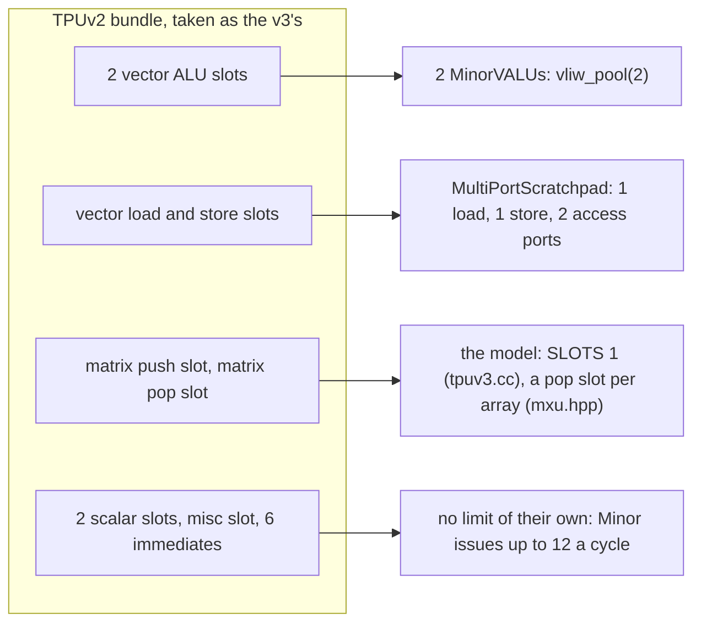

# tpuv3

A TPU v3 TensorCore as one model: `libtpuv3.so`, named `tpuv3`.

It is the [tpuv6e](../tpuv6e/README.md) model with a smaller matrix unit.
Same units, same instructions, same encodings. Three constants differ. This
page shows what those three constants change, and the gem5 machine the model
is timed on.

Read first:

- [README.md](../../README.md): the C ABI, the timing rules, the cp engine
  (`cp::Component`, its `insns()` and its blocks).
- [examples/tpu/README.md](../tpu/README.md): the units `Sfu`, `Misc`, `Xlu`,
  the `[tpu]` trace, the statistics, and the generic gem5 machine.
- [examples/tpuv6e/README.md](../tpuv6e/README.md): what `vmatprep`,
  `vmatpush`, `vmatmul` and `vpop` do.

```
                  libtpuv3.so  (tpuv3.cc)
  ┌────────────────────────────────────────────────────────────┐
  │ tpu::Coprocessor                                           │
  │  ┌───────────┐ ┌────────────┐ ┌───────────┐ ┌────────────┐ │
  │  │ tpu::Sfu  │ │ tpu::Misc  │ │ tpu::Xlu  │ │ tpu::Mxu   │ │
  │  │ TPUV3_SFU │ │ TPUV3_MISC │ │ TPUV3_XLU │ │ <Shape>    │ │
  │  │           │ │            │ │           │ │ TPUV3_MXU  │ │
  │  └───────────┘ └────────────┘ └───────────┘ └────────────┘ │
  │   the same three units as tpuv6e      the v3's Shape:      │
  │   (examples/tpu/*.hpp)                REGISTERS    1       │
  │                                       SLOTS        1       │
  │                                       WORD_A_CYCLE false   │
  └────────────────────────────────────────────────────────────┘
```

<details><summary>How the runs on this page were made</summary>

Every trace line, cycle count and message below comes from a run of the
`cp-engine` tree as built on 2026-10-24, in the pinned environment image
(see [setup/](../../setup); `setup/versions.env`: gem5 `vcix-v0.3.5`, Spike
`751354f`, pk `9435c61`, the toolchain of 2026.08.27). Build, then run the
tests once:

```
cmake -G Ninja -S . -B build && ninja -C build
tests/tpuv3/run.sh build
```

`tests/tpuv3/run.sh` writes each gem5 run's log to `build/tpuv3-<run>.gem5.log`
and its statistics to `build/m5out-tpuv3-<run>/stats.txt`. The trace lines
quoted below are `grep '^\[tpu\]'` of such logs. `source scripts/sim.sh
build` gives the helpers (`rv_program`, `spike_run`, `gem5_run`) that the
other Reproduce blocks use.
</details>

## The model's source

`tpuv3.cc:16-32`:

```cpp
struct Shape {
  static constexpr uint32_t REGISTERS = 1;
  static constexpr uint64_t SLOTS = 1;
  static constexpr bool WORD_A_CYCLE = false;
};

class Tpuv3 final : public tpu::Coprocessor {
 public:
  const char *name() const override { return "tpuv3"; }

 private:
  tpu::Sfu sfu_{*this, "TPUV3_SFU"};
  tpu::Misc misc_{*this, "TPUV3_MISC"};
  tpu::Xlu xlu_{*this, "TPUV3_XLU"};
  tpu::Mxu<Shape> mxu_{*this, "TPUV3_MXU"};
};
```

`tpuv6e.cc` has the same lines with `2`, `2`, `true`, the unit names
`TPUV6E_*` and the name `tpuv6e`. What each constant does:

- `REGISTERS`: how many vector registers one operand spans. The array is
  `REGISTERS x vpu_num_lanes` wide and deep. The v3 has 1: at 128 lanes the
  array is 128 x 128. The v6e has 2: 256 x 256.
- `SLOTS`: how many of `vmatprep`, `vmatpush` and `vmatmul` the unit carries
  out in one cycle, over all arrays; the unit accepts `SLOTS + tpu_mxu_units`
  a cycle into its `insns()`. The v3 has 1, the v6e 2.
- `WORD_A_CYCLE`: whether a 32-bit word that holds two 16-bit rows enters the
  array in one cycle (v6e), or one row enters a cycle (v3).

Each is a default: a machine description that states `tpu_mxu_registers`,
`tpu_mxu_issue_slots` or `tpu_mxu_word_a_cycle` sets it instead, so one machine
file holds the shape the compiler and the model both read. `libtpuv6e.so` with
`1`, `1` and `0` runs `mxu.S` and `mxu_rate.S` as `libtpuv3.so` does
(`tests/tpuv3/run.sh`, asserted, with the values each key refuses).

gem5 reports one unit per block ([tpu: statistics](../tpu/README.md#statistics-one-unit-per-block)):
a component's name is its primary port, `<name>_insns` its instruction queue,
`<name>_<block>` each queue and pipeline. The model lists them in the order of
`tpuv3.cc`: SFU, MISC, XLU, MXU, each component's blocks in their order
(`tests/tpuv3/ports.cc` reads the C table with no simulator); gem5's
`stats.txt` sorts them by name:

```
TPUV3_MISC TPUV3_MISC_insns TPUV3_MXU TPUV3_MXU_array0_input TPUV3_MXU_array0_line TPUV3_MXU_array0_output TPUV3_MXU_insns
TPUV3_SFU TPUV3_SFU_eup TPUV3_SFU_eup_input TPUV3_SFU_eup_output TPUV3_SFU_insns
TPUV3_XLU TPUV3_XLU_buffer TPUV3_XLU_insns TPUV3_XLU_line TPUV3_XLU_moves TPUV3_XLU_out TPUV3_XLU_queue TPUV3_XLU_stages
```

The unit classes and their instructions are described once, in
[examples/tpu/README.md](../tpu/README.md). The DMA's instructions are
`Misc`'s, as in the tpu model. This model has no systolic or multi-precision
array.

## The matrix unit at 4 lanes: v3 and v6e side by side

The tests run the matrix unit on 4 lanes, so the arrays stay small enough to
draw.

```
  tpuv3, 4 lanes: REGISTERS 1                 tpuv6e, 4 lanes: REGISTERS 2

  one register = 4 lanes                      two registers = 8 lanes' worth
         columns 0..3                                columns 0..3   4..7
        ┌──┬──┬──┬──┐                                ┌─────────┬───────────┐
  depth │  │  │  │  │ 4 x 4                    depth │  lower  │  upper    │ 8 x 8
  0..3  ├──┼──┼──┼──┤                          0..3  │  half   │  half     │
        │  │  │  │  │                                ├─────────┴───────────┤
        ├──┼──┼──┼──┤                          4..7  │  upper half of the  │
        │  │  │  │  │                                │  depth (vmatpush    │
        ├──┼──┼──┼──┤                                │  [4:3] = 2)         │
        │  │  │  │  │                                └─────────────────────┘
        └──┴──┴──┴──┘
  delay line: 2 x 4 - 1 = 7 stages            delay line: 2 x 8 - 1 = 15 stages
  one output queue (array0_output)            two output queues (array0_lower, array0_upper)
  no vmatprep                                 vmatprep holds an upper half
```

The delay line's default length is `2 x REGISTERS x lanes - 1`
(`examples/tpu/mxu.hpp:69`). A trace line shows the array's queues: one
output queue on the v3, two on the v6e (`mxu.hpp:95-105`):

```
[tpu] issue vpop: 1 cycles after the last issue, 1 in flight, input queue 0, output queue 0          <- tpuv3
[tpu] commit vpop: 13 cycles after its issue
[tpu] issue vpop: 1 cycles after the last issue, 1 in flight, input queue 0, output queues 0 and 0   <- tpuv6e
[tpu] commit vpop: 19 cycles after its issue
```

The first pair is from `tests/tpuv3/mxu.S` (walked below). The second is
from `tests/tpuv6e/mxu.S` on the v6e at 4 lanes
([tpuv6e: a cycle walk](../tpuv6e/README.md#a-cycle-walk-teststpuv6emxus)).

## One register an operand

An operand is one register, so there is no upper half anywhere. The field at
19:15 of an MXU instruction (`mxu.hpp:37-40`) has three forms the v3 never
carries out:

```
  field at bits 19:15 (5 bits)

    4   3   2   1   0
  ┌───────┬───┬───────┐
  │ DEPTH │ 2 │FORMAT │   FORMAT [1:0]  0 single, 1 two halves, 3 two bfloat16
  └───────┴───┴───────┘   [2]           vmatprep: weights or inputs
                                        vmatmul:  latch the staged weights
                                        vpop:     0 lower, 1 upper half of the columns   <- 1 refused on v3
                          DEPTH [4:3]   vmatpush: 1 lower, 2 upper half of the depth     <- 2 refused on v3

  vmatprep itself                                                                        <- refused on v3
```

`tests/tpuv3/mxu.S` decoded, from `llvm-objdump -d --mattr=+v,+xsfvcp` of
the object that `run.sh` builds (`build/tpuv3-mxu.o`):

```
  2615b05b  sf.vc.iv  0x1, 0x0, v1, 0xb   vmatpush  field 11 = 0b01_0_11  DEPTH 1 (lower), bfloat16
  2213b05b  sf.vc.iv  0x0, 0x0, v1, 0x7   vmatmul   field  7 = 0b00_1_11  latch, bfloat16
  0800315b  sf.vc.v.i 0x2, 0x0, v2, 0x0   vpop      field  0              lower half, single
  080031db  sf.vc.v.i 0x2, 0x0, v3, 0x0   vpop      field  0
```

The three forms are a `fault` as the instruction reaches the head of the
unit's `insns()` (`mxu.hpp:212-213`, `218-219`, `226-227`). On Spike the model
ends the run with the reason, exit 1. `tests/tpuv3/functional/run.sh` asserts
these three:

```
tpu: vmatprep: an operand of an array of lanes x lanes is one register, with no upper half
tpu: vmatpush: [4:3] 2 names a second half of the depth, which an array of lanes x lanes has not
tpu: vpop: [2] names the upper half of the columns, which an array of lanes x lanes has not
```

On gem5 the instruction is accepted and issued; the run ends with the same
line, exit 1, when it commits. Here is one `vmatprep` on both:

```
$ spike --extlib=build/libtpuv3.so --isa=rv64gcv_zfh_xvcixaccel \
    --machine-config=tests/tpu/functional/machine.yml pk prep
tpu: vmatprep: an operand of an array of lanes x lanes is one register, with no upper half
$ echo $?
1

$ gem5.opt -d m5out examples/gem5_se.py --model build/libtpuv3.so --config lanes4.yml \
    --max-ticks 100000000 prep
...
[tpu] issue vmatprep: the first, input queue 0, output queue 0
[tpu] commit vmatprep: 1 cycles after its issue
tpu: vmatprep: an operand of an array of lanes x lanes is one register, with no upper half
$ echo $?
1
```

(The gem5 log prints the issue line twice: the first issue is squashed and
the instruction issued again.)

<details><summary>Reproduce: prep.S</summary>

```
# A vmatprep (sf.vc.iv 0x2, field 3) on libtpuv3.so, whose operand is one register: a fault at the head.
    .option norvc
    .text
    .globl main
main:
    li      t0, 4
    vsetvli t0, t0, e32, m1, ta, ma
    sf.vc.iv  0x2, 0x0, v1, 3
    li      a0, 0
    ret
```

```
source scripts/sim.sh build
rv_program prep.S prep
printf 'tpu_trace: 1\nvpu_num_lanes: 4\n' > lanes4.yml
spike_run build/libtpuv3.so tests/tpu/functional/machine.yml prep
gem5_run m5out build/libtpuv3.so lanes4.yml prep --max-ticks 100000000
```
</details>

So a v6e program and a v3 program are not the same program. The v3 test
program `tests/tpuv3/functional/mxu.c` on `libtpuv6e.so` is refused at its
first `vmatpush`, which has no `vmatprep` before it
(`tests/tpuv3/functional/run.sh`, asserted):

```
tpu: vmatpush: no vmatprep of its upper half came before it
```

`tpu_mxu_bound_to_lanes: 1` makes the v6e's array one register wide, as the
v3's is. Then `libtpuv6e.so` runs `mxu.c` and writes what `libtpuv3.so`
writes, byte for byte, at 4 and at 8 lanes (asserted, same file). Its timing
stays the v6e's: two slots, a word a cycle (below).

## A row a cycle, not a word a cycle

A `vmatmul` operand is `vl` words of 32 bits. A word holds one single, or two
16-bit rows ([tpuv6e: words and rows](../tpuv6e/README.md#words-and-rows)).

`vmatmul` puts its rows in the array's input queue, the first row of each
word tagged with the rows that enter the line with it (`mxu.hpp:303-313`):

```cpp
const uint32_t field = cp::rs1(insn), word = word_a_cycle_ ? rows_in_word(field) : 1;
...
for (uint64_t row = 0; row < rows; row++) {
  Input in{row % word ? 0 : word, {}};
  ...
  a.input.push(std::move(in), now);
}
```

One word a cycle leaves the queue into the line, when the unit's input port
has room for its rows (`Array::flow`, `mxu.hpp:173-178`). So for `vl` = 4
words of bfloat16 (8 rows):

```
  v3  (WORD_A_CYCLE false):  8 words of 1 row       input port: 1 row a cycle
  v6e (WORD_A_CYCLE true):   4 words of 2 rows      input port: 2 rows a cycle
```

The input port's width is `(word_a_cycle ? 2 : 1) x tpu_mxu_units` rows: 1 on
the v3, 2 on the v6e, or as a machine's `tpu_mxu_word_a_cycle` says
(`mxu.hpp:63-68`, `73`). gem5 reports it as the unit's `capacity`.

The v3 still needs a queue of at least 2 rows. A `vmatmul` with `vl` = 1 of
bfloat16 sends two rows, and both must fit the input queue. A queue of 1 is
refused when the model is made (`mxu.hpp:50-51`; `tests/tpuv3/run.sh`,
asserted):

```
src/cpu/minor/vcix_accel_model.cc:257: fatal: <build>/libtpuv3.so: tpuv3: machine description: tpu_mxu_queue_entries: '1' is not a queue size: a word of two rows needs 2
```

## A walk through `tests/tpuv3/mxu.S`

The program pushes weights, runs one `vmatmul` of 8 bfloat16 rows that
latches them, and pops the result in two halves of 4 rows. The machine
description is `tests/tpuv3/mxu.yml`, 4 lanes and queues of 8:

```yaml
tpu_trace: 1
vpu_num_lanes: 4
tpu_mxu_queue_entries: 8
```

The array is 4 x 4 and the line has 2 x 4 - 1 = 7 stages. The trace:

```
[tpu] issue vmatpush: the first, input queue 0, output queue 0
[tpu] issue vmatmul: 0 cycles after the last issue, 1 in flight, input queue 0, output queue 0
[tpu] commit vmatpush: 1 cycles after its issue
[tpu] issue vpop: 1 cycles after the last issue, 1 in flight, input queue 0, output queue 0
[tpu] issue vpop: 0 cycles after the last issue, 2 in flight, input queue 0, output queue 0
[tpu] commit vmatmul: 2 cycles after its issue
[tpu] commit vpop: 13 cycles after its issue
[tpu] commit vpop: 17 cycles after its issue
```

Cycle by cycle, counting from the `vmatpush`:

```
  cycle 0    vmatpush and vmatmul are accepted: the unit takes SLOTS + 1 = 2 a cycle.
  cycle 1    vmatpush is carried out at the head: it stages the weights; nothing enters
             the array. vmatmul waits: SLOTS is 1, and the vmatpush took the MXU slot.
             Both vpops are accepted and wait behind it.
  cycle 2    vmatmul is carried out: its 8 rows go into the input queue.
  cycle 3-10 the rows enter the 7-stage line one a cycle; the fourth at 6, out at 13,
             visible to the vpop at 14.
  cycle 14   the first vpop takes its 4 rows: 13 cycles after its issue at 1.
  cycle 18   the second vpop takes the next 4, which came out one a cycle: 17 after its issue.
```

The unit's statistics (`stats.txt`, under `...vcix.TPUV3_MXU`):

```
admitted          8    rows in at the input port
capacity          1    rows a cycle the port admits
occupancy        56    = 8 rows x 7 cycles each in the line
utilized_cycles   8    = admitted / capacity
```

`TPUV3_MXU_array0_line` reads the same (8 words of a row each);
`TPUV3_MXU_insns` admitted 4, capacity 2.

### The same program with the v6e's SLOTS and WORD_A_CYCLE

`libtpuv6e.so` with `tpu_mxu_bound_to_lanes: 1` on 4 lanes has the same 4 x 4
array and 7 stages, so `mxu.S` runs on it unchanged. Only `SLOTS` and
`WORD_A_CYCLE` differ:

```
  tpuv3                                        tpuv6e, bound to the lanes
  commit vmatpush: 1 cycles after its issue    commit vmatpush: 1 cycles after its issue
  commit vmatmul: 2 cycles after its issue     commit vmatmul: 1 cycles after its issue
  commit vpop: 13 cycles after its issue       commit vpop: 10 cycles after its issue
  commit vpop: 17 cycles after its issue       commit vpop: 12 cycles after its issue
  capacity 1, occupancy 56                     capacity 2, occupancy 56
  utilized_cycles 8                            utilized_cycles 4
```

- With 2 slots, the `vmatmul` is carried out in the cycle of the `vmatpush`:
  its rows are in the queue a cycle earlier.
- With a word a cycle, the 4 rows of the first pop are 2 words: 2 cycles to
  enter, not 4; the second pop's 4 rows follow 2 cycles later, not 4.
- Occupancy is 56 in both: 8 rows, 7 cycles each.

<details><summary>Reproduce</summary>

`mxu.S` on `tests/tpuv3/mxu.yml` with `libtpuv3.so`, and on that file plus
`tpu_mxu_bound_to_lanes: 1` with `libtpuv6e.so` (`tests/tpuv3/run.sh`, its
runs `mxu` and `tpuv6e-bound-4`).
</details>

### Room in the input queue: `tests/tpuv3/mxu_rate.S`

A `vmatmul` is carried out only when all its rows fit the input queue. This
program pushes weights (field 8: singles, lower half), runs a `vmatmul` of 4
singles that latches (field 4), then a `vmatmul` of 4 bfloat16 words, 8 rows
(field 3), then pops 4 rows three times.

With queues of 8 (`tests/tpuv3/mxu.yml`):

```
[tpu] issue vmatpush: the first, input queue 0, output queue 0
[tpu] issue vmatmul: 0 cycles after the last issue, 1 in flight, input queue 0, output queue 0
[tpu] commit vmatpush: 1 cycles after its issue
[tpu] issue vmatmul: 1 cycles after the last issue, 1 in flight, input queue 0, output queue 0
[tpu] issue vpop: 0 cycles after the last issue, 2 in flight, input queue 0, output queue 0
[tpu] commit vmatmul: 2 cycles after its issue
[tpu] issue vpop: 1 cycles after the last issue, 2 in flight, input queue 4, output queue 0
[tpu] issue vpop: 1 cycles after the last issue, 3 in flight, input queue 3, output queue 0
[tpu] commit vmatmul: 6 cycles after its issue
[tpu] commit vpop: 13 cycles after its issue
[tpu] commit vpop: 17 cycles after its issue
[tpu] commit vpop: 20 cycles after its issue
```

- The first `vmatmul` is carried out at 2, its 4 singles in the queue (the
  `vpop` accepted at 2 shows them: `input queue 4`).
- The second `vmatmul`, at the head from 2, needs room for 8 rows in a queue
  of 8. It waits until the 4 singles have entered the line, and is carried
  out at 7 (6 cycles after its issue at 1).
- The first `vpop` commits 13 cycles after its issue: the singles' 4 cycles to
  enter and 7 stages, as in `mxu.S`. The second takes the first 4 bfloat16
  rows, which entered from 8: 17. The third, the last 4: 20.
- 12 rows are admitted; occupancy is 84 = 12 x 7.

With queues of 16 the second `vmatmul` does not wait for room. It waits one
cycle for the MXU slot:

```
[tpu] issue vmatmul: 0 cycles after the last issue, 1 in flight, input queue 0, output queue 0
[tpu] commit vmatpush: 1 cycles after its issue
[tpu] issue vmatmul: 1 cycles after the last issue, 1 in flight, input queue 0, output queue 0
[tpu] issue vpop: 0 cycles after the last issue, 2 in flight, input queue 0, output queue 0
[tpu] commit vmatmul: 2 cycles after its issue
[tpu] issue vpop: 1 cycles after the last issue, 2 in flight, input queue 4, output queue 0
[tpu] commit vmatmul: 2 cycles after its issue
[tpu] issue vpop: 1 cycles after the last issue, 2 in flight, input queue 11, output queue 0
[tpu] commit vpop: 13 cycles after its issue
[tpu] commit vpop: 16 cycles after its issue
[tpu] commit vpop: 19 cycles after its issue
```

The third `vpop`, accepted at 3, sees 3 singles and the 8 bfloat16 rows
(`input queue 11`); the bfloat16 rows enter right behind the singles, so the
second and third `vpop` commit 16 and 19.

<details><summary>Reproduce</summary>

`mxu_rate.S` on `tests/tpuv3/mxu.yml`, and on that file with
`tpu_mxu_queue_entries: 16` (`tests/tpuv3/run.sh`, its runs `mxu_rate` and
`mxu_rate-16`); the occupancy from the first run's `stats.txt`.
</details>

### Lanes set the delay

The first pop of 4 rows commits `6 + (2 x lanes - 1)` cycles after its issue:
1 for the `vmatmul` to be carried out behind the `vmatpush`, 1 for its rows
to reach the queue, 3 for the fourth row to enter behind the first, the
stages, and 1 to be visible to the pop. `mxu.S` at three lane counts, each
asserted by `run.sh`:

```
  vpu_num_lanes   array      delay line   first vpop, cycles after its issue
  4               4 x 4      7            13
  8               8 x 8      15           21
  128 (default)   128 x 128  255          261
```

At 128 lanes the occupancy is 2040 = 8 x 255.

`tpu_mxu_delay_cycles` sets the line's length directly. The walk's run, with
one key more:

```
  tpu_mxu_delay_cycles absent (7):  commit vpop: 13 cycles after its issue   occupancy 56
  tpu_mxu_delay_cycles: 3        :  commit vpop:  9 cycles after its issue   occupancy 24
```

<details><summary>Reproduce: the delay of 3</summary>

```
source scripts/sim.sh build
printf 'tpu_trace: 1\nvpu_num_lanes: 4\ntpu_mxu_queue_entries: 8\ntpu_mxu_delay_cycles: 3\n' > delay-3.yml
gem5_run m5out-delay-3 build/libtpuv3.so delay-3.yml build/tpuv3-mxu --max-ticks 100000000 | grep '^\[tpu\]'
grep -E 'TPUV3_MXU\.(admitted|occupancy)' m5out-delay-3/stats.txt
```
</details>

### Not modelled

- An array larger than the lanes: `REGISTERS` is 1 or 2 (`mxu.hpp:22`), and
  the field at 19:15 cannot name more of an operand's registers.
- The v3 TensorCore's second MXU. The model has one array (`tpu_mxu_units`
  1); TOGSim's array split models the second (`tpuv3.cc:1-2`). Whether the
  two MXUs share slots is not modelled either.
- The cost of a latch, the RHS transpose, int8, and the rounding of inputs to
  bfloat16.

## Keys read from the machine description

The keys are the v6e's matrix-unit keys
([tpuv6e: keys](../tpuv6e/README.md#keys-read-from-the-machine-description)),
and the other units' keys are the tpu example's
([tpu: keys](../tpu/README.md#keys-read-from-the-machine-description)). On this
model two of them read differently:

- `tpu_mxu_delay_cycles` defaults to `2 x vpu_num_lanes - 1`: 255 at 128
  lanes, 7 at 4 ([Lanes set the delay](#lanes-set-the-delay)).
- `tpu_mxu_bound_to_lanes: 1` changes nothing: the v3's array is lanes x lanes
  already. At 8 lanes the trace with and without it is the same (`run.sh`,
  asserted). On `libtpuv6e.so` the key makes a v3-shaped array
  ([One register an operand](#one-register-an-operand)).

A simulator loads the model by its library: Spike's `--extlib=libtpuv3.so`,
gem5's `--model libtpuv3.so`.

## The gem5 machine

`gem5/` is the machine PyTorchSim times `libtpuv3.so` on. It is the tpu
example's machine ([examples/tpu/README.md](../tpu/README.md), "The gem5
machine") with three changes:

```python
# examples/tpuv3/gem5/script_systolic.py:15-16
tpu.simulate(tpu.machine(tpu.arguments(), TPUv3VPU, tpu.multiport_scratchpad(load=1, store=1, access=2, latency=1),
                         clock="940MHz"))

# examples/tpuv3/gem5/vpu_config.py:14-16
class TPUv3VPU(tpu.RiscvVPU):
    executeLSQRequestsQueueSize = 2
    executeFuncUnits = tpu.vliw_pool(2)
```

1. A scratchpad with 1 load, 1 store and 2 access ports a cycle, latency 1.
2. Two vector ALUs (`vliw_pool(2)`).
3. A 940 MHz system clock.

The rest is the tpu machine's: two LSQ requests, six integer units, issue of
up to 12 a cycle, VLEN 256, the bus and the instruction cache.

```
gem5.opt -d m5out examples/tpuv3/gem5/script_systolic.py -c <binary> --model libtpuv3.so \
    [--machine-config machine.yml] [--vlane N] [--vlen N]
```

`run.sh` reads the machine back from `config.ini` (asserted):

```
exit 0, ports 1 1 2, latency 1; requests 2; integer units 6, VALUs 2; clock 1064 ps
```

### Where the numbers come from

No source lists the v3's bundle slots. The sources describe the TPUv2 core's
bundle: 322 bits, two scalar slots, four vector slots of which two are vector
load and store, two matrix slots (a push and a pop), a misc slot and six
immediates ([Norrie et al., IEEE Micro 2021][norrie], p.4, "TPUv2 Core").
CACM gives the TensorCore of both as "two scalar, two vector ALU, vector load
and store, and a pair of slots that queue data to and from the matrix multiply
and transpose units" ([Jouppi et al., CACM 2020][cacm], p.70).

This machine takes the v3's slots to be the v2's. That is an inference:

- the v3 kept the bundle: "TPUv2 and TPUv3 shared a 322-bit VLIW instruction
  bundle length" ([Jouppi et al., ISCA 2021][isca], p.6);
- the v3's enhancements do not include the vector unit: two MXUs, the clock,
  HBM, the links ([Norrie][norrie], p.7);
- its 32-bit TFLOPS grow by its clock alone, 3 to 4 as 700 to 940 MHz
  ([CACM 2020][cacm], Table 3).

Each kind of slot becomes one gem5 resource:



Why each value:

- **Scratchpad 1 load, 1 store, 2 accesses a cycle.** The bundle's two
  load/store slots, read as one load and one store slot, as CACM's "vector
  load and store". Norrie's "two used for vector load/store" can also read as
  two slots that each load or store; that would give 2 loads a cycle. No
  source bounds their sum, so access is the sum. The v6e machine has 3, 2
  and 4.
- **Scratchpad latency 1.** A placeholder: no source gives VMEM's latency.
- **2 VALUs.** The bundle's two vector ALU slots. 128 lanes x 8 sublanes x 2
  VALUs x 2 cores x 0.94 GHz = 3.85024 T a second, the v3's "4 (32b)" TFLOPS
  of [CACM 2020][cacm], Table 3. The v6e machine has 4.
- **940 MHz.** "Increasing clock frequency from 700 to 940 MHz"
  ([Norrie][norrie], p.7; [CACM 2020][cacm], Table 3). The v6e machine runs
  at the tpu machine's 1GHz.
- **A row a cycle in the MXU.** 128 x 128 MACs x 2 flops x 2 MXUs x 2 cores x
  0.94 GHz = 123.20768 T a second, the v3's 123 TFLOPS a chip.
- **SLOTS 1.** A placeholder. The TPUv2 bundle has one push slot, for its one
  MXU and the transpose unit ([Norrie][norrie], p.4; [CACM 2020][cacm], p.70).
  No source states the v3's, for two MXUs.

The two LSQ requests and the six integer units are the tpu machine's
([examples/tpu/README.md](../tpu/README.md)). They are not measured on the
v3.

### The functional unit pool

`vliw_pool(2)` (`examples/tpu/gem5/vpu_config.py:279-283`), as the run's
`config.ini` lists it:

```
  funcUnits  00-07   scalar unit A: FP, Int, Int, IntMul, IntDiv, Pred, Mem, Misc
             08-15   scalar unit B: the same
             16      the VCIX accelerator: the model's statistics are under
                     system.cpu.executeFuncUnits.funcUnits16.vcix.TPUV3_*
             17-21   vector group A: Config, Config, LdSt, LdSt, VALU (21)
             22-26   vector group B: Config, Config, LdSt, LdSt, VALU (26)
             27-28   Int, Int: the fifth and sixth integer units
```

### The bundle is not a limit of its own

Minor issues in order, up to 12 a cycle (`examples/tpu/gem5/vpu_config.py:294`).
The slots above bound each kind of op, so independent ops in program order
issue as a bundle would. A cap of 8 ops a cycle would make RVV's extra
instructions take the v3's slots: an `addi` for each access (an RVV load has
no immediate offset), `vsetvli`, branches, scalar loads and stores. The v3
does not pay for those. The misc slot and the six immediates are left out for
the same reason.

### The clock changes ticks, not cycles

gem5 counts time in ticks of a picosecond. 940 MHz is not a whole number of
picoseconds a cycle, so gem5 makes the cycle 1064 ticks (`config.ini`:
`clock=1064`, asserted). Cycle counts do not depend on the clock. The same
five programs on a copy of `script_systolic.py` with `clock="1GHz"`:

```
                          system.cpu.numCycles, every dump      simTicks, every dump
  scratchpad.S   940MHz   71 187                                75544 198968
                 1GHz     71 187                                71000 187000
  valu.S         940MHz   51 163                                54264 173432
                 1GHz     51 163                                51000 163000
  loads.S        940MHz   100 86 85 83 193                      106400 91504 90440 88312 205352
                 1GHz     100 86 85 83 193                      100000 86000 85000 83000 193000
  addresses.S    940MHz   115 104 220                           122360 110656 234080
                 1GHz     115 104 220                           115000 104000 220000
  mxu.S          940MHz   514                                   546896
                 1GHz     514                                   514000
```

Every 940 MHz tick count is the cycle count x 1064. The `[tpu]` trace of
`mxu.S` is the same at both clocks.

<details><summary>Reproduce: the 1GHz runs</summary>

```
sed 's/clock="940MHz"/clock="1GHz"/' examples/tpuv3/gem5/script_systolic.py > examples/tpuv3/gem5/script_1ghz.py
tests/tpuv3/run.sh build        # the 940MHz runs: build/m5out-tpuv3-machine-<program>
for p in scratchpad valu loads addresses mxu; do
  yml=(); [ $p = mxu ] && yml=(--machine-config tests/tpuv3/mxu.yml)
  gem5.opt -d m5out-1g-$p examples/tpuv3/gem5/script_1ghz.py -c build/tpuv3-$p --model build/libtpuv3.so "${yml[@]}" > 1g-$p.log
done
grep -E '^(system.cpu.numCycles|simTicks)' m5out-1g-*/stats.txt build/m5out-tpuv3-machine-*/stats.txt
diff <(grep '^\[tpu\]' build/tpuv3-machine-mxu.gem5.log) <(grep '^\[tpu\]' 1g-mxu.log)
```

The copy must sit in `examples/tpuv3/gem5/`: it imports `vpu_config` from
beside itself, and the tpu machine from `../../tpu/gem5`.
</details>

### What the machine does to programs

Four programs on the v6e machine and on this one. Each window is one
statistics dump. `tests/tpuv3/run.sh` asserts the v3's numbers,
`tests/tpuv6e/run.sh` the v6e's.

- `tests/tpuv6e/valu.S`: 64 independent `vfadd`s and `vfmul`s.
  - v6e: VALUs busy 16 of 35 cycles, 4 a cycle.
  - v3: busy 32 of 51 cycles, 2 a cycle.
- `tests/tpu/loads.S`: 64 vector loads from lines 128 bytes apart, then 64
  bytes apart.
  - v6e: 40 and 40 cycles.
  - v3: 86 and 83 cycles, with 68 and 64 scratchpad reads, at most 1 a cycle.
    The scratchpad has no banks, so the spacing alone changes nothing. The 4
    extra reads are the instruction lines the 128-apart window still fetches,
    and they take the one load port.
- `tests/tpu/addresses.S`: 64 vector loads, each with the `addi` that steps
  its pointer.
  - v6e: 76 cycles.
  - v3: 104 cycles.
- `tests/tpuv3/scratchpad.S`: independent loads and stores, one and one in
  turn.
  - v3: at most 1 load, 1 store and 2 accesses a cycle.

`mxu.S` on this machine gives the same trace as on `examples/gem5_se.py`
(the `vpop`s commit 13 and 17 cycles after their issue): the matrix unit's
timing is the model's, not the machine's. This machine does not print the tpu
machine's warning that it is the generic one (asserted).

### Not modelled in the machine

- VMEM's banks and their conflicts: the ports take any address.
- VMEM's capacity. The sources disagree: 16 MiB a core in
  [CACM 2020][cacm], p.71's text, 8 MiB a core in its Figure 3, of the TPUv2.
- Smem apart from VMEM. A scalar load or store and an instruction fetch take a
  vector load or store port; with one load port a cold instruction cache shows
  (`loads.S` above).
- The bundle's static schedule, and the forwarding of at most three scalar
  values to the vector unit a bundle ([Norrie][norrie], p.4).
- Each slot's pipeline latency. VALU `opLat` 1 is the tpu machine's.
- The transcendental unit (its inverse square root, [CACM 2020][cacm],
  pp.70-71). A vector divide or square root takes a VALU slot with `opLat` 1,
  as on the tpu machine; a placeholder.
- The second MXU (TOGSim's array split).
- The v3's 4 KiB vector registers (8 x 128 x 32 bits, [CACM 2020][cacm],
  p.71). VLEN stays PyTorchSim's 256.

A reduction takes two VALU slots: gem5 commits each `vfredusum.vs` as a
`SimdMisc` and a `SimdFloatReduceAdd` op, and `MinorVALU` takes both classes.
`tests/tpuv6e/valu.S` with its sixteen ops replaced by `vfredusum.vs`: busy 64
of 83 cycles on this machine, 64 `SimdMisc` and 64 `SimdFloatReduceAdd` ops in
the window.

<details><summary>Reproduce: the reductions</summary>

```
sed -E 's/(vfadd|vfmul)\.vv (v[0-9]+), v16, v17/vfredusum.vs \2, v16, v17/' tests/tpuv6e/valu.S > valu_red.S
source scripts/sim.sh build
rv_program valu_red.S valu_red
gem5.opt -d m5-red examples/tpuv3/gem5/script_systolic.py -c valu_red --model build/libtpuv3.so
gem5_window m5-red 1 system.cpu.units.Vpu.admitted; gem5_window m5-red 1 system.cpu.numCycles
grep -E 'committedInstType::(SimdMisc|SimdFloatReduceAdd) ' m5-red/stats.txt | head -2
```
</details>

[norrie]: https://www.gwern.net/doc/ai/scaling/hardware/2021-norrie.pdf
[cacm]: https://www.gwern.net/doc/ai/scaling/hardware/2020-jouppi.pdf
[isca]: https://www.cs.cmu.edu/~18742/papers/Jouppi2021.pdf

## Tests

```
tests/tpuv3/run.sh [build-dir [spike [pk [gem5.opt]]]]
```

Each check prints `PASS` or `FAIL`, its text and the values it read. Which
check proves what:

- `ports.cc`: the unit names and their order, with no simulator.
- `mxu.S`, 4 lanes: one MXU slot, a row a cycle, `6 + 7`; the unit names in
  gem5's dump; `admitted 8, capacity 1, occupancy 56`.
- `mxu_rate.S`, queues of 8 and 16: a `vmatmul` waits for room for all its
  rows.
- `mxu.S`, 8 and 128 lanes: the delay is `2 x lanes - 1`.
- `tpu_mxu_bound_to_lanes`: `libtpuv6e.so` bound at 4 and 128 lanes (two
  slots, a word a cycle); `libtpuv3.so` at 8 lanes with and without the key,
  the same trace; `libtpuv6e.so` with the key at 0, the same trace as without
  it on `tests/tpuv6e/mxu.S` (8 issues); the key at 2 refused.
- `tpu_mxu_registers`, `tpu_mxu_issue_slots`, `tpu_mxu_word_a_cycle`:
  `libtpuv6e.so` with the v3's values runs `mxu.S` and `mxu_rate.S` as
  `libtpuv3.so`; a value outside each key's range is refused.
- The v3 machine: its `config.ini`, the four programs of the list above,
  `mxu.S` timed as on `gem5_se.py`, and no generic-machine warning.
- `tpu_mxu_queue_entries: 1` refused.
- `functional/run.sh`, on Spike: `functional/mxu.c` against a formula on 4
  and 8 lanes (`mxu: 312 of 312 elements as the formula says` and `mxu: 720
  of 720 elements as the formula says`); `libtpuv6e.so` bound writes the same
  bytes; the three refusals of one register an operand; the v3 program
  refused on an unbound `libtpuv6e.so`, and its `vmatprep` refused on a bound
  one. It uses the machine description of `tests/tpu/functional` and the
  kernels of `tests/tpuv6e/functional`.

`tpu_mxu_bound_to_lanes` is tested here for both models.
