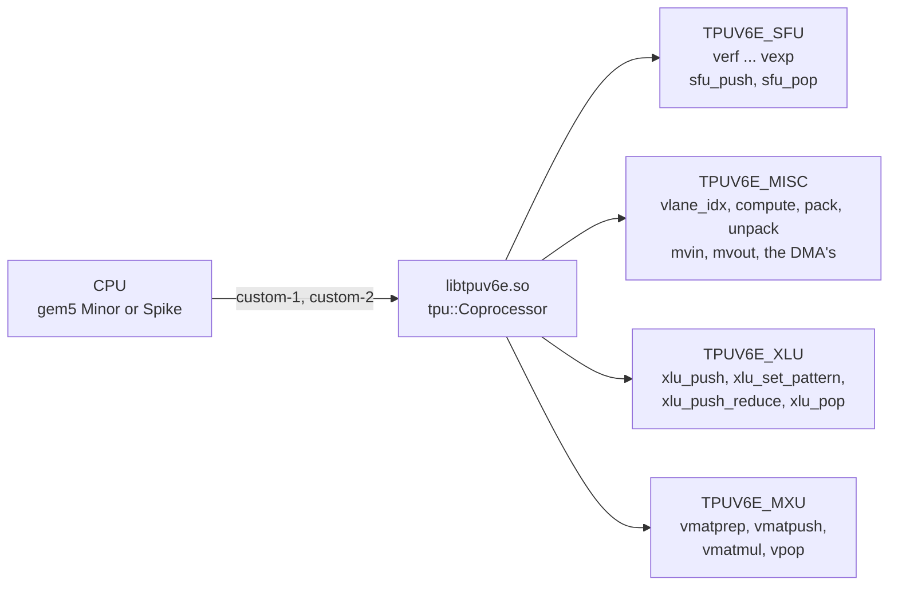
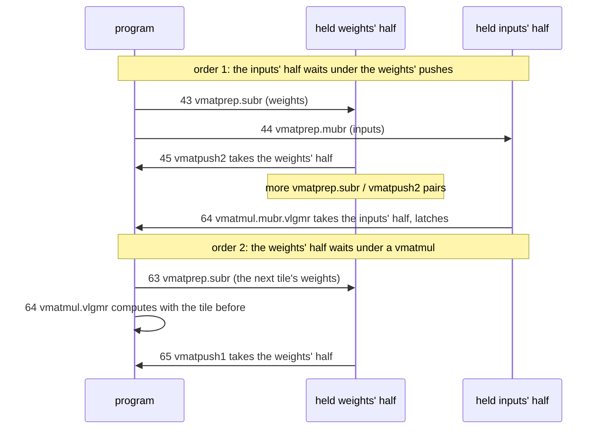
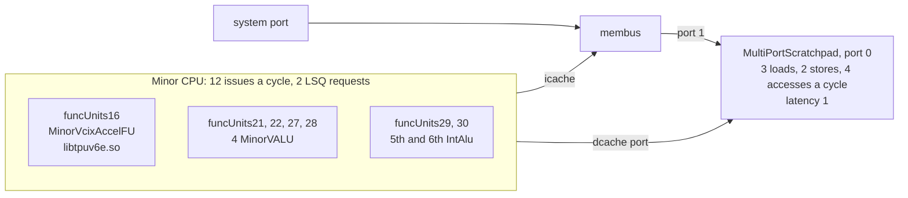

# tpuv6e

A TPU v6e as one model: `libtpuv6e.so`, model name `tpuv6e`.

It has four units. Three of them are the tpu example's units, shared as they
are: the special-function unit, the one-cycle instructions and the cross-lane
unit ([`examples/tpu/README.md`](../tpu/README.md) says how they work). The
fourth is the matrix unit `tpu::Mxu` (`examples/tpu/mxu.hpp`) in the v6e's
shape. It takes the place of the tpu model's systolic array and
multi-precision array.

This README covers what is the v6e's own:

- [the matrix unit](#the-matrix-unit): `vmatprep`, `vmatpush`, `vmatmul`, `vpop`;
- [the EUP](#the-eup-sfu_push-and-sfu_pop): `sfu_push` and `sfu_pop`;
- [the gem5 machine](#the-gem5-machine) PyTorchSim measures it on.

How a model plugs into gem5 and Spike, and what a component's `insns()`, its
blocks (`cp::Port`, `cp::Queue`, `cp::Pipeline`), `complete` and `fault` mean,
is in the [root README](../../README.md).



## A program for libtpu.so is not a program for libtpuv6e.so

The matrix unit uses the encodings that the tpu model gives its two arrays.
So the same 32-bit word is a different instruction in each library
(`examples/tpu/mxu.hpp:108-112`, `systolic.hpp:45-47`, `msa.hpp:27-28`):

```
 encoding       match        libtpu.so              libtpuv6e.so
 sf.vc.iv  0    0x2200305B   systolic input push    vmatmul
 sf.vc.iv  1    0x2600305B   systolic weight push   vmatpush
 sf.vc.iv  2    0x2A00305B   msa push               vmatprep
 sf.vc.v.i 2    0x0800305B   systolic pop           vpop
 sf.vc.v.i 3    0x0C00305B   msa pop                (no unit owns it)
```

Run the v6e's `tests/tpuv6e/mxu.S` on `libtpu.so`, and its first
instruction, a `vmatprep`, reaches the multi-precision array:

```
$ spike --extlib=build/libtpu.so --isa=rv64gcv_zfh_xvcixaccel --machine-config=lanes4.yml pk mxu
tpu: msa push: inputs of 4 to a word, weights of 1
$ echo $?
1
```

The same binary on `libtpuv6e.so` exits 0.

<details><summary>Reproduce</summary>

`lanes4.yml` is `vpu_num_lanes: 4`, `vpu_spad_size_kb_per_lane: 512`,
`vpu_vector_length_bits: 256`. `mxu` is `tests/tpuv6e/mxu.S`, built as
`rv_program` in `scripts/sim.sh` builds it:

```
clang --target=riscv64 -march=rv64gcv_xsfvcp -c tests/tpuv6e/mxu.S -o mxu.o
riscv64-unknown-elf-gcc -static mxu.o -o mxu
```
</details>

## Units

`tpuv6e.cc` is a `tpu::Coprocessor` (`examples/tpu/machine.hpp`) holding four
components as members. Each is built with the name its statistics report
(`tpuv6e.cc:21-31`):

- `tpu::Sfu` (`examples/tpu/sfu.hpp`), reported as `TPUV6E_SFU`;
- `tpu::Misc` (`examples/tpu/misc.hpp`), reported as `TPUV6E_MISC`;
- `tpu::Xlu` (`examples/tpu/xlu.hpp`), reported as `TPUV6E_XLU`;
- `tpu::Mxu<Shape>` (`examples/tpu/mxu.hpp`), reported as `TPUV6E_MXU`.

The headers are included as `tpu/<unit>.hpp`; the build adds `examples` to
the include path (`CMakeLists.txt:24`). `Shape` is the one thing this model sets
(`tpuv6e.cc:13-19`):

```cpp
// The v6e's MXU: 256 x 256 on 128 lanes, so an operand is two registers; two MXU slots a bundle, shared by its
// MXUs; a word of two 16-bit rows a cycle.
struct Shape {
  static constexpr uint32_t REGISTERS = 2;
  static constexpr uint64_t SLOTS = 2;
  static constexpr bool WORD_A_CYCLE = true;
};
```

gem5 reports one unit per block: a component's name is its primary port,
`<name>_insns` its instruction queue, and `<name>_<block>` each of its queues
and pipelines (`include/vcix_cp.hpp:363-367`, `vcix_cp_base.hpp:326-363`).
The order you see them in depends on who lists them:

- The C statistics table is in the model's order, each component's blocks in
  their order: SFU (`insns`, `TPUV6E_SFU`, `eup_input`, `eup`, `eup_output`),
  MISC (`insns`, `TPUV6E_MISC`), XLU (`insns`, `TPUV6E_XLU`, `queue`,
  `stages`, `moves`, `buffer`, `line`, `out`), MXU (`insns`, `TPUV6E_MXU`,
  then per array `array<i>_input`, `array<i>_line`, `array<i>_lower`,
  `array<i>_upper`), then one commit count per encoding. `tests/tpuv6e/ports.cc`
  reads it with no simulator.
- gem5's `stats.txt` sorts them by name. Lines from the `mxu.S` run
  [below](#a-cycle-walk-teststpuv6emxus):
  ```
  system.cpu.executeFuncUnits.funcUnits8.vcix.TPUV6E_MXU.admitted            8                       # rows admitted at port input (Count)
  system.cpu.executeFuncUnits.funcUnits8.vcix.TPUV6E_MXU.capacity            2                       # rows the unit can admit per cycle ((Count/Cycle))
  system.cpu.executeFuncUnits.funcUnits8.vcix.TPUV6E_MXU.occupancy          120                       # rows held behind the port, summed over cycles (Count)
  system.cpu.executeFuncUnits.funcUnits8.vcix.TPUV6E_MXU_array0_line.admitted            4
  system.cpu.executeFuncUnits.funcUnits8.vcix.committed.vmatmul            1                       # instructions counted (Count)
  system.cpu.executeFuncUnits.funcUnits8.vcix.committed.vmatpush            1                       # instructions counted (Count)
  system.cpu.executeFuncUnits.funcUnits8.vcix.committed.vmatprep            2                       # instructions counted (Count)
  system.cpu.executeFuncUnits.funcUnits8.vcix.committed.vpop            4                       # instructions counted (Count)
  ```
  `TPUV6E_MXU` counts rows at the input port, `TPUV6E_MXU_array0_line` the
  words that entered the line: 8 rows of bfloat16 are 4 words.

## The matrix unit

### The picture

An array is a grid of weights, `2 x vpu_num_lanes` columns wide and as many
depths deep. On the default 128 lanes it is 256 x 256. The tests use 4 lanes,
so 8 x 8.

A register has one column per lane, so one register holds only half of the
columns. An operand is two registers: `vmatprep` brings the upper half and
holds it; the `vmatpush` or `vmatmul` after it brings the lower half and
takes the held one.

```
            vmatprep W ─┐ (upper columns, held)
            vmatpush ───┴─> STAGED weights ──(a vmatmul that latches)──> ACTIVE weights
                                                                              │
 vmatprep I ─┐ (upper half of each input row, held)                           │ x
 vmatmul  ───┴─> input queue ──a word a cycle──> delay line ──────────────────┘
                 array<i>_input                  array<i>_line, tpu_mxu_delay_cycles stages
                                                        │
                                      each result row goes into BOTH output queues
                                            ┌───────────┴────────────┐
                                     array<i>_lower            array<i>_upper
                                            │                        │
                                     vpop, field 0            vpop, field 4
```

The machine can have several such arrays (`tpu_mxu_units`, default 1). Each
array has its own held halves, weights, queues and delay line (`Array`,
`mxu.hpp:141-192`).

### The four instructions

All four are `custom-2` words with funct3 `011`. The field at 19:15 is the
instruction's immediate. The array number goes in a field that names no
register: `rd` (11:7) for `sf.vc.iv`, `rs2` (24:20) for `sf.vc.v.i`. Two
words from `tests/tpuv6e/mxu_arrays.S`, as `llvm-objdump` prints them:

```
 2a11b0db   sf.vc.iv  0x2, 0x1, v1, 0x3       vmatprep, array 1

  31     26 25 24   20 19   15 14 12 11    7 6       0
 ┌─────────┬──┬───────┬───────┬─────┬───────┬─────────┐
 │ 001010  │1 │ 00001 │ 00011 │ 011 │ 00001 │ 1011011 │
 └─────────┴──┴───────┴───────┴─────┴───────┴─────────┘
  sf.vc.iv 2    vs2=v1  field 3       rd = array 1

 081031db   sf.vc.v.i 0x2, 0x1, v3, 0x0       vpop, array 1

 ┌─────────┬──┬───────┬───────┬─────┬───────┬─────────┐
 │ 000010  │0 │ 00001 │ 00000 │ 011 │ 00011 │ 1011011 │
 └─────────┴──┴───────┴───────┴─────┴───────┴─────────┘
  sf.vc.v.i 2   rs2 =   field 0       vd=v3
                array 1
```

With one array both fields are 0, so a program for one array runs unchanged
on a machine of more.

The field at 19:15 (`mxu.hpp:37-40`: `FORMAT = 0x3, SECOND = 0x4, LATCH =
0x4, DEPTH = 0x18`):

```
 bit:      4  3  2  1  0
          └─┬─┘  │  └─┬─┘
            │    │    └── [1:0] format: 0 a single, 1 two fp16 halves, 3 two bfloat16
            │    └─────── [2]   vmatprep: 0 weights, 1 inputs
            │                   vmatmul:  1 latch the staged weights first
            │                   vpop:     0 lower columns, 1 upper columns
            └──────────── [4:3] vmatpush: 1 first half of the depth, 2 second half
```

What each instruction does:

- **`vmatprep`** (`sf.vc.iv 2`): holds the upper half of one operand, weights
  or inputs, until the next `vmatpush` (weights) or `vmatmul` (inputs) takes
  it (`mxu.hpp:278-281`).
- **`vmatpush`** (`sf.vc.iv 1`): with the held upper half, writes one weight
  per row in every column into the staged weights, in the half of the depth
  that [4:3] names. Nothing enters the array (`mxu.hpp:284-300`).
- **`vmatmul`** (`sf.vc.iv 0`): with the held upper half, sends the input
  rows into the array. Each column computes its active weights times the row.
  With [2] set it first copies the staged weights into the active ones
  (`mxu.hpp:303-315`).
- **`vpop`** (`sf.vc.v.i 2`): takes exactly `vl` result rows of one half of
  the columns, as singles. Row i goes to element i of `vd`; lane l gets
  column l of that half (`mxu.hpp:255-260`).

The fields the tests use, decoded:

```
 sf.vc.iv  0x2, 0, v1, 3    vmatprep  bfloat16, weights
 sf.vc.iv  0x2, 0, v1, 7    vmatprep  bfloat16, inputs
 sf.vc.iv  0x2, 0, v1, 4    vmatprep  singles,  inputs
 sf.vc.iv  0x1, 0, v1, 11   vmatpush  bfloat16, first half of the depth   (11 = 0b01011)
 sf.vc.iv  0x1, 0, v1, 8    vmatpush  singles,  first half of the depth
 sf.vc.iv  0x0, 0, v1, 7    vmatmul   bfloat16, latches
 sf.vc.iv  0x0, 0, v1, 3    vmatmul   bfloat16, does not latch
 sf.vc.iv  0x0, 0, v1, 4    vmatmul   singles,  latches
 sf.vc.v.i 0x2, 0, v2, 0    vpop      lower columns
 sf.vc.v.i 0x2, 0, v3, 4    vpop      upper columns
```

### Words and rows

Every element is a word of 32 bits (`vsetvli ... e32`). The format says how
many rows a word holds (`mxu.hpp:41`, `316-334`):

```
 format 0 (single):    │             row w (f32)              │   1 row a word
 format 1 (fp16):      │ row 2w+1 (bits 31:16) │ row 2w (15:0) │   2 rows a word
 format 3 (bfloat16):  │ row 2w+1 (bits 31:16) │ row 2w (15:0) │   2 rows a word
 format 2:             refused: "format 2 names nothing a word holds"
```

So the `vl = 4` words of bfloat16 in `mxu.S` are 8 rows. A `vpop` always
returns singles (format 0, `e32`).

### Weights: staged and active, a worked example

Two rules (`mxu.hpp:284-300`, `303-307`):

1. A `vmatpush` of n rows writes the **staged** weights, in one half of the
   depth. What that half held moves down n depths; what passes the half's
   last depth is gone; the new rows take the top, row r at depth r. The other
   half is untouched. The staged weights are zeros at the first push.
2. A `vmatmul` computes with the **active** weights. One that latches first
   copies the staged weights, whole, into the active ones.

Rule 1 is why a tile is pushed deepest first, as `mxu.c` does: the last push
lands on top, and the half ends up holding the tile in order.

The example below runs on Spike with 4 lanes (an 8 x 8 array). The weight
at depth k, column c is `W[k][c] = 10 * (k + 1) + c`, so row k of W reads
`10(k+1)`, `10(k+1)+1`, ... After each step a latching `vmatmul` multiplies
nine input rows: the eight rows of the identity, then a row of ones. Identity
row r times the weights is the weights at depth r. So the output prints the
active weights depth by depth, and the last line sums each column.

```
1. vmatpush of W rows 2-3 to the first half; vmatmul latches
  depth 0:   30   31   32   33   34   35   36   37      <- the first push lands on top
  depth 1:   40   41   42   43   44   45   46   47
  depth 2:    0    0    0    0    0    0    0    0      <- zeros: nothing pushed here yet
  depth 3:    0    0    0    0    0    0    0    0
  depth 4:    0    0    0    0    0    0    0    0
  depth 5:    0    0    0    0    0    0    0    0
  depth 6:    0    0    0    0    0    0    0    0
  depth 7:    0    0    0    0    0    0    0    0
  ones   :   70   72   74   76   78   80   82   84
2. vmatpush of W rows 0-1 to the first half; vmatmul latches
  depth 0:   10   11   12   13   14   15   16   17      <- the new rows on top
  depth 1:   20   21   22   23   24   25   26   27
  depth 2:   30   31   32   33   34   35   36   37      <- the old rows moved down by 2
  depth 3:   40   41   42   43   44   45   46   47
  depth 4:    0    0    0    0    0    0    0    0
  depth 5:    0    0    0    0    0    0    0    0
  depth 6:    0    0    0    0    0    0    0    0
  depth 7:    0    0    0    0    0    0    0    0
  ones   :  100  104  108  112  116  120  124  128
3. vmatpush of rows 6-7, then 4-5, to the second half; vmatmul latches
  depth 0:   10   11   12   13   14   15   16   17
  depth 1:   20   21   22   23   24   25   26   27
  depth 2:   30   31   32   33   34   35   36   37
  depth 3:   40   41   42   43   44   45   46   47
  depth 4:   50   51   52   53   54   55   56   57      <- the second half, in order
  depth 5:   60   61   62   63   64   65   66   67
  depth 6:   70   71   72   73   74   75   76   77
  depth 7:   80   81   82   83   84   85   86   87
  ones   :  360  368  376  384  392  400  408  416
4. vmatpush of two rows 900+c, 990+c to the first half; vmatmul does not latch
  depth 0:   10   11   12   13   14   15   16   17      <- unchanged: the push went to
  ...                                                       the staged weights only
  depth 7:   80   81   82   83   84   85   86   87
  ones   :  360  368  376  384  392  400  408  416
5. the same vmatmul, latching
  depth 0:  900  901  902  903  904  905  906  907
  depth 1:  990  991  992  993  994  995  996  997
  depth 2:   10   11   12   13   14   15   16   17      <- moved down by 2
  depth 3:   20   21   22   23   24   25   26   27      <- the 30s and 40s fell off the half
  depth 4:   50   51   52   53   54   55   56   57      <- the second half is untouched
  depth 5:   60   61   62   63   64   65   66   67
  depth 6:   70   71   72   73   74   75   76   77
  depth 7:   80   81   82   83   84   85   86   87
  ones   : 2180 2188 2196 2204 2212 2220 2228 2236
```

Step 4 is how the v6e overlaps tiles: the next tile is pushed between the
`vmatmul`s of the one in use, and the first `vmatmul` that latches switches
to it.

A tile 128 deep on the v6e (K = 128, half the depth) pushes only the first
half and brings zeros in the upper half of its inputs. The second half keeps
old weights, but they meet only zeros. `tests/tpuv6e/functional/mxu.c`
checks this case, the tile-between-`vmatmul`s case and both v6e orders
below against a C formula, in all three formats.

<details><summary>Reproduce (the program, built with the test's kernels)</summary>

`mxu_walk.c`, in a scratch directory. It uses the kernels of
`tests/tpuv6e/functional/kernels.S` (each takes lane 0's scratchpad address,
the element count and the field) and `tests/tpu/functional/common.h`.

```c
#include "common.h"

kernel_with k_mxu_matmul_32, k_mxu_push_32, k_mxu_prep_32, k_mxu_pop_32;

enum { SINGLE = 0, INPUTS = 4, LATCH = 4, UPPER = 4, PUSH1 = 8, PUSH2 = 16 };
#define W 8u
#define IN 0ul
#define LO 4096ul
#define HI 8192ul

// rows of the matrix, a column per lane: the lower columns (0-3) or the upper ones (4-7).
static void place(float (*m)[W], unsigned rows, unsigned first) {
  for (unsigned lane = 0; lane < LANES; lane++)
    for (unsigned r = 0; r < rows; r++) *(float *)spad(lane, IN + 4 * r) = m[r][first + lane];
}
// An operand: vmatprep of its upper columns, then `lower` with its lower columns.
static void operand(kernel_with *lower, float (*m)[W], unsigned rows, unsigned prep_field, unsigned field) {
  place(m, rows, LANES);
  k_mxu_prep_32(spad(0, IN), 0, rows, prep_field, 0);
  place(m, rows, 0);
  lower(spad(0, IN), 0, rows, field, 0);
}
static float weights[W][W], in[W + 1][W];

static void show(const char *what, unsigned field) {
  operand(k_mxu_matmul_32, in, W + 1, SINGLE | INPUTS, SINGLE | field);
  k_mxu_pop_32(0, spad(0, LO), W + 1, SINGLE, 0);
  k_mxu_pop_32(0, spad(0, HI), W + 1, SINGLE | UPPER, 0);
  printf("%s\n", what);
  for (unsigned r = 0; r <= W; r++) {
    printf(r < W ? "  depth %u:" : "  ones   :", r);
    for (unsigned c = 0; c < W; c++) printf(" %4g", (double)*(float *)spad(c % LANES, (c < LANES ? LO : HI) + 4 * r));
    printf("\n");
  }
}

int main(void) {
  for (unsigned k = 0; k < W; k++)
    for (unsigned c = 0; c < W; c++) weights[k][c] = 10.0f * (k + 1) + c;
  for (unsigned r = 0; r < W; r++) in[r][r] = 1;
  for (unsigned c = 0; c < W; c++) in[W][c] = 1;

  operand(k_mxu_push_32, weights + 2, 2, SINGLE, SINGLE | PUSH1);   // depths 2 and 3 first
  show("1. vmatpush of W rows 2-3 to the first half; vmatmul latches", LATCH);
  operand(k_mxu_push_32, weights + 0, 2, SINGLE, SINGLE | PUSH1);   // then depths 0 and 1
  show("2. vmatpush of W rows 0-1 to the first half; vmatmul latches", LATCH);
  operand(k_mxu_push_32, weights + 6, 2, SINGLE, SINGLE | PUSH2);
  operand(k_mxu_push_32, weights + 4, 2, SINGLE, SINGLE | PUSH2);
  show("3. vmatpush of rows 6-7, then 4-5, to the second half; vmatmul latches", LATCH);
  static float big[2][W];
  for (unsigned c = 0; c < W; c++) big[0][c] = 900 + c, big[1][c] = 990 + c;
  operand(k_mxu_push_32, big, 2, SINGLE, SINGLE | PUSH1);
  show("4. vmatpush of two rows 900+c, 990+c to the first half; vmatmul does not latch", 0);
  show("5. the same vmatmul, latching", LATCH);
  return 0;
}
```

Built and run as `tests/tpuv6e/functional/run.sh` builds and runs `mxu.c`:

```
clang --target=riscv64 -march=rv64gcv_xsfvcp -c tests/tpuv6e/functional/kernels.S -o kernels.o
riscv64-unknown-elf-gcc -O1 -Wall -Werror -static -march=rv64gc -mabi=lp64d -Wl,--section-start=.kernel=0x2000000 \
    -I tests/tpu/functional mxu_walk.c kernels.o -o mxu_walk
spike --extlib=build/libtpuv6e.so --isa=rv64gcv_zfh_xvcixaccel --machine-config=tests/tpu/functional/machine.yml \
    --kernel-addr=2000000:2100000 pk mxu_walk
```

Step 4 prints all eight depths; above, depths 1 to 6 are left out. They are
the same as in step 3.
</details>

### Held halves and the v6e's two orders

Each array holds one upper half of the weights and one of the inputs, apart.
A held half waits through any instructions in between, the other operand's
included, until its own `vmatpush` or `vmatmul` takes it. So the unit runs
the two orders the v6e's bundles issue (bundle number: op; quoted and run in
`tests/tpuv6e/functional/mxu.c`):



`mxu.c` runs both orders and checks every result:

```
mxu: 912 of 912 elements as the formula says
mxu arrays: 176 of 176 elements as the formula says
```

The second line is the same kind of check on `tpu_mxu_units: 2`: each array
its own tile and held halves, array 1 popped before array 0
(`tests/tpuv6e/functional/run.sh`).

A second `vmatprep` of an operand whose held half is still untaken waits at
the head of `insns()` (`mxu.hpp:217`). In an in-order program nothing can
take that half any more, so the program stops there. On Spike:

```
vcix_cp: vmatprep waits, and nothing in its unit moves any more: on Spike, which runs each instruction to its end before the next, it never ends
```

(`tests/tpuv6e/functional/run.sh`: the cases `prep-weights` and
`prep-inputs` of `mxu.c`.)

### Timing

#### Issue slots

An instruction is accepted into `insns()` at its issue; the unit accepts up
to `SLOTS + tpu_mxu_units` a cycle (`mxu.hpp:72`). From the next cycle it is
carried out whole at the head, in program order, when its slots, its rows and
its room allow; several heads can go in one cycle (`mxu.hpp:87-92`,
`240-276`). The slots, per cycle (`mxu.hpp:74`, `142-145`, `265-270`):

```
 shared by all arrays:    [ MXU slot ] [ MXU slot ]       vmatprep, vmatpush, vmatmul  (issue, SLOTS wide)
 each array, each cycle:  [ weights ]  [ inputs ]  [ pop ]
                           vmatprep W   vmatprep I   vpop   (weight_issue, input_issue, pop_issue)
                           vmatpush     vmatmul
```

So one array can take a weights' instruction, an inputs' instruction and a
`vpop` in one cycle. These follow the v6e's bundles: two MXU slots shared by
its MXUs (`tpuv6e.cc:13-14`), and a `vpop` of an MXU in the same bundle as a
`vmatmul` of that MXU (`vpop.mxu1` with `vmatmul.mxu1`, cited in
`tests/tpuv6e/mxu_slots.S`).

#### Rows through the array

A `vmatmul` puts all its rows in its array's input queue at once, the first
row of each word tagged with the word's rows (`mxu.hpp:303-313`). One **word**
a cycle leaves the queue into the delay line, when the unit's input port,
`TPUV6E_MXU.input`, has room for its rows: `2 x tpu_mxu_units` a cycle
(`WORD_A_CYCLE`; `mxu.hpp:73`, `173-178`). So rows of 16 bits enter two a
cycle, and singles one a cycle. Each `vmatmul`'s rows enter at their own
format's rate.

After `tpu_mxu_delay_cycles` stages a word leaves the line into **both**
output queues of its array (`Array::flow`, `mxu.hpp:161-171`). A `vpop`
takes from its own half's queue.

The line moves all together or not at all. It holds still only while its
finished head cannot leave: when either output queue has less room than the
head's rows (`mxu.hpp:162-165`; the pipeline's rule,
`include/vcix_cp.hpp:227-229`):

```cpp
if (line.done(now)) {
  const uint32_t rows = line.front(now).rows;
  if (lower.available(now) >= rows && (!upper || upper->available(now) >= rows)) {
    Word w = line.take(now);
    ...
```

#### A cycle walk: `tests/tpuv6e/mxu.S`

4 lanes (an 8 x 8 array, 15 stages in the line), queues of 8
(`tests/tpuv6e/mxu.yml`). The program pushes one weight operand, sends one
input of 4 words of bfloat16 (8 rows), then pops 4 rows at a time, lower and
upper by turns. The `[tpu]` trace on gem5:

```
[tpu] issue vmatprep: the first, input queue 0, output queues 0 and 0
[tpu] issue vmatpush: 0 cycles after the last issue, 1 in flight, input queue 0, output queues 0 and 0
[tpu] commit vmatprep: 1 cycles after its issue
[tpu] issue vmatprep: 1 cycles after the last issue, 1 in flight, input queue 0, output queues 0 and 0
[tpu] issue vmatmul: 0 cycles after the last issue, 2 in flight, input queue 0, output queues 0 and 0
[tpu] commit vmatpush: 2 cycles after its issue
[tpu] commit vmatprep: 1 cycles after its issue
[tpu] issue vpop: 1 cycles after the last issue, 1 in flight, input queue 0, output queues 0 and 0
[tpu] issue vpop: 0 cycles after the last issue, 2 in flight, input queue 0, output queues 0 and 0
[tpu] commit vmatmul: 2 cycles after its issue
[tpu] issue vpop: 1 cycles after the last issue, 2 in flight, input queue 8, output queues 0 and 0
[tpu] issue vpop: 0 cycles after the last issue, 3 in flight, input queue 8, output queues 0 and 0
[tpu] commit vpop: 19 cycles after its issue
[tpu] commit vpop: 20 cycles after its issue
[tpu] commit vpop: 20 cycles after its issue
[tpu] commit vpop: 21 cycles after its issue
```

An issue line gives the cycles since the issue before it, how many issued
instructions have not committed, and the rows in the array's input queue and
in its lower and upper output queues **as the instruction is accepted**, after
that cycle's tick: the rows an earlier instruction put in that cycle count,
its own never do (`machine.hpp:68-80`; `mxu.hpp:95-105`). A commit line gives
the cycles since its issue.

The same run, cycle by cycle (cycle 0 is the first issue):

```
 cycle        0      1      2      3      4   5   6   7  ...  19   20   21   22   23   24
 accepted     P U    P M    lo hi  lo hi
 carried out         P      U P    M
                     (W)      (I)  8 rows into the input queue
 line                              w0  w1  w2  w3 enter, a word of 2 rows a cycle
 out                                                      w0   w1   w2   w3   leave into both queues
 vpop done                                                     lo   hi   lo   hi

 P = vmatprep, U = vmatpush, M = vmatmul; lo / hi = vpop of the lower / upper columns
```

- Cycle 0: the weights' `vmatprep` and the `vmatpush` are accepted together
  (3 a cycle). Cycle 1: the `vmatprep` is carried out; the `vmatpush` needs
  the same weights' slot and waits (its commit, 2 cycles after its issue).
  The inputs' `vmatprep` and the `vmatmul` are accepted.
- Cycle 2: the `vmatpush` and the inputs' `vmatprep` go together, one slot
  each operand's; both MXU slots are spent, so the `vmatmul` waits. Cycle 3:
  the `vmatmul` puts its 8 rows in the input queue, where the two `vpop`s
  accepted in that cycle already see them (`input queue 8`).
- Cycles 4 to 7: a word of 2 rows a cycle enters the 15-stage line. Word 0
  leaves at 19 into both queues, visible at 20; word 1 at 21.
- The first `vpop` (lower, 4 rows = 2 words), at the head since 3, takes its
  rows at 21: 19 cycles after its issue. The upper `vpop` of the same cycle
  needs the array's pop slot and goes at 22. The second pair follow their
  words, at 23 and 24.

The gem5 statistics of the run: `TPUV6E_MXU` admitted 8, capacity 2,
occupancy 120. That is 8 rows through the input port, 2 rows a cycle with one
array, and 8 rows x 15 cycles in the line.

<details><summary>Reproduce</summary>

```
clang --target=riscv64 -march=rv64gcv_xsfvcp -c tests/tpuv6e/mxu.S -o mxu.o
riscv64-unknown-elf-gcc -static mxu.o -o mxu
gem5.opt -d m5out examples/gem5_se.py --model build/libtpuv6e.so --config tests/tpuv6e/mxu.yml \
    --max-ticks 100000000 mxu > mxu.log 2>&1
grep '^\[tpu\]' mxu.log
grep 'vcix.TPUV6E_MXU' m5out/stats.txt
```
</details>

#### The delay line is a key

The same program with one key more. The first `vpop` is issued one cycle
after the `vmatmul`; its commit line reads:

```
 machine description                          first vpop, cycles after its issue
 tests/tpuv6e/mxu.yml (4 lanes)                19   (4 + 15)
 the same + tpu_mxu_delay_cycles: 4             8   (4 + 4)
 tpu_trace: 1 only (128 lanes, the default)   515   (4 + 511)
```

The default is the array's width + depth - 1, that is
`4 x vpu_num_lanes - 1` (`mxu.hpp:69`): 15 on 4 lanes and 511 on 128. The 4
is the `vmatmul`'s wait for a slot, its rows reaching the queue, and the
second word's two cycles behind the first.

<details><summary>Reproduce</summary>

As above, with `--config` a copy of `tests/tpuv6e/mxu.yml` plus
`tpu_mxu_delay_cycles: 4`, and then a file of only `tpu_trace: 1`. The
first `vpop` commit lines:

```
[tpu] commit vpop: 8 cycles after its issue
[tpu] commit vpop: 515 cycles after its issue
```
</details>

#### A word a cycle: `tests/tpuv6e/mxu_rate.S`

Queues of 16. A `vmatmul` of 4 words of singles (4 rows), then one of 4
words of bfloat16 (8 rows) queued behind it, then weight pushes while the
queue drains. The input queue at each issue, from the trace:

```
 cycle  issue                     input queue at issue
  0     vmatprep W, vmatpush       0, 0
  1     vmatprep I, vmatmul (4 singles)       0, 0
  2     vmatprep I, vmatmul (8 bf16 rows)     0, 0
  3     vmatprep W, vmatpush       4, 4    <- the singles, put in at 3
  4     vmatprep W, vmatpush       3, 3    <- 1 single has entered the line
  5     vpop                      10       <- 2 singles + the 8 bf16 rows, put in at 5
  6     vpop, vpop                 9, 9    <- singles: 1 row a cycle
  7     vpop                       8
  8     vpop                       6       <- bfloat16: 2 rows a cycle
  9     vpop                       4
```

The second `vmatmul` is carried out at 5, behind the second inputs' `vmatprep`
for the inputs' slot (its commit, 3 cycles after its issue). The six `vpop`s
are accepted early and wait at the head: the singles are out 4 + 15 cycles
after they entered, so the first `vpop` commits 18 cycles after its issue, and
the bfloat16 rows two a cycle after them (18, 19, 19, 19, 19).

#### Program order at the head: `tests/tpuv6e/mxu_slots.S`

Two inputs. The first input's lower `vpop` comes before the second input's
`vmatmul` in the program. Both are accepted, in one cycle:

```
[tpu] issue vmatmul: 1 cycles after the last issue, 2 in flight, input queue 8, output queues 0 and 0
[tpu] issue vpop: 0 cycles after the last issue, 3 in flight, input queue 8, output queues 0 and 0
[tpu] commit vpop: 19 cycles after its issue
[tpu] commit vmatmul: 18 cycles after its issue
```

The heads go in program order, so the `vmatmul` (its slot free) waits behind
the `vpop` until that one has its 4 rows: 18 cycles. The `vpop` after it in
the program (the first input's upper half) goes in the `vmatmul`'s cycle,
through the pop slot. The same lines come on `examples/gem5_se.py` and on the
v6e machine.

#### Two arrays share two MXU slots: `tests/tpuv6e/mxu_arrays.S`

`tpu_mxu_units: 2`, queues of 8, on the v6e machine, whose CPU issues up to
12 instructions a cycle (`executeIssueLimit=12`), and the unit accepts 4. The
heads, by cycle, from the trace:

```
 cycle  accepted                                           carried out (array)           MXU slots
  0     vmatprep W (0), vmatpush (0), vmatprep W (1), vmatpush (1)
  1     vmatprep I (0), vmatprep I (1), vmatmul (0), vmatmul (1)   vmatprep W (0), vmatprep W (1)   2
  2     vpop lo (0)                                        vmatpush (0),   vmatpush (1)     2
  3     vpop lo (1), vpop hi (0)                           vmatprep I (0), vmatprep I (1)   2
  4     vpop hi (1)                                        vmatmul (0),    vmatmul (1)      2
 22-24                                                     the four vpops, 20 cycles after each one's issue
```

The commit lines say it: the `vmatpush`es commit 2 and 3 cycles after their
issue, the inputs' `vmatprep`s 2 and 3, the `vmatmul`s 3 and 4, every `vpop`
20. On `examples/gem5_se.py`, whose CPU issues 2 a cycle, the same program
goes two instructions a cycle and the `vpop`s commit 18 and 19 cycles after
their issue. With two arrays the input port takes 4 rows a cycle:
`TPUV6E_MXU capacity 4`, admitted 16, occupancy 240.

#### Two arrays share one pop port: `tests/tpuv6e/mxu_pops.S`

The `vpop`s of all arrays share a pop port that takes `tpu_mxu_queue_entries`
rows a cycle (`mxu.hpp:75`, `252-254`). With queues of 4 and two arrays, both
`vmatmul`s (4 singles each) are accepted and carried out in one cycle. Array
1's `vpop` still waits a cycle behind array 0's:

```
[tpu] issue vmatmul: 38 cycles after the last issue, 0 in flight, array 0, input queue 0, output queues 0 and 0
[tpu] issue vmatmul: 0 cycles after the last issue, 1 in flight, array 1, input queue 0, output queues 0 and 0
[tpu] commit vmatmul: 1 cycles after its issue
[tpu] commit vmatmul: 1 cycles after its issue
[tpu] issue vpop: 1 cycles after the last issue, 0 in flight, array 0, input queue 4, output queues 0 and 0
[tpu] issue vpop: 0 cycles after the last issue, 1 in flight, array 1, input queue 4, output queues 0 and 0
[tpu] commit vpop: 20 cycles after its issue
[tpu] commit vpop: 21 cycles after its issue
```

Compare `mxu_arrays.S` above: with queues of 8, two `vpop`s of 4 rows go in
one cycle.

### What it refuses

A case the unit cannot carry out is a `fault` at the head of `insns()`
(`carried`, `mxu.hpp:204-236`; `mxu.hpp:240-242`): on Spike the run ends
there with a line on standard error that starts `tpu: ` and exit 1; gem5
accepts and issues the instruction, prints the same line and exits 1 when it
commits. Each line below is a case of `tests/tpuv6e/functional/mxu.c`,
asserted by `tests/tpuv6e/functional/run.sh`:

```
 a vpop of rows never computed          tpu: vpop: 1 rows asked of the upper half, 0 computed
 a vmatmul with no vmatprep before it   tpu: vmatmul: no vmatprep of its upper half came before it
 a vmatpush after an inputs' vmatprep   tpu: vmatpush: no vmatprep of its upper half came before it
 vmatprep of 2 words, vmatpush of 1     tpu: vmatpush: 1 rows, and the vmatprep before it held 2
 a latching vmatmul, nothing pushed     tpu: vmatmul: no weight was pushed before it
 pushed, never latched, no latch here   tpu: vmatmul: no weights were latched before it, and it does not latch
 vmatpush with [4:3] = 0                tpu: vmatpush: field 3 names no half of the depth: [4:3] is 1 or 2
 vmatpush with [4:3] = 3                tpu: vmatpush: [4:3] 3 is the v6e's vmatpush3, which is not modelled
 format 2                               tpu: vmatprep: format 2 names nothing a word holds
 elements of 16 bits                    tpu: vmatpush: its elements are words of 32 bits, not of 16
 vpop of array 1 on one array           tpu: vpop: array 1, and the machine has 1 (tpu_mxu_units)
 vmatmul of array 2 on two arrays       tpu: vmatmul: array 2, and the machine has 2 (tpu_mxu_units)
```

A `vpop` asks for exactly `vl` rows. While rows are still coming it waits. It
is a fault only when nothing more will be computed: its array's input queue
empty and its line idle (`mxu.hpp:248-251`). Here is `mxu.S` with a fifth
`vpop` (`sf.vc.v.i 0x2, 0x0, v6, 0`) after the four that take all 8 rows, on
both simulators:

```
$ spike --extlib=build/libtpuv6e.so --isa=rv64gcv_zfh_xvcixaccel --machine-config=extra.yml pk mxu_extra
tpu: vpop: 4 rows asked of the lower half, 0 computed
$ echo $?
1

$ gem5.opt -d m5out examples/gem5_se.py --model build/libtpuv6e.so --config tests/tpuv6e/mxu.yml \
    --max-ticks 100000000 mxu_extra
...
[tpu] issue vpop: 1 cycles after the last issue, 4 in flight, input queue 6, output queues 0 and 0
[tpu] commit vpop: 19 cycles after its issue
[tpu] commit vpop: 20 cycles after its issue
[tpu] commit vpop: 20 cycles after its issue
[tpu] commit vpop: 21 cycles after its issue
[tpu] commit vpop: 20 cycles after its issue
tpu: vpop: 4 rows asked of the lower half, 0 computed
$ echo $?
1
```

The gem5 trace has 9 issues: the fifth `vpop` is issued, waits at the head
behind the fourth, and ends the run as it commits. `extra.yml` is
`tests/tpu/functional/machine.yml` plus `tpu_mxu_queue_entries: 8`.

### The code, for `vmatmul`

`mxu.hpp:204-236` holds every check, in order; `240-276` carries the head
out; `303-315` is the `vmatmul`. Both simulators run the same code: only
`values(...)` runs on Spike alone.

```cpp
bool carry_out(const Insn &insn, Cycle now) {
  std::string why;
  if (!carried(insn, why)) return why.empty() ? false : (fault(insn, why), true);   // a failed check: a fault; a held half: wait
  ...
  const bool weights = is(insn, PUSH) || (is(insn, PREP) && !(field & SECOND));
  Port &slot = weights ? a.weight_issue : a.input_issue;                           // the array's slot for this operand
  const uint64_t rows = uint64_t{vl} * rows_in_word(field);
  if (!issue_.available(now) || !slot.available(now) || (is(insn, MATMUL) && a.input.available(now) < rows)) return false;
  issue_.utilize(1, now);                                                            // an MXU slot
  slot.utilize(1, now);
  if (is(insn, PREP)) prep(insn, a, weights ? WEIGHTS : INPUTS, rows);
  else if (is(insn, PUSH)) push(insn, a);
  else matmul(insn, a, rows, now);
  complete(insn);
  return true;
}
// vmatmul: one that latches first makes the staged weights the active; then its vl words of 1 or 2 rows enter the
// input queue, each row's outputs made as it enters (output()), a word one entry under tpu_mxu_word_a_cycle.
void matmul(const Insn &insn, Array &a, uint64_t rows, Cycle now) {
  const uint32_t field = cp::rs1(insn), word = word_a_cycle_ ? rows_in_word(field) : 1;
  const bool latch = field & LATCH;
  values([&](const Host &) {
    if (latch) a.values.active = a.values.staged;
  });
  for (uint64_t row = 0; row < rows; row++) {
    Input in{row % word ? 0 : word, {}};
    values([&](const Host &host) { in.out = output(host, insn, a, row); });
    a.input.push(std::move(in), now);
  }
  a.state.held[INPUTS] = false, a.state.latched |= latch;
}
```

A word's rows enter the line together (`flow`, `mxu.hpp:173-178`): 2 for the
16-bit formats, 1 for singles. `output()` (`mxu.hpp:337-350`) computes a
row's results as it is pushed; only Spike, which has the values, calls it.

## The EUP: `sfu_push` and `sfu_pop`

The v6e computes transcendentals in its EUP: a push sends registers in, and
a pop takes the results back later. Work placed between them hides the
latency. In this model both instructions belong to the special-function unit,
whose one pipeline the EUP is (`examples/tpu/sfu.hpp:1-3`, `99-119`,
`169-172`):

- **`sfu_push`** (`sf.vc.vv 3`, `0x2E00005B`): puts the registers of `vs2`'s
  group into the EUP's input queue, as many as fit a cycle, each element as
  `2^x`. It is done once they are in; they enter the EUP one a cycle.
- **`sfu_pop`** (`sf.vc.v.x 3`, `0x0C00405B`): accepted at once; at the head
  it takes as many registers as `vd`'s group holds, in push order, each as it
  comes out.

```
 sfu_push v8 (m8: 8 registers)   r0 .. r7 into the input queue, cycle 1
                                 r0 .. r7 enter the EUP one a cycle, 2 .. 9
                                 each leaves tpu_sfu_latency_cycles later, out at 13 .. 20
 sfu_pop v16                     issued at 1, takes each register as it comes out: done at 20
```

Values, on Spike: push `0, 1, ..., 7`, pop, store.

```
$ spike --extlib=build/libtpuv6e.so --isa=rv64gcv_zfh_xvcixaccel --machine-config=lanes4.yml pk eup
1 2 4 8 16 32 64 128
```

Timing, on gem5: `tests/tpuv6e/sfu.S` pushes a group of 8 registers
(`vl = 64`, `e32`, `m8`, VLEN 256) and pops it right after.

```
[tpu] issue sfu_push: the first, input queue 0, output queue 0
[tpu] commit sfu_push: 1 cycles after its issue
[tpu] issue sfu_pop: 1 cycles after the last issue, 0 in flight, input queue 8, output queue 0
[tpu] commit sfu_pop: 19 cycles after its issue
```

The pop's issue line shows the 8 registers in the input queue; the pop commits
8 + 10 + 1 cycles after its issue, and 13 with `tpu_sfu_latency_cycles: 4`.
The statistics: `TPUV6E_SFU_eup` admitted 8, occupancy 80 (8 registers, 10
cycles each). The EUP's two keys, `tpu_sfu_latency_cycles` and
`tpu_sfu_queue_registers`, are the tpu example's
([keys](../tpu/README.md#keys-read-from-the-machine-description)). On
`libtpu.so`, `tests/tpu/functional/run.sh` checks two groups popped in push
order.

<details><summary>Reproduce (the value example)</summary>

`eup.S`:

```
    .option norvc
    .text
    .globl eup
eup:
    li      t0, 8
    vsetvli t0, t0, e32, m1, ta, ma
    vid.v   v8
    vfcvt.f.xu.v v8, v8
    sf.vc.vv  0x3, 0x0, v8, v8
    sf.vc.v.x 0x3, 0x0, v16, zero
    vse32.v v16, (a0)
    ret
```

`eup.c`:

```c
#include <stdio.h>
void eup(float *out);
int main(void) {
  float out[8];
  eup(out);
  for (int i = 0; i < 8; i++) printf("%g%s", (double)out[i], i < 7 ? " " : "\n");
  return 0;
}
```

```
clang --target=riscv64 -march=rv64gcv_xsfvcp -c eup.S -o eup.o
riscv64-unknown-elf-gcc -O1 -static -march=rv64gc -mabi=lp64d eup.c eup.o -o eup
```

`lanes4.yml` is the one of the first section. The timing: `sfu.S` on a
description of `tpu_trace: 1` and `vpu_num_lanes: 4`, plus
`tpu_sfu_latency_cycles: 4` for the 13.
</details>

## The gem5 machine

`gem5/` is the machine PyTorchSim measures `libtpuv6e.so` on. It is the
generic tpu machine ([`examples/tpu/README.md`](../tpu/README.md), "The gem5
machine") with two changes: a scratchpad with the v6e's ports, and four VALUs
that take any vector ALU op. Both files state only the difference
(`gem5/script_systolic.py:15`, `gem5/vpu_config.py:14-16`):

```python
tpu.simulate(tpu.machine(tpu.arguments(), TPUv6eVPU, tpu.multiport_scratchpad(load=3, store=2, access=4, latency=1)))

class TPUv6eVPU(tpu.RiscvVPU):
    executeLSQRequestsQueueSize = 2
    executeFuncUnits = tpu.vliw_pool(4)
```

```
gem5.opt -d m5out examples/tpuv6e/gem5/script_systolic.py -c <binary> --model libtpuv6e.so \
    [--machine-config machine.yml] [--vlane N] [--vlen N]
```

The options are the generic script's. The scratchpad needs a gem5 with
`MultiPortScratchpad`; `setup/versions.env` pins `vcix-v0.3.5`.



The run's `config.ini` reads it back (`tests/tpuv6e/run.sh` asserts it):

```
ports 3 2 4, latency 1; requests 2; integer units 6, VALUs 4
```

Where 3, 2, 4 and 4 come from is in the comments at the top of the two
files (`gem5/script_systolic.py:1-2`, `gem5/vpu_config.py:1-3`): the v6e's
slots a bundle, in libtpu's static bundle profile of a v6e matmul. The
latency of 1 is a choice.

### The scratchpad

The data port goes straight to a `MultiPortScratchpad`. It takes up to 3
loads, 2 stores and 4 accesses in all a cycle, at any address; it has no
banks. The instruction cache and the system port reach it through the bus, on its
second port.

Measured on this machine and on the generic tpu machine (two banks,
interleaved by the 64-byte line):

```
 program                                      v6e machine             generic tpu machine
 scratchpad.S  loads and stores, 3 and 2      at most 3 loads,        -
               in turn                        2 stores, 4 accesses
                                              a cycle
 loads.S       64 loads, lines 128 B apart    40 cycles               85 cycles  (all in bank 0)
               64 loads, lines 64 B apart     40 cycles               51 cycles  (both banks)
 addresses.S   64 loads, each with its addi   76 cycles               91 cycles
```

v6e column: `tests/tpuv6e/run.sh`. Generic column: `tests/tpu/run.sh`. The
two `loads.S` windows take the same here, since the ports take any address.

These window counts depend on the exact binary. Build with the pinned
toolchain (`setup/versions.env`, `TOOLCHAIN_TAG`).

### Four VALUs

The generic pool has vector units of each kind (adders, multipliers,
dividers, reduction, misc). Here the vector ALUs are four `MinorVALU`s, each
of which takes every vector ALU op class, as any vector ALU op takes any VALU
slot of a VLIW TPU (`examples/tpu/gem5/vpu_config.py`, `MinorVALU` and
`vliw_pool`).

The two machines side by side, on 64 independent vector ops between two
statistics dumps.
"Busy" is `system.cpu.units.Vpu.admitted`, the cycles any vector unit was
occupied:

```
 64 ops                       generic tpu machine       v6e machine
 vfadd only                   busy 16 of 35 cycles      busy 16 of 35 cycles    4 a cycle on both
 vfadd and vfmul in turn      busy  8 of 28 cycles      busy 16 of 35 cycles    8 a cycle -> 4 a cycle
   (tests/tpuv6e/valu.S)
 vfredusum.vs only            busy 16 of 36 cycles      busy 32 of 51 cycles    two VALU ops each
```

`tests/tpuv6e/run.sh` asserts the `valu.S` row on the v6e machine. The rest
come from runs of `valu.S` and of two copies with every op replaced.

A reduction costs two VALU slots: gem5 splits it into two ops, and both op
classes are VALU classes. In the `vfredusum.vs` window gem5 commits 145
instructions as 209 ops:

```
system.cpu.commitStats0.committedInstType::IntAlu           81     38.76%     38.76% # Class of committed instruction. (Count)
system.cpu.commitStats0.committedInstType::SimdMisc           64     30.62%     69.38% # Class of committed instruction. (Count)
system.cpu.commitStats0.committedInstType::SimdFloatReduceAdd           64     30.62%    100.00% # Class of committed instruction. (Count)
```

<details><summary>Reproduce</summary>

`valu_add.S` and `valu_red.S` are `tests/tpuv6e/valu.S` with the sixteen ops
of its `sixteen` macro replaced by `vfadd.vv vN, v16, v17` and by
`vfredusum.vs vN, v16, v17` (N = 0 to 15). Each program runs on both
machines:

```
gem5.opt -d m5-v6e examples/tpuv6e/gem5/script_systolic.py -c valu_red --model build/libtpuv6e.so
gem5.opt -d m5-tpu examples/tpu/gem5/script_systolic.py    -c valu_red --model build/libtpuv6e.so
```

The numbers are from the first statistics dump: `gem5_window <m5out> 1
system.cpu.numCycles` and `gem5_window <m5out> 1 system.cpu.units.Vpu.admitted`
(`scripts/sim.sh`).
</details>

### Two LSQ requests and two more integer units

Both come with the generic tpu machine: `RiscvVPU` sets
`executeLSQRequestsQueueSize = 2`, and `vliw_pool` keeps the fifth and sixth
integer units last in the pool (`funcUnits29` and `30` here, so the units
before them keep their indices). They make up for the CPU not being a VLIW
machine; they are not counts of the v6e.
[`examples/tpu/README.md`](../tpu/README.md) says why and what they change.

## Keys read from the machine description

The matrix unit's (`mxu.hpp:46-81`):

- **`vpu_num_lanes`**, default 128. The array is 2 x this wide and deep.
  1 to 65535, the most the cross-lane unit takes.
- **`tpu_mxu_queue_entries`**, default 256. The rows in each array's input
  queue and in each half's output queue, and the rows a cycle the `vpop`s of
  all arrays take together through the pop port. At least 2, since a word of
  two rows enters whole. With 1, gem5 stops:
  ```
  src/cpu/minor/vcix_accel_model.cc:257: fatal: <build>/libtpuv6e.so: tpuv6e: machine description: tpu_mxu_queue_entries: '1' is not a queue size: a word of two rows needs 2
  ```
- **`tpu_mxu_delay_cycles`**, default `4 x vpu_num_lanes - 1`
  (`2 x vpu_num_lanes - 1` when bound to the lanes). The stages in each
  array's delay line, a cycle each. At least 1.
- **`tpu_mxu_units`**, default 1. How many arrays, each with its own queues,
  delay line, weights and held halves. 1 to 32, what a field of 5 bits names.
  With 33, gem5 stops:
  ```
  src/cpu/minor/vcix_accel_model.cc:257: fatal: <build>/libtpuv6e.so: tpuv6e: machine description: tpu_mxu_units: '33' is not a number of arrays an instruction's field of 5 bits can name: 1 to 32
  ```
- **`tpu_mxu_bound_to_lanes`**, default 0. With 1 the array is
  `vpu_num_lanes x vpu_num_lanes` and an operand is one register, as in
  [`examples/tpuv3`](../tpuv3/README.md); the slots and the word a cycle stay
  this model's. A `vmatprep`, a `vmatpush` to the second half and an upper
  `vpop` are then faults (`mxu.hpp:212-213`, `218-219`, `226-227`).
  `tests/tpuv3/run.sh` runs it on `libtpuv6e.so`: on 4 lanes a 4 x 4 array
  and 7 stages, the first `vpop` committing 10 cycles after its issue; 0
  gives the same trace as no key; 2 is refused.
- **`tpu_mxu_registers`**, **`tpu_mxu_issue_slots`**, **`tpu_mxu_word_a_cycle`**,
  defaults this model's `Shape` (2, 2, 1). The registers an operand spans (1 or
  2; 1 with `tpu_mxu_bound_to_lanes: 1`), the instructions of `vmatprep`,
  `vmatpush` and `vmatmul` a cycle (at least 1), and whether a word of two
  16-bit rows enters a cycle (1) or a row (0); see
  [`examples/tpuv3`](../tpuv3/README.md#the-models-source).

The other units read the `tpu_sfu_*`, `tpu_misc_*` and `tpu_xlu_*` keys and the
DMA's keys, as [the tpu example's key list](../tpu/README.md#keys-read-from-the-machine-description)
gives them. A key is named `tpu_<unit>_<what>` whichever TPU model reads it.
The `tpu_systolic_*` keys belong to units this model does not have, and they
are not read.

**`tpu_trace`**, default 0. With 1, a line at every issue and every commit.
A matrix-unit issue adds its array when there are several, then its input
queue and its two output queues (one, when bound to the lanes), as they are
when the instruction is accepted. An `sfu_push` or `sfu_pop` adds the EUP's
queues. Every trace in this README comes from it.

## Tests

`tests/tpuv6e/run.sh` (gem5, then Spike):

- the C statistics table, with no simulator (`ports.cc`);
- the matrix unit's timing: `mxu.S`, `mxu_rate.S`, `mxu_slots.S` (also on
  the v6e machine), `mxu_arrays.S` (two arrays; also on the v6e machine) and
  `mxu_pops.S` (the shared pop port). They run on `examples/gem5_se.py`
  unless noted;
- the EUP's push and pop, `sfu.S`, with latency 10 and 4;
- the v6e machine: its configuration; `scratchpad.S`; `tests/tpu`'s
  `loads.S` and `addresses.S`; `valu.S`;
- a refused machine description (`tpu_mxu_queue_entries: 1`);
- `functional/run.sh`: on Spike, `mxu.c` against a formula on one array and
  on two, and the fourteen refusals above. It runs on the machine of
  `tests/tpu/functional` (`machine.yml`, `common.h`).

`tpu_mxu_bound_to_lanes` is tested on `libtpuv6e.so` in `tests/tpuv3/run.sh`
and `tests/tpuv3/functional/run.sh`.

<details><summary>Where the numbers in this README come from</summary>

Every trace line, cycle count, statistic and message is from a run of the
`cp-engine` tree as built on 2026-10-24, in the environment image of
[setup/](../../setup) (`setup/versions.env`: gem5 `vcix-v0.3.5`, Spike
`751354f`, pk `9435c61`, the riscv-gnu-toolchain of 2026.08.27: clang 22, GCC
16.1.0), with the commands given beside them. The runs: `mxu.S` on
`libtpu.so` and on `libtpuv6e.so`; `mxu.S` with its commits and statistics,
and its delay-line variants; `mxu_rate.S`; `mxu_slots.S` on `gem5_se.py` and
on the v6e machine; `mxu_arrays.S` on both; `mxu_pops.S`; `sfu.S` at latency
10 and 4; `mxu_walk.c`; `mxu_extra`; `eup`; `mxu.c`'s formula checks and
refusals; `tpu_mxu_queue_entries: 1` and `tpu_mxu_units: 33` on `mxu.S`; the
v6e machine's `config.ini`, `scratchpad.S`, `loads.S`, `addresses.S`, `valu.S`
and the `valu.S` variants on both machines.
</details>
